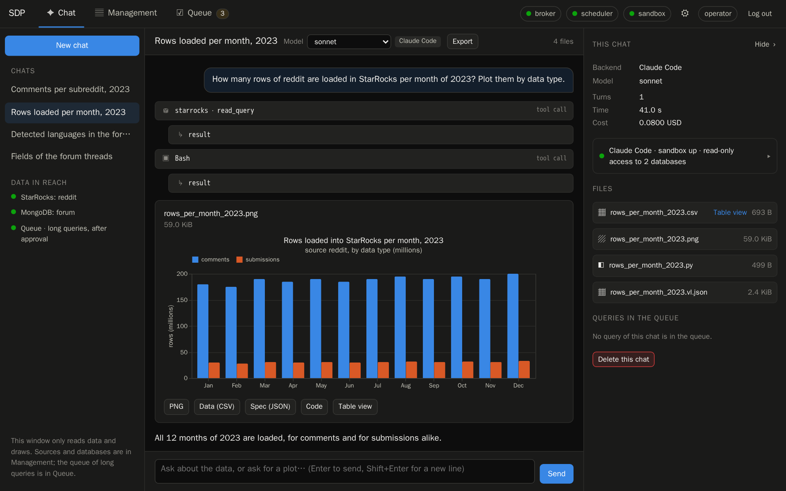

<div align="center">

# Social Data Pipeline

[](https://www.docker.com/)
[](https://www.python.org/)
[](https://www.postgresql.org/)
[](https://www.mongodb.com/)
[](https://www.starrocks.io/)
[](https://developer.nvidia.com/cuda-toolkit)
[](https://onnxruntime.ai/)

A researcher-focused CLI pipeline for processing, classifying, ingesting, and querying large-scale data dumps using performant databases. Built for the [Reddit dumps](https://github.com/ArthurHeitmann/arctic_shift) and supporting any high-volume record-based dataset ([Hugging Face](https://huggingface.co/datasets)), with first-class agentic AI access.
<br/><br/>
<p align="center"><strong>Try it in your browser:</strong></p>
<p align="center">
  <a href="https://codespaces.new/joaopn/social-data-pipeline?ref=main">
    
  </a>
</p>
</div>



This is the web UI, which you run on your own Linux machine (the Codespaces demo above does not set it up): its Chat window answers a question about the data loaded in StarRocks.

[Install](https://joaopn.github.io/social-data-pipeline/user-guide/install.html) · [Getting started](https://joaopn.github.io/social-data-pipeline/user-guide/getting-started.html) · [Quick start](https://joaopn.github.io/social-data-pipeline/user-guide/quick-start.html) · [User guide](https://joaopn.github.io/social-data-pipeline/user-guide/) · [Architecture](https://joaopn.github.io/social-data-pipeline/architecture/) · [CLI reference](https://joaopn.github.io/social-data-pipeline/user-guide/cli.html) · [FAQ](https://joaopn.github.io/social-data-pipeline/user-guide/faq.html)

## What it does

- **Web UI and chat.** A page in the browser to run and follow the pipeline, start and stop the databases, approve queries, and ask an AI assistant in a sandbox about your data.
- **Sources.** The [Reddit dumps](https://github.com/ArthurHeitmann/arctic_shift) from Arctic Shift (with Reddit-specific deletion detection, id deduplication, base-36 ids and schema conversion across years), [Hugging Face](https://huggingface.co/datasets) datasets, or any JSON, CSV or Parquet records of your own.
- **Parsing.** Detects and decompresses `.zst`, `.gz`, `.xz` and `.tar.gz` dumps and parses them into typed Parquet or CSV files with the fields you choose.
- **Classifiers.** Language detection on CPU (Lingua) and transformer classifiers on GPU, with multi-GPU parallelization and language filtering; add your own through YAML or Python.
- **Databases.** StarRocks for fast analytical queries, PostgreSQL with tuned settings and duplicate handling, and MongoDB for the raw records, each with optional admin and read-only users.
- **AI access.** Read-only MCP servers for each database, for agentic clients such as Claude Code, Codex or Cursor.
- **Query scheduler.** Agents queue heavy queries over MCP, you approve each one on a page, and the results land as Parquet, CSV or NDJSON files.
- **Resumable.** Every profile tracks its progress: rerun any profile safely without reprocessing completed files.

## Install

You need Python 3.11+ with PyYAML and Docker Compose v2; the GPU classifiers also need the NVIDIA Container Toolkit, and the web UI and chat need Linux.

```bash
git clone https://github.com/joaopn/social-data-pipeline
cd social-data-pipeline
pip install pyyaml                          # run directly: python sdp.py <command>
pipx install --editable .                   # or: a global `sdp` command
python sdp.py --help                        # lists the command groups
```

The [Install](https://joaopn.github.io/social-data-pipeline/user-guide/install.html) page has the full requirements, the recommended hardware, the Codespaces demo and how to update.

## How it works

To do this in the browser instead, follow [Getting started in the browser](https://joaopn.github.io/social-data-pipeline/user-guide/getting-started.html): the web UI sets up the databases, adds the source, runs the pipeline and approves the queries, with screenshots of each step.

**1. Configure the databases.** Pick PostgreSQL, MongoDB or StarRocks, their data paths and ports, optional authentication and tuning; this is a one-time setup.

```bash
python sdp.py db setup
```

**2. Add a source.** The name `reddit` uses the Reddit platform, any other name a platform configured from your answers; `--hf` starts from a Hugging Face dataset. Put the dumps in the dumps folder you chose.

```bash
python sdp.py source add reddit
```

**3. Start the databases.** This starts every configured database, its MCP server and the query scheduler.

```bash
python sdp.py db start
```

**4. Run the pipeline.** Each profile runs in its own container for one source.

```bash
python sdp.py run parse                     # decompress and parse the dumps
python sdp.py run lingua                    # optional: language detection
python sdp.py run ml                        # optional: GPU classifiers
python sdp.py run sr_ingest                 # load into StarRocks (or postgres_ingest, mongo_ingest)
python sdp.py run sr_ml                     # optional: load classifier outputs (or postgres_ml)
```

**5. Query.** Connect with any client: psql for PostgreSQL, any MySQL client for StarRocks, `mongosh` for MongoDB.

```bash
mysql -h 127.0.0.1 -P 9030 -u root          # StarRocks
```

**6. Give it to an agent.** Set up the read-only MCP servers and the query scheduler, then point your agent at them; the web UI and its chat run on top.

```bash
python sdp.py db setup-llm                  # setup-mcp, then setup-jobs
python sdp.py broker passwd                 # the web UI's management password
python sdp.py broker start
python sdp.py webui setup
python sdp.py webui start
```

## Profiles

| Profile | Description | Input | Output |
|---|---|---|---|
| `parse` | Decompress dumps, parse JSON/CSV/Parquet to Parquet/CSV | Compressed dump files, extracted JSON/CSV/Parquet | `PARSED_PATH/` |
| `lingua` | Lingua language detection (CPU) | Parsed files | `OUTPUT_PATH/lingua/` |
| `ml` | Transformer classifiers (GPU) | Parsed files + Lingua output | `OUTPUT_PATH/{classifier}/` |
| `postgres` | PostgreSQL database server | — | — |
| `postgres_ingest` | Ingest into PostgreSQL | Parsed files (or Lingua-enriched) | PostgreSQL tables |
| `postgres_ml` | Ingest ML outputs into PostgreSQL | Classifier output files | PostgreSQL tables |
| `mongo` | MongoDB database server | — | — |
| `mongo_ingest` | Ingest raw data into MongoDB | Extracted JSON/NDJSON/CSV/Parquet | MongoDB collections |
| `starrocks` | StarRocks OLAP database server | — | — |
| `sr_ingest` | Ingest parsed files into StarRocks | Parsed files (or Lingua-enriched) | StarRocks tables |
| `sr_ml` | Ingest ML outputs into StarRocks | Classifier output files | StarRocks tables |
| `jobs` | Query scheduler: page + MCP for human-approved agent queries against PostgreSQL, MongoDB and StarRocks | SQL/aggregation submissions | `JOBS_RESULT_ROOT/<job_id>/` |

`python sdp.py run` takes the eight pipeline profiles; the database servers and `jobs` start with `python sdp.py db start`.

## Built on

| Tool | Used for |
|---|---|
| [Docker Compose](https://docs.docker.com/compose/) v2 | Every stage, database and MCP server as a profile |
| [Python](https://www.python.org/) 3.13 images, [Polars](https://pola.rs/) and [PyArrow](https://arrow.apache.org/) | Parsing and the ingest stages |
| [Lingua](https://github.com/pemistahl/lingua-py) | Language detection |
| NVIDIA PyTorch 25.03 image, [Hugging Face Transformers](https://huggingface.co/docs/transformers) and [ONNX Runtime](https://onnxruntime.ai/) GPU | The GPU classifiers |
| [StarRocks](https://www.starrocks.io/) (`starrocks/allin1-ubuntu`) | The analytical database |
| [PostgreSQL](https://www.postgresql.org/) 18 with [pg_parquet](https://github.com/CrunchyData/pg_parquet) | The general-purpose database |
| [MongoDB](https://www.mongodb.com/) 8 and `mongoimport` | The raw-record database |
| [postgres-mcp](https://github.com/crystaldba/postgres-mcp), [mcp-mongo-server](https://github.com/kiliczsh/mcp-mongo-server) (patched), [mcp-server-starrocks](https://pypi.org/project/mcp-server-starrocks/) 0.3.0 | The read-only MCP servers |
| [FastAPI](https://fastapi.tiangolo.com/), Jinja2, [htmx](https://htmx.org/) 2.0.4 | The query scheduler's page and the web UI |
| [Pico CSS](https://picocss.com/) 2 | The query scheduler's page |
| [Vega](https://vega.github.io/vega/) 6.4.0, [Vega-Lite](https://vega.github.io/vega-lite/) 6.5.0 and [vega-embed](https://github.com/vega/vega-embed) 7.3.0 (BSD-3-Clause), [Altair](https://altair-viz.github.io/) and vl-convert | The Chat window's interactive charts (Altair and vl-convert in the chat's sandbox) |
| [Claude Code](https://docs.anthropic.com/en/docs/claude-code) or an OpenAI-compatible endpoint | The chat's assistant |

## Documentation

- [User guide](https://joaopn.github.io/social-data-pipeline/user-guide/): how to install and use it, from adding a source to querying the databases.
- [Architecture](https://joaopn.github.io/social-data-pipeline/architecture/): how it works and why, with the design decisions.

## AI disclaimer

Most of the orchestration and dockerization glue code was written by LLMs, under human planning, code review, and [extensive testing](https://joaopn.github.io/social-data-pipeline/architecture/testing.html). The algorithms and ingestion structure are a merge of a number of private repos developed over a period of almost 4 years.

## License

See LICENSE file.
