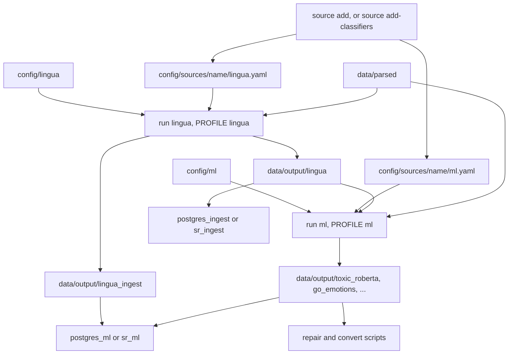

# Classifiers

The classifier profiles read parsed files and write one output file per input file into `output/<source>/<classifier>/`: `lingua` detects language on the CPU, `ml` runs Hugging Face models on one or more NVIDIA GPUs. This page describes how each works, the text cleaning both share, how they resume, what the outputs contain and who reads them, and how a custom Python classifier plugs into the registry. Running and configuring them is on [Language detection and classifiers](../user-guide/classifiers.md).

## How it connects



Both profiles run the same module, `orchestrators/ml.py`, switched by the `PROFILE` variable each compose service sets. `ml` reads the Lingua output by default (`use_lingua: true`) so it can skip texts outside each model's languages; the database stage loads each output folder as its own table.

## The two profiles

| | `lingua` | `ml` |
|---|---|---|
| Hardware | CPU (Rust library, many threads) | One or more NVIDIA GPUs |
| Image | The CPU image | The GPU image (PyTorch, ONNX Runtime) |
| Runs | The `lingua` language detector | Each classifier in `gpu_classifiers` |
| Input | `parsed/` | `output/lingua/` when `use_lingua: true`, else `parsed/` |
| Output rows | Every input row | Only rows that were classified |
| Base config | `config/lingua/pipeline.yaml`, `cpu_classifiers.yaml` | `config/ml/pipeline.yaml`, `gpu_classifiers.yaml` |
| Source override | `config/sources/<name>/lingua.yaml` | `config/sources/<name>/ml.yaml` |

`--filter "<glob>"` narrows the input files and `--classifier <name>` runs only one classifier from the list. Each entry of the run list is a name (all data types) or `{name, data_types}` (only those data types). Every classifier other than `lingua` must have a `suffix` and a `model`, and `lingua` a `suffix` and `languages`, or the run stops with a config error; a name in the run list with no settings at all is skipped with a message.

## Text cleaning pipeline

Both profiles clean text the same way before classifying it:

1. Concatenate the configured text columns (for example title + selftext for submissions).
2. Remove exact strings: `[deleted]`, `[removed]`, `[unavailable]`.
3. Remove regex patterns: URLs (`https?://\S+`), subreddit mentions (`r/\w+`), user mentions (`u/\w+`).
4. Normalize whitespace.

The cleaning is configured with `text_columns`, `remove_strings` and `remove_patterns` in each profile's classifier config file.

## How lingua works

1. **Text cleaning**: removes the configured strings (`[deleted]`, `[removed]`, `[unavailable]`) and patterns (URLs, subreddit and user mentions), then normalizes whitespace.
2. **Text validity filtering**: texts shorter than `min_chars` (default 5) after cleaning are skipped and get empty language values.
3. **Detection**: texts are sorted by length (descending) for the best Rayon parallel use. Detection runs in configurable batches (default 2M rows) to bound memory, over the languages listed in `languages`.
4. **Output**: appends the language columns to the original data, in the same format as the input (Parquet or CSV).
5. **Row check**: the output must have exactly as many rows as the input; otherwise it is deleted and the file counts as failed.

| Column | Meaning |
|--------|---------|
| `lang`, `lang2` | Most and second most likely language, ISO 639-1 code |
| `lang_prob`, `lang2_prob` | Their confidence, 0 to 1 |
| `lang_chars` | Length of the cleaned text, so short texts can be filtered at query time |

When either `postgres_ingest` or `sr_ingest` of the source has `prefer_lingua: false`, lingua also writes `output/lingua_ingest/`: only the key columns, the configured `fields` and the language columns, which `postgres_ml` and `sr_ml` load as a separate `<data_type>_lingua` table.

`workers` is the total thread budget. With `file_workers` above 1, it is divided evenly among the files processed at once (at most one process per pending file).

## How the transformer classifiers work

1. **Model loading**: models are downloaded from Hugging Face and cached in `$HF_HOME/sdb_models/`; the whole model repository is fetched before the GPU threads load it. Each GPU worker thread loads its models once at startup and reuses them across files (persistent workers).
2. **Text cleaning**: the same pipeline as lingua.
3. **Tokenization**: parallel tokenization with Hugging Face tokenizers, on `tokenize_workers` threads.
4. **Filtering**:
   - **Language filter** (optional): when `use_lingua: true`, only texts whose `lang` column matches the classifier's `supported_languages` are processed. With `lang2_fallback: true`, `lang2` is checked too.
   - **Min tokens filter**: texts with fewer than `min_tokens` tokens are skipped (applied after cleaning and tokenization).
5. **Chunking**, for texts longer than `max_length`:
   - **`truncate`** (default): a single chunk, truncated to `max_length`.
   - **`chunk`**: a sliding window with a configurable `stride` (overlap), producing several chunks per text.
6. **Inference**: batched inference on the GPU(s), with a configurable `classifier_batch_size`.
7. **Chunk aggregation**: with the `chunk` strategy, each label independently selects its top-k chunks by logit value and averages them. This per-label top-k pooling lets different labels focus on different parts of a long text. With `top_k: 1` it is max-pooling.
8. **Activation**:
   - `sigmoid`: multi-label classification (each label independent, probabilities 0 to 1).
   - `softmax`: single-label classification (outputs sum to 1).
9. **Output**: a file in the input's format (Parquet or CSV) with the key columns, the configured extra `fields`, and the classifier output columns (see [What the outputs contain](#what-the-outputs-contain)).

Shipped classifiers, in `config/ml/gpu_classifiers.yaml`: `toxic_roberta` and `go_emotions` (English, in the default run list), `multilingual_sentiment` and `xlmr_toxicity` (several languages, defined but not in the default run list), and `openai_detector` (commented out).

## Multi-GPU architecture

The `ml` profile uses persistent worker threads for GPU inference:

| Part | How it works |
|------|--------------|
| GPU threads | One executor thread per GPU in `gpu_ids`, with its models loaded into thread-local storage; thread affinity makes each worker process only on its assigned GPU |
| File workers | `file_workers` controls how many files are processed in parallel, as separate processes; each file uses all GPUs |
| Model lifetime | Models are loaded once at startup and reused across files |
| GPU memory | Each file-worker process loads the model on every GPU, so each GPU holds `file_workers` copies; raising it helps only with small models |

## How classifiers resume

Both profiles check for an existing output file (`output/<classifier>/<data_type>/<file id><suffix>.<ext>`) before processing an input file. If the output file exists, the input is skipped. Deleting an output file, or a whole classifier output folder, makes the next run process those inputs again. `--filter` narrows the input set before this check. Outputs are written under a `.temp` name and renamed when complete, and a leftover `.temp` is deleted before the file is redone.

## What the outputs contain

Each input file gives one output file named after it, `output/<classifier>/<data_type>/<file id><suffix>.parquet` (or `.csv` when the source uses CSV):

| Columns | Content |
|---------|---------|
| Key columns | The platform's `mandatory_fields` (Reddit: `dataset`, `id`), used to join to the base table |
| Extra fields | The configured `fields` (default: `retrieved_utc`, `author`, `subreddit`); none when `fields` is empty |
| Scores | One Float32 column per model label, named in snake_case (`very_negative`, `toxic`) |

| Reader | Uses |
|--------|------|
| `postgres_ml`, `sr_ml` | Each classifier's folder, loaded into a `<data_type><suffix>` table |
| `postgres_ingest`, `sr_ingest` | `output/lingua/` instead of `parsed/` when `prefer_lingua: true` |
| `parse --skip-lingua-files` | `output/lingua/` as proof that a file is done |

All of them find files by classifier name and suffix, so renaming a classifier or changing its `suffix` makes existing outputs invisible.

## The repair and convert scripts

Two scripts at the top of the repository fix classifier outputs written by older versions. They run on the host from the repository root (they are in no image and need `polars`, `pyarrow` and `pyyaml`), write to a new folder, never in place, skip files already written so they can be rerun to resume, and check row counts after every write.

| Script | Use it when | What it does |
|--------|-------------|--------------|
| `repair_classifier_outputs.py <in> <out> --platform-config ... --lingua-dir ... --suffix ...` | Parquet outputs have string score columns, or lack `retrieved_utc` | Casts columns to the `platform.yaml` types and scores to Float32, re-adds `retrieved_utc` from the matching Lingua file by `id`, reorders columns, and skips files with `LABEL_*` columns (those need reclassifying) |
| `convert_csv_classifier_outputs.py <in> <out> --platform-config ...` | Outputs are CSV or CSV.zst from before Parquet | Converts to typed Parquet with the same column order and snake_case score names as fresh outputs (`--keep-score-names` keeps the originals) |

## Custom Python classifiers

For classifiers that need custom logic (non-Hugging Face models, special preprocessing and so on), write a Python classifier class. The config-only approach for Hugging Face models is on [Custom classifiers](../user-guide/custom-classifiers.md).

**1. Create the classifier module.** Write `social_data_pipeline/classifiers/my_classifier.py`:

```python
from .base import register_classifier


@register_classifier('my_classifier')
class MyClassifier:
    def __init__(self, name, classifier_config, global_config):
        """
        Initialize the classifier.

        Args:
            name: Classifier name (e.g., 'my_classifier')
            classifier_config: Per-classifier config from gpu_classifiers.yaml
            global_config: Full config including global settings
        """
        self.name = name
        self.config = classifier_config
        # Load your model, initialize resources, etc.

    def process_csv(self, input_csv, output_csv, data_type, config):
        """
        Process a single CSV file.

        Args:
            input_csv: Path to input CSV file
            output_csv: Path to write output CSV
            data_type: Data type being processed (e.g., 'submissions')
            config: Full pipeline configuration
        """
        # Read input CSV
        # Run classification
        # Write output CSV with the key columns (id, dataset) and retrieved_utc
        #   + any extra fields + classifier output columns
        pass
```

**2. Import it.** The decorator runs only when the module is imported, and nothing imports a new module by itself: add `from . import my_classifier` to `social_data_pipeline/classifiers/__init__.py`.

**3. Register it in the configuration.** Add it to `config/ml/gpu_classifiers.yaml`. The run checks every classifier other than `lingua` for a `suffix` and a `model` key, so both must be present even when your class does not use `model`:

```yaml
my_classifier:
  suffix: "_my_output"
  model: "unused"
  # Add any custom config your classifier needs
  my_option: value
```

Then add it to the matching `pipeline.yaml`:

```yaml
gpu_classifiers:
  - my_classifier
```

Only the `ml` profile can run it: the `lingua` profile runs the built-in detector under the name `lingua`, and any other name there takes the GPU path without the GPU settings and stops with an error.

### How the registry works

The `@register_classifier('name')` decorator registers the class in a global registry. When the pipeline meets a classifier name on its sequential path (`file_workers: 1`, or a single pending file), it:

1. Checks the registry for a custom classifier.
2. If found, instantiates it with the config.
3. If not found and the config has a `model` key, falls back to the built-in `TransformerClassifier`.
4. If neither, reports that it could not create the classifier and counts its files as failed.

With `file_workers` above 1 and more than one pending file, the parallel path builds a `TransformerClassifier` directly and does not consult the registry, so a custom classifier needs `file_workers: 1`.

### Output requirements

The `process_csv` output must include:

| Columns | Why |
|---------|-----|
| The key columns, `id` and `dataset` (the platform's `mandatory_fields` for Reddit), and `retrieved_utc` | Needed for database ingestion with ON CONFLICT and its dedup order |
| Classifier output columns | Your classification results |
| Optional extra fields | Any additional columns from the input, controlled by the `fields` config |

## Design decisions

**One orchestrator, two profiles.** Lingua and the transformers share file detection, filtering, skip logic and output layout, but need different images: Lingua is a CPU library, the transformers need CUDA, and GPU libraries are imported only when a classifier runs, so the module also loads in CPU containers. The cost is that `orchestrators/ml.py` holds both paths, with `lingua` special-cased by name.

**Language first, then models.** Most models are trained on one language, so running Lingua once and letting each classifier filter on `lang` avoids spending GPU time on texts a model cannot score, and stores the language for querying anyway. The cost is an ordering dependency: with `use_lingua: true`, a file without a Lingua output is not classified until `lingua` has run.

**Separate output per classifier, joined by key.** Each classifier writes its own files with only key columns, chosen extras and scores, so a classifier can be added, rerun or dropped without touching the base tables or the other classifiers. The cost is that the name and `suffix` are part of the file names, and changing either orphans existing outputs.

**Models stay on the GPU between files.** Loading a large model costs seconds to minutes, so persistent per-GPU threads load it once per run, and the model repository is fetched before they start, which also avoids Hugging Face rate limits when several threads start together. The cost is GPU memory: every file worker keeps its own copy on every GPU.

**One naming rule for scores.** Labels from model metadata vary in style (`Very Negative`, `toxic`), and one function (`normalize_score_name`) turns them into snake_case for fresh outputs and converted historical ones alike, so tables from old and new runs have the same columns and need no quoting in SQL. The cost is that a column name can differ from the label the model card shows.
