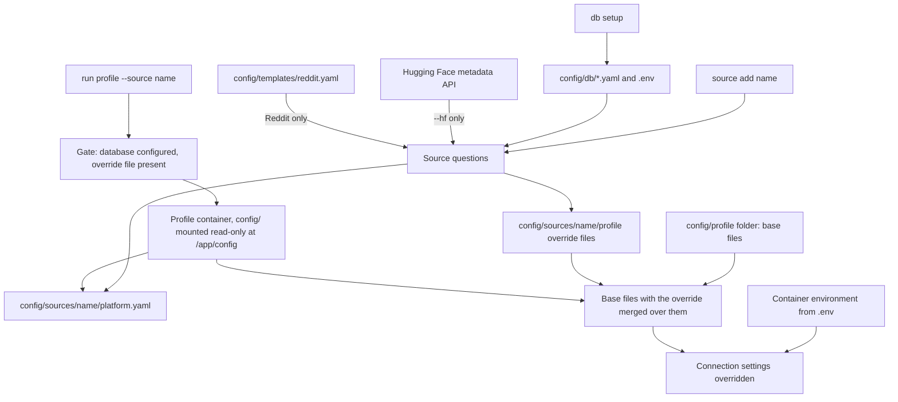

# Setup and configuration

The setup commands (`python sdp.py db setup`, `python sdp.py source add`) ask the questions once and write the answers as config files; inside the containers, each profile loads its base config from `config/<profile>/` and lays the source's override file from `config/sources/<name>/` over it, then reads the source's `platform.yaml` beside it. This page describes the layers, how they merge and which one wins, and how a run reads them. Every setting and file is listed in [Configuration reference](../user-guide/configuration.md).

## How it connects

Setup writes the files once; at run time nothing asks again. `python sdp.py run` checks that the files exist, and the container merges and reads them.

## The configuration layers

| Layer | Written by | Tracked or local | Controls |
|-------|------------|------------------|----------|
| `config/<folder>/pipeline.yaml`, plus `cpu_classifiers.yaml`, `gpu_classifiers.yaml`, `services.yaml` | The project | Tracked | Defaults for every profile (lowest precedence) |
| `config/<folder>/user.yaml` | You, by hand from `user.yaml.example` | Local | Legacy overrides, read only when the source has no override file for that profile |
| `config/sources/<name>/<override file>.yaml` | `source add`, `source configure`, `source add-classifiers` | Local | Per-source overrides of the profile defaults; when present, `user.yaml` is ignored entirely |
| `config/sources/<name>/platform.yaml` | `source add`, `source configure`, `db create-indexes` | Local | The data description: data types, paths, file patterns, fields, types, keys, indexes; read beside the profile config, not merged into it |
| `config/templates/reddit.yaml` | The project | Tracked | Starting point of Reddit's `platform.yaml`; copied at setup, not read at run time |
| `config/db/*.yaml` | `db setup`, `db setup-mcp` | Local | Global database settings |
| `.env` | `db setup` and others | Local | Ports, data paths, auth flags; passed into the containers |
| The `run` environment | `python sdp.py run` | Not stored | `PLATFORM`, `SOURCE`, the data paths from `platform.yaml`, `--filter` (`FILE_FILTER`), `--skip-lingua-files` |

Because `python sdp.py run` refuses to start without the source's override file, `user.yaml` is reached only when a container reads another profile's config: `lingua`, for example, reads the `postgres_ingest` and `sr_ingest` settings to decide whether to write `lingua_ingest/`. `config/setup_state.yaml` is tracked but read by nothing.

## How the layers merge

1. **Base config.** The profile's base files are loaded from its config folder: `config/<profile>/pipeline.yaml`, plus the other profile-level files (`cpu_classifiers.yaml` for `lingua`, `gpu_classifiers.yaml` for `ml`, `services.yaml` for `postgres_ml` and `sr_ml`). A missing base file is an error.
2. **Source override.** The source's override file for that profile, `config/sources/<name>/<file>.yaml`, is deep-merged on top. Without one, `config/<folder>/user.yaml` is used if it exists.
3. **Scoped by file name.** Overrides are scoped by config filename: each top-level key of the override file corresponds to one base file, without the `.yaml` extension (`pipeline:` → `pipeline.yaml`, `gpu_classifiers:` → `gpu_classifiers.yaml`, `services:` → `services.yaml`). A top-level key that names no base file of that profile is not applied.
4. **Lists replace.** A list value in an override fully replaces the base list; lists are never merged. Mappings are merged key by key, and the override's value wins.
5. **Multi-file profiles.** The base files of one profile are merged in a fixed order (`pipeline.yaml` first), and a later file wins on a shared key.

The profile folders and override files do not always share a name:

| Profile | Base folder | Base files | Source override file |
|---------|-------------|------------|----------------------|
| `parse` | `config/parse/` | `pipeline.yaml` | `parse.yaml` |
| `lingua` | `config/lingua/` | `pipeline.yaml`, `cpu_classifiers.yaml` | `lingua.yaml` |
| `ml` | `config/ml/` | `pipeline.yaml`, `gpu_classifiers.yaml` | `ml.yaml` |
| `postgres_ingest` | `config/postgres/` | `pipeline.yaml` | `postgres.yaml` |
| `postgres_ml` | `config/postgres_ml/` | `pipeline.yaml`, `services.yaml` | `postgres_ml.yaml` |
| `mongo_ingest` | `config/mongo/` | `pipeline.yaml` | `mongo.yaml` |
| `sr_ingest` | `config/sr/` | `pipeline.yaml` | `starrocks.yaml` |
| `sr_ml` | `config/sr_ml/` | `pipeline.yaml`, `services.yaml` | `sr_ml.yaml` |

`config/starrocks/` is not a profile config folder: it holds the StarRocks server's config templates.

The platform config, `config/sources/<name>/platform.yaml`, is not merged with anything: it is one self-contained file per source. For Reddit it is a copy of `config/templates/reddit.yaml` with the paths, file format, row-group size and bucket count filled in; for custom and Hugging Face sources it is generated from the answers.

## How a run reads its config

1. **Gate.** `python sdp.py run <profile> --source <name>` (the source is auto-selected when only one exists) checks that the profile's database has a `config/db/<db>.yaml` and that the source has the profile's override file. Either missing stops the run with the command that writes it (`db setup --add <db>`, or `source configure <name>`).
2. **Mount check.** For the PostgreSQL and StarRocks profiles it also checks that the running server can see the source's folders (see [Databases and ingestion](databases.md#how-the-servers-see-the-files)).
3. **Container.** It starts the profile's container with `PLATFORM`, `SOURCE` and the data paths set, and the repository's `config/` mounted read-only at `/app/config`.
4. **Merge.** Inside the container the stage merges its profile's base files and the override, then applies the environment overrides below.
5. **Platform.** It reads the source's `platform.yaml` separately for fields, types, patterns, schema and indexes; a missing `platform.yaml` stops the run and says to run `python sdp.py source add <name>`.
6. **Required keys.** A required key that is missing stops the run with an error that names the key path (for example `Required configuration missing: processing.parse_workers`).

## Environment overrides

After the merge, a few environment variables from `.env` override database keys:

| Profile | Variable | Overrides |
|---------|----------|-----------|
| `postgres_ingest`, `postgres_ml` | `POSTGRES_PORT`, `DB_NAME` | `database.port`, `database.name` |
| `postgres_ingest`, `postgres_ml` | `DB_SCHEMA`, when set (nothing in `sdp` or the compose file sets it) | `database.schema` |
| `postgres_ingest`, `postgres_ml` | `POSTGRES_PASSWORD` (prompted at start) | The connection password |
| `mongo_ingest` | `MONGO_PORT` | `database.port` |
| `mongo_ingest` | `MONGO_ADMIN_USER`, `MONGO_ADMIN_PASSWORD` (prompted at start) | `database.user`, the connection password |
| `sr_ingest`, `sr_ml` | `STARROCKS_PORT`, `STARROCKS_FE_HTTP_PORT` | `database.port`, `database.fe_http_port` |
| `sr_ingest`, `sr_ml` | `STARROCKS_ROOT_PASSWORD` (prompted at start) | The connection password |

## Design decisions

**Decisions are taken at setup and stored; runtime only executes config.** Anything that depends on your intent (which columns to keep, what to do with a field that has no SQL type, whether to deduplicate) is asked once and written to `config/sources/<name>/`, and the stages do exactly what it says, with no auto-detection that overrides it. The cost is that a change of mind means a `source configure` or a hand edit, and a rerun of setup rewrites `platform.yaml` from the answers (the previous file is kept as `.bak`).

**A missing required value fails loudly.** `get_required` raises an error naming the key, and the `run` gate names the command that writes a missing file, so a broken setup never runs against the wrong path, port or schema. The cost is two known fallbacks that remain: `python sdp.py run` uses `./data/<folder>/<source>` when `platform.yaml` has no `paths`, and `docker-compose.yml` carries fallback values for unset `.env` keys.

**Override files are scoped by base file name and lists replace.** A top-level key per base file keeps each override unambiguous in a multi-file profile, and replacing lists means an override's list is exactly what runs. The cost is that you cannot add one item to a base list: the override must repeat the whole list.

**Each source has its own folder of config, independent of the others.** Each source carries its own paths, platform description and profile overrides, so sources with different layouts, databases and classifiers live side by side and can be added or removed without touching each other. The cost is repetition: a setting you want for every source has to be in the base files or in each source's override.

**The configuration is mounted read-only into the containers.** A stage can read `/app/config` but never change it, so only the host-side setup commands write configuration. The cost is that nothing a run discovers (a detected schema, a new index) is saved back; you record it through setup.
