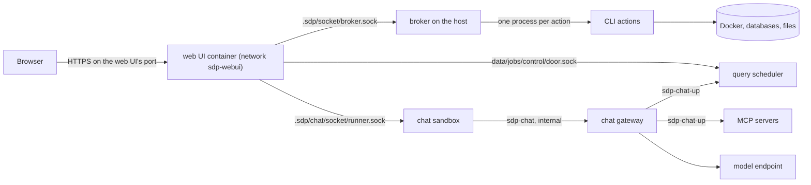

# Broker, web UI and chat

Three pieces let a person drive one deployment from a browser without giving the browser's side any power of its own. The **broker** is a host process, next to the CLI, that listens on a unix socket in the deployment folder and runs a fixed list of typed CLI actions for a logged-in session. The **web UI** is a container that serves the page over HTTPS and holds nothing but the broker's socket folder, its certificate and, when they are there, the scheduler's control and results folders and the chat's socket folder. The **chat** is two containers: a sandbox, where the assistant runs, whose only network peer is a gateway that holds the model's credential and reaches the model and the databases' MCP servers for it. This page describes what each piece holds, keeps and checks, and for each what it defends against, and what not. How to use them is in [Web UI](../user-guide/webui.md) and [Chat](../user-guide/chat.md).

## How it connects

## The broker

The broker runs on the host and listens on `.sdp/socket/broker.sock`. Through that socket a logged-in session can run a fixed list of actions of the CLI: the status commands, starting, listing, reading and cancelling pipeline runs, starting and stopping databases, and a few removals. Its client is `social_data_pipeline/control/client.py`. It runs on Linux only.

### The broker's files

| Path (in the deployment folder) | What it is |
|---|---|
| `.sdp/socket/broker.sock` | The socket, in a folder of mode 0700. The full path must fit in the 108 bytes of a unix socket address; a deployment folder with a longer path is refused at start with a message saying so. |
| `.sdp/broker/password.json` | The management password as a salted scrypt hash, never the password. |
| `.sdp/broker/audit.jsonl` | The audit log: one line per login, logout, session end, refused call, accepted call, ended call and second check of the management password (`step_up_failed`, and `password_checked` for a right one given with `session.check_password`), each naming the hash of the line before it. Failed logins, requests without a valid session and read calls are only counted, in a `counts` line at most once a minute. Secrets are written as `<secret>`. |
| `.sdp/broker/broker.log` | The broker's own lines: start, stop, and the kind of any error it met (never its text). |
| `.sdp/broker/lock` | Held by the running broker; holds its pid and start time. A second broker is refused. |
| `.sdp/broker/write.lock` | Held while an action that changes something runs, by the broker and by the action's process, so that only one such action runs at a time, also after a broker crash. Starting a pipeline run holds it shared, so several runs can be started at once but none while such an action runs. |
| `.sdp/broker/calls/` | The output of an action that changes something, in two files while it runs (read and deleted when it ends). Because the action writes to files and not to the broker, it runs to its end even when the broker crashed; files that no running action owns are deleted at the next start and every 30 seconds while the broker runs, whenever no such action is alive. |

`.sdp/broker` has mode 0700 and its files 0600, whatever the umask.

### What a session can do

A session starts with a login with the management password and lasts at most eight hours. A login names its channel, `local` (the operator's own machine, as the web UI tells it) or `remote` (anything else, and the default), and each channel has its own budget of five failed logins, one given back every 30 seconds, so that failed guesses through the network never lock out a login on the operator's own machine; the audit log counts the failed logins of both as one number.

Every action is a verb of the registry (`social_data_pipeline/control/verbs.py`) with typed fields; a field that is not listed for the verb is refused. Verbs that remove, start, set up or change database services or sources, or create indexes (`db.start`, `db.reset`, `db.unsetup`, `db.unsetup_mcp`, `db.unsetup_jobs`, `db.setup`, `db.setup_mcp`, `db.setup_jobs`, `source.remove`, `source.add`, `source.configure`, `source.add_classifiers`, `db.create_indexes`) need the management password again with the call; five wrong ones end the session. A session can keep a database admin password, after giving the management password again; it is then added to `run.start` and `db.start` when the call carries none. A client can also have the management password checked again without any action (`session.check_password`); a wrong one counts towards the same five and is written to the audit log like any other failed second check, and a right one is written as `password_checked`.

`db.reset`, `db.unsetup`, `db.unsetup_mcp`, `db.stop` and `source.remove` are refused while a pipeline run is alive, and when Docker cannot be asked whether one is (`db.unsetup_mcp` because the CLI stops each database that has an MCP server configured together with that server); they look for live runs only once they hold the write lock, so no run can be started between that look and the action. `db.start` of PostgreSQL (or of every service) is refused with a database password that holds a quote, `$`, a backtick or a backslash.

### How an action runs

Each action runs in a process of its own, started in the deployment folder with the request on its standard input and an environment cut down to a short list of names. A read action has at most 60 seconds and 8 run at a time; an action that changes something runs to its end even when the client has gone.

A long action that is not a pipeline profile runs as a **task**: a recorded run of kind `task`, under the same supervisor as a pipeline run, with the verb and a label in its record instead of a profile and its secrets passed on standard input only. Only the verbs on the allow-list of `social_data_pipeline/control/tasks.py` run this way, one live task per key. `runs list` and the web UI show a task by its label; a cancel ends the action's process group and says what it does not undo; a task whose supervisor is gone reads `lost` without Docker being asked.

What leaves the broker has every database password a session holds or held, every one of at least 8 characters a request carried in its fields (a shorter one is overwritten in that request's own reply only), and the `HF_TOKEN` of its environment, overwritten with `*`, as is the rest of every `$ docker compose` line the CLI prints; an answer too large to go through that is refused rather than sent. The log of a pipeline run that has not ended is served without its last few bytes (as many as the longest of those secrets, less one), so that a secret it is still writing is never shown half written; once the run has ended, its log is served to the end. The audit view (`audit.list`) is overwritten with the sessions' passwords and the environment's token only, so that words sent as passwords cannot blank it.

Not bounded or not done, on purpose: the output files of an action have no size limit (the CLI's actions print little); a process that an action leaves behind after it has ended is not ended by the broker; and whether a group is the operator's private one is best effort where accounts come from a directory service that is not enumerated.

### What the broker defends against, and what not

The broker defends against:

- **Another user of the machine.** The socket's folder is 0700, and a connection from any other user id, read from the kernel, is closed without a reply. The broker refuses to start when the CLI, the package, the `control` package folder or its own folders belong to another user or can be written by the group or by others.
- **Whatever can send bytes to the socket** (the web UI's container). One request per connection, at most 64 KiB and ten seconds to arrive; nothing but `hello` and `login` is answered without a valid session; only the registry's verbs, with typed fields, deny by default.
- **A stolen session token.** It can run the typed verbs only, and needs the management password again for anything that removes or starts services.

It does NOT defend against a program that runs on the host as the operator: such a program already has Docker and the deployment's files.

## The web UI

### What the container holds and what it does not

| It has | It does not have |
|---|---|
| The broker's socket folder (`.sdp/socket`), mounted read-only at `/run/sdp`: it can connect to the socket, not remove or create anything there | The Docker socket, the deployment folder, `.env`, any database password, the broker's own folder, the scheduler's job store (`data/jobs` itself) |
| When they pass their checks at the start: the scheduler's control folder (`data/jobs/control`) read-only at `/run/sdp-jobs`, and its results folder read-only at `/run/sdp-results` | A way to write into either |
| When it passes its check at the start: the chat's socket folder (`.sdp/chat/socket`) read-only at `/run/sdp-chat` | The chat's work folder, its credential or settings |
| The certificate folder (`.sdp/webui/tls`), mounted read-only at `/tls` | Any other mount; a writable root file system (only a 16 MiB `/tmp` without exec) |
| The broker's client and the web package, and FastAPI, Jinja2 and uvicorn | The CLI, the verb registry, the setup code, PyYAML |
| The operator's user and group id, no capabilities, no new privileges, at most 256 processes and 512 MiB; two listening ports, 8443 and 8444 | A way out to the internet: its network does no masquerading, so it reaches the machine and nothing beyond |

The image pins htmx 2.0.4 and checks it against a SHA-256 sum written in `Dockerfile.webui` when it is built; the stylesheets are the web UI's own. Its Python packages (FastAPI, uvicorn, Jinja2) are installed from PyPI with lower bounds in `requirements-webui.txt`, not pinned to versions or checked against hashes, as elsewhere in this project; only that static file is checked against a recorded sum.

Files on the host, in the deployment folder: `.sdp/webui/` (mode 0700) with `config.json` (0600: the port, addresses, names, the certificate's fingerprint and end date) and `tls/` (0700) with `cert.pem` and `key.pem` (0600).

### Sessions

A login sends the management password to the broker and keeps nothing of it. The broker's session token stays in the web UI's memory; the browser gets only a random session id in a cookie (`__Host-sdp_session`: HTTPS only, not readable by scripts, not sent by other sites, gone when the browser closes). Every form that changes something carries the session's form token, one per session; a choice that is taken is answered with a redirect, so a reload never sends it again.

A session lasts as long as the broker's (at most eight hours) and ends at the logout, when the broker ends it (the password was changed, the broker was restarted) and when the broker cannot be reached; the login page then says why. A page or an action asks the broker on its way, so a session the broker has ended is found out at the next one: every Management page reads through the broker, every page of the Queue window asks it (its yes is believed for 5 seconds, a download asks every time), and every change of the Queue asks it before the scheduler. The logout is passed on to the broker under a bound of its own; when that stays full for a few seconds, the page says that the broker could not be told, and the broker's session then ends by itself within eight hours (its token was only in the web UI's memory, which drops it). Restarting the web UI logs everyone out.

A request body has ten seconds to arrive in full (408 beyond). Slow request headers are bounded only by the server's limit of 256 connections at a time. Every answer of the application carries the security headers described here; two answers come from the server itself and carry only its fixed text: its 503 when that limit is reached, and its 400 for a request it cannot parse.

### Local and remote logins

The container listens on two ports: 127.0.0.1 of this machine is published to its port 8444, every other listen address to its port 8443. A login is sent to the broker as `local` only with two signs: it arrived on 8444, and it comes from the address of the container network's gateway (as which Docker's proxy shows a client on 127.0.0.1). Any other login is `remote`. Each channel draws on the broker's budget of that name (five failed logins, one given back every 30 seconds), so that failed guesses from elsewhere never lock out a login at the machine itself.

One sign is not enough: Docker's proxy can connect from the gateway for a client of any address on 8443, and a machine that routes to the container's network through this one may reach 8444 directly with its own address. "Local" therefore means anyone on this machine who can reach 127.0.0.1, other accounts of the machine included. Where Docker's proxy is switched off for loopback traffic, a login at the machine itself counts as coming from elsewhere, which is the safe direction. With `all` as listen address, every login arrives on the ordinary port and counts as remote.

Besides, the web UI limits each client address (an IPv6 address by its /64; every local login counts as one address) to five failed logins in five minutes. That limit is best effort: the address can be the proxy's, and one IPv6 /48 holds 65,536 /64 networks. The broker's two budgets are the real bound on guessing.

### What the web UI keeps in its memory

Nothing of this is written to a file, and restarting the web UI drops all of it.

| What | How long | How much |
|---|---|---|
| Your session: the broker's token, the form token | Until the logout, the broker's end of the session (at most eight hours) or a restart | 64 sessions; a new login beyond that drops the oldest |
| Pending actions, with a database admin password typed into a form, and for a Queue action its page made once (for an approval with the whole record of the job as the scheduler sent it) | Five minutes, or until confirmed | 16 per session, and at most 4 MiB together, counted with every run of escaped text at 128 bytes besides its characters; the oldest is dropped, and an approval that alone weighs more is not kept (its page says to use the scheduler's own page) |
| Outcomes of confirmed actions: the exit code and the end of the output and the errors; for the Queue what the scheduler answered (the start of an EXPLAIN's plan or error) | As long as the session, among its newest | 32 per session (finished ones are dropped before running ones), 16 KiB of each text |
| Output views: where each open run page reads next, and its unfinished last line | As long as the session | 8 per session (the oldest is dropped; its page then says so), 64 KiB held per view |
| Whether a database admin password was kept at the broker for the session (the password itself is kept by the broker only) | As long as the session | One flag |

So a session holds at most about 5.6 MiB: 1 MiB of outcomes, 512 KiB of unfinished lines and 4 MiB of pending Queue actions (records and their pages' runs, as counted); 64 sessions that each keep approvals of the largest jobs the scheduler sends could reach about 360 MiB of the container's 512 MiB. The management password typed again for an action is passed to the broker and kept nowhere.

### The output of a run

For a run started from the web UI the output is read from its log file in pieces of 64 KiB and appended, every 3 seconds while the run is alive and at once for the rest of a run that has ended; whole lines only are appended, and the unfinished last line is shown apart until its end arrives, so that colour codes and a progress bar that rewrites its line are cleaned as one line (a line longer than 64 KiB without an end is shown as it is). For a run started in a terminal, and for a recorded run whose supervisor is gone while its container still runs, the output is what Docker holds, its last 500 lines, read every 10 seconds and replacing what is shown.

The pieces of all open views are read through four places of their own and Docker's tails through two, apart from the pages, so that open run pages cannot make the other pages busy; when those places are full, the view says it is busy and tries again in 10 seconds. A request for output the view has already shown (a stale tab) adds nothing and stops that view. The view stops when the run has ended and nothing more came, after one empty answer for a run that is lost or whose record cannot be read, and after 4 MiB in one view, where a link continues from that point in a fresh view (`/runs/<run id>?offset=<byte>`). Escape sequences, control characters and characters that change the direction of text are removed before the text is shown.

### How an approval is confirmed, and what the page does not check

The Approve button sends only the job's id. The web UI then reads the whole job from the scheduler and keeps it, with the scheduler's digest of what the job runs (its target, backend, statement, output file, overwrite, collection and database), as a pending action of your session.

Its page shows the target and backend, for MongoDB the collection and database, the output file and "It overwrites an existing result of that name." when it does (for any true value of the record's `overwrite`, as the scheduler reads it; a value that is not `true` is shown beside it), the description, and the statement exactly as the scheduler holds it, whole, in a box without a height of its own, under a line with its number of lines and characters (the job's page has the same line above its box, which scrolls).

Every character that would not show as itself is written as an escape (`\u202e` for a change of the text's direction, `\u200b` for an invisible space, `\u0000` for a control character, a line or paragraph separator, a private character), marked, and the page says how many it found; the line break and the tab are kept. A lone surrogate (half of a character, which a hand-edited record can hold) arrives as `?`: the scheduler replaces it before it sends. A statement that is not text (a record edited by hand) is shown as its JSON, the page says so, and no hints are computed for it.

Below it are the **hints, not a check**: the words of a short list per backend that the statement holds, ignoring case.

| Backend | Hinted words |
|---|---|
| PostgreSQL | `PROGRAM`, `COPY`, `pg_read_`, `pg_ls_`, `pg_write_`, `lo_import`, `lo_export`, `dblink`, a `;` that is not the last character, a leading `ANALYZE` or `(` option list |
| StarRocks | `INTO OUTFILE`, `FILES(`, `INSERT`, `LOAD`, `SET`, a `;` that is not the last character |
| MongoDB | `$out`, `$merge`, `$function`, `$accumulator`, `$where`, also with the `$` written `\u0024` |

Words count from a word's start (`OFFSET` does not hint `SET`); a PostgreSQL dollar quote does not hide a word (`$q$COPY ...$q$` hints `COPY`); comments before PostgreSQL's leading `ANALYZE` are skipped, nested block comments as PostgreSQL nests them. An empty list proves nothing. The page says that the query will run with the database's admin login, and that this page does not check the statement.

Confirming sends the approval with the digest kept from that page. The scheduler compares it with the job as it is at that moment: a job that was changed since is refused ("changed"), one that is no longer pending is refused with what it is now, and nothing is approved. A job approved through the web UI names `web-<n>` in the scheduler's record.

### Changes of the Queue

Before the scheduler is asked, the web UI asks the broker whether your session still lives: a session the broker has ended (the management password was changed in a terminal, the broker was restarted) goes to the login page and the scheduler is not asked; a broker that cannot be reached refuses the change. A change whose request was sent and whose answer never came may have been done: its outcome says so. The same is said when the request could not be delivered after the connection was made: the page cannot tell the two apart and says the cautious thing.

Every page and part of the Queue window asks the broker first whether your session still lives (`audit.list` of one line), and believes its yes for 5 seconds; a download asks every time. A session the broker has ended goes to the login page, and a broker that cannot be reached shows its sentence: in both cases nothing is asked of the scheduler and no file is opened.

The Queue window's calls to the scheduler run apart from the Management pages, four at a time ("busy" beyond), with a time limit of 30 seconds for a read, 90 seconds for EXPLAIN and 75 seconds for any other change.

**Queries of the chat's assistant.** A query whose record carries `submitted_by: "assistant"` is labelled as the assistant's. For the rejection, the kill and the EXPLAIN, the web UI reads the job when the action is chosen, after the broker's check, and keeps only whether it is the assistant's; a session the broker has ended goes to the login page and nothing is read. Any other value of that field, which only a hand-edited record can have, is shown as nothing. The job cannot be read when the web UI is busy, the scheduler refuses or does not answer, or the reply is of another shape. What is kept and sent on confirm (the job's id, its digest, `web-<n>`) is the same as for any query.

### Previews and downloads of the Queue

A part is addressed by its position among the parts (`/queue/<job id>/download/<n>`, counted from 0 in the order the preview lists them), not by its name. The web UI reads the parts itself, from its read-only mount of the results folder, and only for a job the scheduler has in its history as done: the job's folder is opened without following a link, only files named like the job's output file (or `<name>_<number><extension>`) that are regular files are offered (a link, a folder or a FIFO with such a name is not), and the part is sent from the file it opened, as a download (`application/octet-stream`, its name reduced to letters, digits, `.`, `_` and `-`). At most two downloads run at a time; a third is answered "busy".

### Everything from the sandbox is shown as text

The code the assistant writes runs in the sandbox beside the runner, as the same user: it can replace the runner's socket and make it answer anything. So the page treats every answer as hostile.

- **The socket.** Before each connection it checks that the socket's folder and the socket are of your user and closed to everyone else, and sends nothing otherwise.
- **Size and shape.** An answer larger than the runner ever sends (1 MiB) is not read, and one holding more than 20,000 objects and lists is not parsed. Every answer must have exactly the shape the runner sends, numbers within their bounds and a page of events at most 512 KiB of text, as the runner sends (else the page says the sandbox answered something it does not understand, and shows nothing of it), and every event too (else one line says so).
- **What one page shows.** One page of events is shown as at most 100,000 pieces of text, blocks and list items: the first event beyond that is a line with a link that opens the chat from that event on, and the events after it on that page say they follow; an event too long to show even on its own is shown cut, with a line saying so.
- **Text.** Every text is shown as text, with invisible and direction-changing characters as escapes such as `\u202e`. The assistant's answers are drawn by the page's own small renderer: paragraphs, headings, lists, quotes, code blocks, bold, italic and code; a link, an image or HTML in an answer is shown as its literal text, never followed or loaded. A tool's name is shown only when it is a plain name.
- **Files.** File downloads and images carry `Content-Security-Policy: sandbox` and `nosniff`, so a browser never runs what is in them. A download is read through the runner's socket piece by piece.

Every page, part, download and change of the Chat window asks the broker first whether your session still lives (believed 5 seconds for a page or a part, asked again for every change, download and image): a session the broker has ended goes to the login page and nothing is asked of the sandbox. The window's calls run four at a time ("busy" beyond), with a time limit of 10 seconds (30 for sending and deleting).

### What the web UI defends against, and what not

The web UI is written for these threats:

- **Anyone who can reach an address it answers on, without the password.** Nothing but the login page, the health check and the static files is served without a session; failed logins are limited by the broker's two budgets and, best effort, per address; requests over 64 KiB and anything but form data are refused before they are read.
- **A page of another site open in your browser.** Every request that is not a GET must come from the page itself (its `Origin`), and a logged-in request must also carry the session's form token; the page cannot be framed; a foreign `Host` is refused.
- **Hostile text shown on the page** (a source name, a file name, Docker's output). Everything is escaped, the page runs no inline script and allows no script but its own, and a name becomes a link only when it is a plain name.
- **A stolen cookie.** It works only from a browser that can reach the page, only until the logout or the session's end, and only for what the broker lets a session do (typed verbs; the management password again for a database start, a database reset, removing a database, the MCP servers' configuration or the scheduler's configuration, setting up a database, setting up the MCP servers or setting up the scheduler, removing a source, adding a source, reconfiguring a source, adding classifiers to a source, creating indexes, and keeping the database admin password for the session) and for the Queue's actions, which a session the broker has ended cannot make. With it, an approval, a rejection, a kill and an EXPLAIN need no password; switching auto-accept on or raising its limit does.
- **A taken-over web UI process** (someone who gets to run code in it). Such a process holds the broker token of every live session, and reads every management password typed into the page after the takeover, which opens new logins and the verbs that need the password again. When the Queue's folders are mounted it can also ask the scheduler's control socket anything the socket takes (approve any pending query, switch auto-accept on) and read the results. It can probably reach services of this machine that listen on all of its addresses through its network's gateway: the databases, the MCP servers and the scheduler's page are published that way. What stays out of its reach: the Docker socket, the deployment's files, the internet, and anything the broker's typed verbs do not allow.

It does not defend against someone who can run programs on the host as you (that already has Docker and the files), nor against someone who has your management password. "Local" logins are those from anyone on this machine, other accounts included.

## The chat

### The chat's images

`python sdp.py chat setup` builds two images:

| Image | Built from | What it holds |
|---|---|---|
| `sdp-gateway` | `Dockerfile.gateway` | The gateway package on `python:3.13-slim`, as user 65534 |
| `sdp-sandbox` | `Dockerfile.sandbox` | `python:3.13-slim` with pandas, numpy, matplotlib, pyarrow and the `mcp` package, and Claude Code at a pinned version, its binary downloaded directly from the vendor's download location and checked against a SHA-256 written in the Dockerfile before it is run, at `/usr/local/bin/claude`, and the chat's runner and its agent; as user 65534 |

Each image is built from a context cut down by its ignore file (`Dockerfile.gateway.dockerignore`, `Dockerfile.sandbox.dockerignore`) to the files that Dockerfile copies, so `.sdp` and the credential never reach Docker.

### What chat start makes

After its refusals and the choice of databases (see [What chat start does](../user-guide/chat.md#what-chat-start-does)), the running MCP container of each database is found as the container of this deployment: the compose project `sdp`, the service, and the compose working folder equal to the deployment folder. Then start makes, in order:

1. **The networks.** `sdp-chat-up`, an ordinary bridge, and `sdp-chat`, an internal network (no route out of it), IPv4 only (`--ipv6=false`), made with the IPv4 gateway mode `isolated` (`-o com.docker.network.bridge.gateway_mode_ipv4=isolated`), so that this machine has no IPv4 address on it: a plain internal network gives the machine the network's gateway address, through which a container on it could reach every service of the machine that listens on all addresses. `sdp-chat` is made once so that Docker picks a free subnet, then made again with that subnet given, so that the gateway can be given a fixed address on it: the subnet's second host address. Each time, start reads the network back and requires it to be internal, to carry the isolated gateway mode, to have no gateway address and to have no IPv6 subnet; otherwise it removes what it made and refuses (for IPv6, with a line that names Docker's default network options as the thing to check). A Docker that refuses or ignores the option cannot keep the machine itself off the chat's network: start then refuses and says that a newer Docker is needed (it never falls back to a plain internal network).
2. **The gateway's config**, `.sdp/chat/gateway/config.json`: it listens on its `sdp-chat` address only; the model on port 8080 (for `claude-code` the vendor's API with the `anthropic-beta` values measured from the pinned Claude Code, for `openai-compatible` the saved address and model); and one port per attached database: postgres on 8001, mongo on 8002, starrocks on 8003, each forwarded to that MCP server by an alias on `sdp-chat-up` (`sdp-chat-postgres-mcp`, `sdp-chat-mongo-mcp`, `sdp-chat-starrocks-mcp`) and only on its paths (`/sse` and `/messages/` for postgres, `/mcp` for the other two); with the query queue, port 8004 to the scheduler.
3. **The gateway** (`sdp-gateway`): made on `sdp-chat` at its address, connected to `sdp-chat-up`, started; start waits until it says every listener listens (a gateway that refuses its config ends with its own message, which start prints). Its config folder and the credential's folder are mounted read-only; it publishes no port and has no environment holding a secret.
4. **The databases are attached**: each one's MCP container is connected to `sdp-chat-up` under its alias, and with the query queue the scheduler's container under `sdp-chat-jobs`. The compose project's own network is never touched.
5. **The sandbox** (`sdp-sandbox`): on `sdp-chat` only, with `.sdp/chat/work` at `/work` and `.sdp/chat/socket` at `/run/sdp-chat` (both read-write) and nothing else mounted, `HOME=/work`, the gateway's address in `SDP_CHAT_GATEWAY`, and for the runner the back end (`SDP_CHAT_BACKEND`), the attached databases (`SDP_CHAT_DATABASES`, a comma list) and the soft cap in GiB (`SDP_CHAT_CAP_GIB`), and `SDP_CHAT_QUEUE=1` with the query queue, none of them a secret. Docker's init runs as its first process (`--init`), so that what a turn's processes leave behind is reaped.

Both containers run as your uid and gid, with a read-only root, no capabilities, no new privileges, no restart, a small `/tmp` in memory, and limits on processes and memory (the sandbox: 512 processes, 4 GiB).

### The assistant's query queue

When the deployment's query scheduler runs (its `jobs` container, found by the same compose labels as the databases) and `data/jobs/control` is a real folder of yours without access for the group or others (the scheduler makes it, see [The control socket](query-scheduler.md#the-control-socket)), start also gives the gateway a way to the scheduler's [assistant endpoint](query-scheduler.md#the-assistants-endpoint):

- It makes sure `data/jobs/control/assistant.secret` holds a valid secret: one that is there and valid is kept (so the secret stays the same across restarts of the chat), one that is not valid is replaced by 32 random bytes as hex, written to a temporary file of mode 0600 that then takes the name, without following a link. A link or anything but a regular file of yours in its place is left as it is, and the chat starts without the queue.
- It copies the secret into `.sdp/chat/gateway/assistant.secret` (0600), which the gateway reads at its start from its read-only mount of that folder. The scheduler's control folder (which holds the control socket) is never mounted into the gateway.
- The gateway's port 8004 forwards `/assistant/mcp` and `/assistant/results/` to `http://sdp-chat-jobs:<port>`, the port being `JOBS_PORT` of the deployment's `.env` (8050 when it is not set), and adds the header `x-sdp-assistant` with the secret to every request on that port, and on no other. A header of that name sent by the sandbox is dropped, like every header not on the gateway's list.

The secret is never printed, put on a command line or in an environment. Queries of the assistant are marked as its own and are never auto-accepted: each waits for a person's approval on the scheduler's page or in the web UI's Queue window.

### What the sandbox can and cannot reach

By construction, the sandbox is on `sdp-chat` only, an internal IPv4-only network on which this machine has no IPv4 address (the isolated gateway mode is about IPv4, which is why the network is refused when it comes back with IPv6; the sandbox's interface has no IPv6 address and does not reach the bridge's link-local address, which the script checks), so its only peer is the gateway, which listens there on its own address only.

`tests/e2e/manual/check_chat_isolation.py` checks this against a real Docker: the bridge of `sdp-chat` has no IPv4 and no global IPv6 address of the machine and its read-back is internal, isolated, without a gateway and without IPv6; from inside the sandbox, the gateway's ports on its `sdp-chat` address answer (the model port refuses a path that is not in its table with its own error and forwards nothing; a database's port reaches its MCP server; the port of a database left out is closed), and nothing else is reached: no address and no name on the internet, no MCP server by its own address or its alias, not the gateway's `sdp-chat-up` address, and nothing at any network's gateway address or any address of the machine. That a published port of this machine is not reached could not be shown on the development machine, whose own firewall drops what any container sends to it.

The sandbox sees neither the broker's socket folder, nor Docker's socket, nor the deployment's data folder, nor the credential (no file of it, and the token in no process's environment). It runs as your user, its root is read-only, it has no capabilities, and what it writes to `/work` and `/run/sdp-chat` lands in `.sdp/chat/work` and `.sdp/chat/socket`, owned by you. From `sdp-chat-up`, the gateway's ports are closed: it listens on `sdp-chat` only.

### What the sandbox runs

The sandbox's command is the chat's runner (`python -m social_data_pipeline.chat`, the package `social_data_pipeline/chat/`), a small server on the unix socket `/run/sdp-chat/runner.sock` (`.sdp/chat/socket/runner.sock` on this machine, mode 0600). The Chat window of the web UI talks to it through that folder, which `python sdp.py webui start` mounts read-only. The runner keeps the chats and, for each message, runs one turn of the assistant.

**A turn with the back end `claude-code`** is one run of Claude Code (`claude -p`, the version the image pins) in the chat's folder, with the tools `Bash`, `Read`, `Write`, `Edit`, `Glob` and `Grep` and one MCP server per attached database, each reached through the gateway's port for it (postgres on 8001, mongo on 8002, starrocks on 8003). It is told that it answers questions about your databases through their MCP tools, read-only, that it saves plots as PNG files in its folder and names them in its answer, and that it cannot reach the internet. It runs without asking for permissions (the listed tools and the databases' MCP tools are allowed, anything else is refused), with no settings, hooks, plugins or memory files loaded, and with an environment of its own that holds no credential: Claude Code is given a placeholder in place of a token and the gateway's address as its API address, and the gateway puts your token in.

Each turn gets a new, empty scratch folder `/tmp/sdp-chat-<chat id>` inside the sandbox (in memory; whatever was there before is renamed away first, a link without being followed, and removed in the background, a little at a time when a leftover process keeps writing into it): it is the turn's temporary folder, and its `home/` and `matplotlib/` are the turn's `HOME` and matplotlib settings folder, so that a shell start-up file or a matplotlib setting the assistant leaves behind does not shape its next turn. Claude Code's own folder (`CLAUDE_CONFIG_DIR`) is the chat's `home/`, where its session is kept. The first message of a chat starts a new Claude Code session; each later one resumes it, so the assistant remembers the chat.

**A turn with the back end `openai-compatible`** is one run of the project's own agent (`python -m social_data_pipeline.chat.agent`, in `social_data_pipeline/chat/agent.py`) in the chat's folder, with the same scratch folder, the same kind of environment (built from scratch, holding no credential: the turn's `HOME`, `TMPDIR` and matplotlib folder, `PATH`, the gateway's address, the model's name and the attached databases) and the same stop and time limit as a Claude Code turn. Each model call is a request to the gateway's model port (`POST /chat/completions`, not streamed, without a key: the gateway adds yours and sends it to the address and model saved at setup, and refuses any other model); the request holds the same role text as the Claude Code back end, the chat's history, your message and the tools.

| Piece of the agent | How it works |
|---|---|
| `run_shell` | Runs a command with `bash` in the chat's `files/` folder in a process group of its own. Its output, standard output and error together, cut to 16,000 characters, and its exit code go back to the model. It is ended after 120 seconds, and whatever it leaves running in the background is ended when it returns. |
| Database tools | Every tool of each attached database's MCP server, named `<database>__<tool>`: at most 64 per database; a tool whose name does not fit `[A-Za-z0-9_-]` in 64 characters is left out, its description is cut to 1,000 characters, its input schema is kept only when it is an object under 16 KiB of at most 2,000 objects and lists, and the tools are cut when their schemas together hold more than 100,000. A call has 120 seconds and its result is cut to 16,000 characters. |
| Connections | The agent connects to each database's server through the gateway at the start of the turn (the `mcp` package in the image: SSE for postgres, streamable HTTP for mongo and starrocks); one it cannot reach is left out for that turn. |
| The loop | The model's tool calls are run in order and answered; a reply without tool calls is the answer; at most 40 model calls a turn. |
| Checks of each reply | At most 4 MiB, the shape of a chat-completions answer, tool names among those offered, arguments a JSON object, at most 256 tool calls listed, of which the first 16 are taken and the rest ignored with a note. An unknown tool or arguments that cannot be used are answered to the model as a tool error; a reply that cannot be used ends the turn with an error. |
| Errors | When the gateway or the endpoint answers with any status but 200, the turn ends with the error "the model could not be reached" and `backend.log` names the status, never what the endpoint said. |
| End of a turn | Reports its time and number of model calls but no cost. |

The history of an `openai-compatible` chat is kept in the chat's folder, `home/openai-session.json` (mode 0600, replaced whole after each turn that was not stopped): the messages of the earlier turns, each tool output cut to 4,000 characters. Before each model call the history is cut to 400,000 characters by dropping the oldest turns whole (a tool call is never separated from its result). The budget is fixed at 400,000 characters; the newest turn is always kept (when it alone is over, its tool outputs are left out, and when that is not enough only its question and its answer are kept), and `backend.log` says when turns are dropped. Within a turn the request is budgeted too: when the turn's own messages pass 1,000,000 characters, its oldest tool outputs (then its oldest tool arguments and texts) are replaced by a short placeholder in the request. When the endpoint refuses a request that holds earlier turns as too large (status 400 or 413), it is sent once more with the current turn only, and when that is taken the history starts again from this turn (with a line in `backend.log`): a model with a small context loses the older turns this way. The assistant's commands can edit that file; a file that is not of the shape the agent writes is taken as empty, with a line in `backend.log`. A tool call that has no answer (a turn that failed halfway through its calls) is answered "the tool did not finish" before the turn is kept or sent, and an answer without its call is dropped; a history read back is repaired the same way.

**The query queue in a turn.** When `chat start` attached the queue (otherwise it printed `The assistant cannot use the query queue: <why>.` and the assistant has no such tools), the sandbox gets `SDP_CHAT_QUEUE=1` and both back ends add one more MCP server, `jobs`, at the gateway's port 8004 (`http://<gateway>:8004/assistant/mcp`, streamable HTTP): for Claude Code it is in the turn's `mcp.json` and allowed as `mcp__jobs`; the agent offers its tools as `jobs__<tool>`. Its tools are those of the scheduler's [assistant endpoint](query-scheduler.md#the-assistants-endpoint): `list_targets`, `submit_postgres_query`, `submit_starrocks_query`, `submit_mongo_query`, `query_status` and `query_cancel`. The role text then has one more paragraph: long or heavy queries go to the queue with these tools; a person approves each one in the Queue window of the web UI before it runs and the assistant cannot approve it, so after a submission it tells you the job id and that the query waits for your approval, and ends its turn instead of waiting; `query_status` tells where a query stands and `query_cancel` withdraws one of its own while it is pending; the parts of a finished query's result are listed at `http://<gateway>:8004/assistant/results/<job id>` (JSON) and each part is at `http://<gateway>:8004/assistant/results/<job id>/<part number>`, the gateway's address being in `SDP_CHAT_GATEWAY` (which Claude Code's environment holds only with the queue), fetched from the shell with Python's `urllib` (the sandbox image has no `curl`) into the chat's folder, where they show as the turn's files. Only the assistant's own queries are visible to it there and through `query_status`. The runner's `hello` says whether the queue is attached (`queue`), and the Chat window shows it.

**What carries over** from one turn to the next is only the session itself (the chat's history, kept in `home/`, which the assistant could also edit and so shape its own later turns in the same chat) and the files in `files/` (the scratch folder is new for every turn); agents, commands, output styles, skills and settings files placed in `home/` or in `files/.claude/` were measured not to be loaded.

**Deleting a chat.** A deleted chat leaves the list at once and its files are removed in the background: its folder is first renamed to `<chat id>.old-<8 hexadecimal digits>`; what a process a turn left behind keeps writing is removed a little at a time, at later turns and deletes, when a message is refused over the soft cap, and at the next start; a scratch folder whose chat is no longer listed is removed the same way.

**How a turn ends.** A stopped turn, and one past its time limit, is ended with all its processes as one process group: TERM, then KILL after 5 seconds. A process that detached itself from the group (with `setsid`) is not followed: it lives until the sandbox stops, and when it holds the turn's output open, the runner waits for the output to end for about 5 seconds in all, then lets go of it and ends the turn anyway; nothing such a process prints afterwards reaches the chat.

### How chat unsetup removes

Nothing is removed through a symbolic link: a link in place of a piece is refused and left; inside a removed folder, files, FIFOs, sockets and links are unlinked without being opened or followed, folders of any mode (000 included) and any depth are removed, one folder at a time. A folder on another file system, one of another user, and one that changes while it is removed are not entered and are left; the command then says how many entries could not be removed and exits with 1. A piece that is already gone is not an error. The exit code is 0, or 1 when something could not be removed.

## Design decisions

**The broker runs as you, on the host, not in a container.** It has to drive Docker and edit the deployment's files exactly as the CLI does, and putting that power in a container a browser can reach was the thing to avoid: the web UI's container gets a socket and nothing else. The cost is that the broker runs on Linux only, and it cannot defend against a program that already runs on the host as you.

**Nothing of a request is ever on a command line.** Each action runs in a process of its own with the request on its standard input and an environment cut down to a short list of names, so a process listing shows no input and no password. The cost is one process per action, which is why read actions are bounded to 60 seconds and 8 at a time.

**What leaves the broker is overwritten where it holds a secret.** The database passwords a session holds or held, those a request carried, and the `HF_TOKEN` are overwritten with `*` in every reply and in run logs as they are read. The cost is that this is best effort: a password shorter than 8 characters is overwritten only in its own request's reply, the end of a live log is held back, and an answer too large to search is refused rather than sent.

**The session is the broker's, and the web UI holds a socket, not power.** The web UI's container has no Docker socket, no deployment folder and no database password, and every page, download and action asks the broker on its way, so a session the broker has ended (a password change, a restart) sees nothing more. The cost is a broker round trip for every page (the Queue and Chat windows believe a yes for 5 seconds), and a taken-over web UI process still holds the broker token of every live session.

**Wrong passwords at the machine and from elsewhere are counted apart.** A login counts as `local` only when it arrived on port 8444 from the address of the container network's gateway, and each channel has its own budget of five failed logins, so guesses from the network never lock out a login at the machine itself. The cost is that "local" means anyone on this machine who can reach 127.0.0.1, and with `all` as listen address every login counts as remote.

**The sandbox holds no credential and reaches only the gateway.** The sandbox gets a placeholder in place of a token on an internal network where this machine has no IPv4 address, and the gateway swaps in the real credential for the model's address only and forwards a fixed table of paths. The cost is that `chat start` needs a Docker that supports the isolated gateway mode and refuses on one that does not, with no fallback to a plain internal network.

**The MCP servers are attached to the chat's network, not the other way round.** `chat start` connects each database's MCP container to `sdp-chat-up` under an alias and never touches the compose project's own network, so `python sdp.py db start` and `db stop` behave exactly as without the chat. The cost is that a database restarted later drops out of the chat (which `python sdp.py chat status` reports) until `python sdp.py chat stop` and `chat start`.
