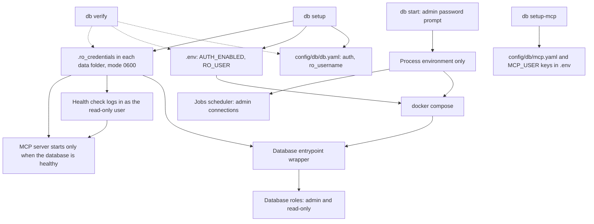

# Credentials and auth

Database authentication is optional; when `python sdp.py db setup` enables it, each database gets an admin user, whose password is prompted at every start and never stored, and an optional read-only user, whose password lives in `.ro_credentials` in the database's data volume and is used by the MCP servers and the health checks. This page describes the tiers, where each credential lives, how each database's entrypoint applies it, and which commands fail loudly when a piece is missing. The users and the recovery commands are on [Databases](../user-guide/databases.md#authentication).

## How it connects

Setup writes the files once; every `python sdp.py db start` prompts for the admin password, and the entrypoints make the database's accounts match the files. `python sdp.py db verify` compares the files without printing a value.

## The tiers

| Tier | What exists | Who connects how |
|------|-------------|------------------|
| Auth off | No passwords | Everyone connects without a password; MCP servers connect as admin or anonymously |
| Auth on, no read-only user | Admin accounts only | You and the pipelines with the admin password; `db setup-mcp` refuses to run |
| Auth on with a read-only user | Admin plus the read-only user (default name `readonly`) | Pipelines and the jobs scheduler as admin; MCP servers and health checks as the read-only user |
| Plus MCP | MCP containers | AI tools reach the data through the read-only user (see [MCP servers](mcp.md)) |

The admin accounts are `postgres` (PostgreSQL), `admin` (MongoDB, `MONGO_ADMIN_USER`) and `root` (StarRocks), all with the same password. One read-only user name is shared by all databases. It gets `pg_read_all_data` in PostgreSQL, `readAnyDatabase` plus `clusterMonitor` in MongoDB, and the `sdp_readonly` role with SELECT on all tables in StarRocks. The jobs scheduler connects with the admin password from its process environment (`POSTGRES_PASSWORD`, `STARROCKS_ROOT_PASSWORD`, `MONGO_ADMIN_PASSWORD`), and its web page, when its own auth is on, checks logins against the same password (see [Query scheduler](query-scheduler.md)).

At the end of `python sdp.py db setup`, the Authentication section asks:

| Question | Default | Effect |
|----------|---------|--------|
| Enable database authentication? | No | One answer covers every database chosen in this run |
| Admin password | None | Asked, but not kept: the password that counts is the one typed at `db start` |
| Create a read-only user? (required for MCP servers) | Yes | One read-only user shared by all databases |
| Read-only username | `readonly` | Stored in each `config/db/<db>.yaml` |
| Keep existing read-only password? | Yes | Offered only on a re-run with the same username |
| Auto-generate read-only password? | Yes | 32 URL-safe random characters; "no" asks for one |

`python sdp.py db setup --add <db>` does not ask again when auth is already on: the new database inherits auth and the existing read-only user and password.

## Where credentials live

| Credential | Where | Mode, owner | Who writes it |
|------------|-------|-------------|---------------|
| Admin password | Nowhere on disk: prompted with `getpass` at `python sdp.py db start` (and at `run` of an ingest profile, and `recover-password`) and passed to the containers as `POSTGRES_PASSWORD`, `MONGO_ADMIN_PASSWORD` or `STARROCKS_ROOT_PASSWORD` | Process environment only | You, at each start |
| Read-only user name | `config/db/<db>.yaml` (`ro_username`, the source of truth), and `POSTGRES_RO_USER` / `MONGO_RO_USER` / `STARROCKS_RO_USER` in `.env` | Ordinary config files | `python sdp.py db setup` |
| Read-only password | `.ro_credentials` in each database's data volume (`PGDATA_PATH`, `MONGO_DATA_PATH`, `STARROCKS_DATA_PATH`): one line, the password only | chmod 600, owned by the host user | `python sdp.py db setup`, `python sdp.py db recover-password --regenerate-ro` |
| Auth flag | `POSTGRES_AUTH_ENABLED`, `MONGO_AUTH_ENABLED`, `STARROCKS_AUTH_ENABLED` in `.env`, and `auth: true` in `config/db/<db>.yaml` | Ordinary config files | `python sdp.py db setup` |
| MCP user | `POSTGRES_MCP_USER`, `MONGO_MCP_USER`, `STARROCKS_MCP_USER` in `.env`, and `config/db/mcp.yaml` | Ordinary config files | `python sdp.py db setup-mcp` |
| PostgreSQL password rules | `config/postgres/pg_hba.local.conf`: present means PostgreSQL asks for passwords | Ordinary config file | `python sdp.py db setup` with auth |

`.ro_credentials` is written atomically (a `.ro_credentials.tmp` sibling, chmod 600, then a rename). It stays owned by the host user so setup, `verify` and recovery can read it without `sudo`; when the host cannot write the data folder (an old install whose folder is owned by a container user), setup falls back to writing it through a short-lived `alpine` container. The file sits next to each database's data so the database and MCP containers read it through the bind mounts they already have.

The admin password is never written to a file by `sdp`, but it is in the environment of the containers started with it, so anything that can inspect a running container's environment can read it: on a shared host, Docker access equals admin access.

The database entrypoint wrappers create or update the read-only user on every start, reading the password from `.ro_credentials` in the data volume. That is why `python sdp.py db reset` keeps `.ro_credentials`: the next `python sdp.py db start` re-creates the read-only user from it. `recover-password --regenerate-ro` writes a fresh `.ro_credentials` for every database with auth and a read-only user before each branch's final restart, and the entrypoint applies the new password as part of the same restart cycle.

## How each database applies auth

| Database | Mechanism |
|----------|-----------|
| PostgreSQL | `pg_hba.local.conf` uses `scram-sha-256` for remote connections and `trust` for the local socket. On a first start the cluster is created with the typed password. On every later start with auth on, the entrypoint boots a private trust-auth instance on port 54321 (localhost only), sets the `postgres` password to the one just typed, and syncs the read-only role from `.ro_credentials`; a typo therefore becomes the new admin password. |
| MongoDB | Fresh databases delegate to the official `docker-entrypoint.sh`. Existing databases switched to auth use the MongoDB localhost exception, once, to create the first admin user. When a read-only user is configured, every start logs in as admin to create or update it, so a wrong admin password fails the start; without one, a wrong password shows up at the first ingest. |
| StarRocks | The entrypoint wrapper starts StarRocks, waits for the FE to be ready, then sets the root password while root still has none and creates or syncs the read-only user through SQL. Read-only access is `GRANT SELECT ON ALL TABLES IN ALL DATABASES TO ROLE 'sdp_readonly'`. |

With auth enabled, the database health checks also log in as the read-only user, so a database counts as healthy only when that user works.

## What fails loudly

Every guard checks the read-only user name first: no name means you chose not to have a read-only user, which is allowed; a name without a password file is drift, and stops.

| Situation | Who refuses | Message names |
|-----------|-------------|---------------|
| Auth on, no read-only user configured | Nobody: no read-only sync, no read-only probe | - |
| Auth on, read-only user set, `.ro_credentials` missing | The database entrypoint at `db start`: the container exits | `sdp db setup --add <db>` or `sdp db recover-password` |
| StarRocks with auth on and no admin password in the environment | The StarRocks entrypoint | `sdp db start` or `sdp db recover-password` |
| `.ro_credentials` empty or unreadable on a setup re-run | Full `db setup` treats it as no password and offers to generate one; `db setup --add <db>` stops | The recovery command |
| `db setup-mcp` with auth on but no read-only user | `db setup-mcp`, before writing anything | `python sdp.py db setup` |
| `db setup-mcp` with a missing `.ro_credentials` | `db setup-mcp`, before writing `mcp.yaml` | `python sdp.py db recover-password --regenerate-ro` |
| MCP user set but no password found | The MCP container exits 1 | The credential file it checked |
| An action run without a terminal (for example from the web UI) and no admin password passed in | The action, before changing anything | "the database admin password is required" |
| Wrong admin password typed at start | PostgreSQL accepts it as the new password; MongoDB fails at start when a read-only user is configured, otherwise at the first ingest; StarRocks fails, but only after its start-up wait (60 tries 5 seconds apart) and with a message that does not mention the password | - |

`python sdp.py db verify` (and the drift section of `python sdp.py db status`) checks, per database, that `config/db/<db>.yaml` and `.env` agree on auth, and that `.ro_credentials` exists, is mode 0600, host-owned and readable; across databases it checks that MCP is enabled only for configured databases with a credential file. `verify` exits 1 on any finding and has a `--json` mode. It also reports two setups the other guards allow: auth on without a read-only user (as a missing `.ro_credentials`), and an MCP server without auth.

## Password recovery

`python sdp.py db recover-password` resets the admin password without the old one:

| Database | How |
|----------|-----|
| PostgreSQL | Backs up `config/postgres/pg_hba.local.conf`, restarts PostgreSQL with trust auth, sets the new password, and restores the original `pg_hba.local.conf` |
| MongoDB | Stops MongoDB, starts it without auth temporarily (in a throwaway `sdp-mongo-recovery` container), and sets the new admin password |
| StarRocks | The analogue of PostgreSQL's trust-auth swap. It stops StarRocks, backs up `config/starrocks/fe.local.conf`, appends `enable_auth_check = false` to it, starts StarRocks with auth checks disabled, sets the new root password, and restores the normal `fe.local.conf` |

With `--regenerate-ro` it also writes a fresh `.ro_credentials` for each database, which the entrypoints apply on the same restart; MCP servers pick it up when they restart. `python sdp.py db unsetup --db <db>` removes that database's `.ro_credentials` along with its keys in `.env`, its config files and its data.

## Design decisions

**The admin password is never stored.** It is prompted on every start and lives only in the environment of the processes started then, so a leaked config folder or backup holds no admin credential. The cost is a prompt at every start, the `recover-password` path for a forgotten password, and a typo at a PostgreSQL start becoming the new password.

**One read-only user, its password in a file next to the data.** MCP servers and health checks run unattended, so the read-only password has to be on disk; in each database's data folder, the database and its MCP container read it through mounts they already have, and it stays out of `.env` and `config/`. The cost is one secret file per database to keep at mode 0600 and host-owned, which `db verify` checks.

**The file holds only the password; the user name lives in the yaml.** One place per fact removed a class of bugs where two copies of the user name disagreed. The cost is that `.env` still mirrors the name for Compose (`<DB>_RO_USER`), and `db verify` has to compare the two.

**Entrypoints re-sync the read-only user on every start.** The file is the truth and the database follows it, so a fresh install, a rotated password and a restored backup all converge on the next start. The cost is a temporary private database instance (PostgreSQL, MongoDB) or an extra SQL round (StarRocks) on every start.

**Health checks log in as the read-only user.** A database that is up but whose read-only login is broken is reported unhealthy, so the MCP servers, which wait for a healthy database, never start against broken credentials. The cost is that a broken read-only user blocks `db start` itself, not only the MCP servers.

**Loud on drift, silent on "not configured".** A guard tells a read-only user you declined (no name) from one that drifted (a name without a password file), and stops only on the second; this came out of an earlier guard that refused to start databases whose operators had simply declined the read-only user. The cost is that every guard must check the name before the file, and `db verify` still reports the declined case.
