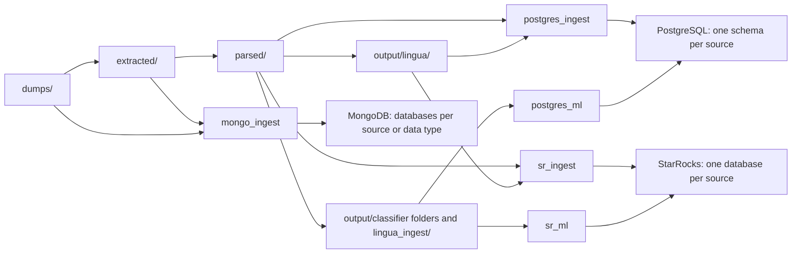

# Databases and ingestion

The ingest profiles load the pipeline's files into three databases: `postgres_ingest` and `sr_ingest` load the parsed (or lingua-enriched) files into base tables, `postgres_ml` and `sr_ml` load classifier outputs into one table per classifier next to them, and `mongo_ingest` loads the raw extracted records. StarRocks is the analytics store and the place new work goes; PostgreSQL is the older relational store, kept working but legacy; MongoDB keeps the raw records as documents for inspection. This page describes how each profile loads, deduplicates, indexes and tracks its state. Using the databases is on [Databases](../user-guide/databases.md).

## How it connects

PostgreSQL and StarRocks read the files themselves, so the ingest container only sends SQL; `mongo_ingest` runs `mongoimport` in its own container. How the files get into `parsed/` and `output/` is on [Pipeline and data folders](pipeline.md) and [Classifiers](classifiers.md).

## Which profile loads what

| Profile | Reads | Writes | Run it after |
|---------|-------|--------|--------------|
| `postgres_ingest` | `parsed/<data_type>/`, or with `prefer_lingua` `output/lingua/<data_type>/`; can also extract and parse dumps itself | `<schema>.<data_type>` | `parse` (and `lingua` if `prefer_lingua`) |
| `postgres_ml` | `output/<classifier>/<data_type>/`, and without `prefer_lingua` `output/lingua_ingest/` | `<schema>.<data_type><suffix>` | `ml` / `lingua` and `postgres_ingest` |
| `sr_ingest` | The same as `postgres_ingest`, but never extracts or parses | `<source>.<data_type>` | `parse` (and `lingua` if `prefer_lingua`) |
| `sr_ml` | The same as `postgres_ml` | `<source>.<data_type><suffix>` | `ml` / `lingua` and `sr_ingest` |
| `mongo_ingest` | `dumps/` (decompressed into `extracted/`), `extracted/<data_type>/` JSON, NDJSON or CSV, and Parquet for `input_format: parquet` sources | One collection per file or per data type | `source add` (no parse needed) |

All profiles run with `python sdp.py run <profile> --source <name>`. `--filter` narrows the files by file id for `postgres_ingest`, `postgres_ml` and `mongo_ingest`; the two StarRocks profiles ignore it. `--classifier` picks one classifier for `sr_ml`.

## The three databases side by side

| | PostgreSQL | MongoDB | StarRocks |
|---|---|---|---|
| Role | Legacy relational store; bug fixes only | Raw-record store for inspection | Primary analytics store |
| Namespace | One schema per source (`db_schema` in `platform.yaml`), in the `datasets` database (`DB_NAME`) | Database from `mongo_db_name`, or the legacy `mongo_db_name_template` (default `{platform}_{data_type}`) | One database named after the source |
| What is loaded | Parsed or lingua-enriched records, typed by `field_types` | Raw extracted records, whole (HF Parquet minus `mongo_exclude_fields`) | Parsed or lingua-enriched records, typed by `field_types` |
| Load mechanism | Server-side `COPY` (CSV, or Parquet through `pg_parquet`) | `mongoimport` from the ingest container; Parquet converted to NDJSON first | `INSERT INTO ... SELECT ... FROM FILES()`, read by the StarRocks BE |
| Duplicate handling | `ON CONFLICT (pk) DO UPDATE`; the newer `upsert_order_field` (Reddit: `retrieved_utc`) wins, NULL counts as oldest | None: every import inserts | Primary Key table replaces on load; `merge_condition` keeps the newer `upsert_order_field` |
| First load of a table | Fast load: no PK, blind COPY, dedup, then add the PK | Same as any load | Same as any load |
| Without a primary key | Append-only, `check_duplicates: false` | Always append | Duplicate Key table, append-only |
| Classifier outputs | `postgres_ml`: one table per classifier and data type, with a foreign key to the base table by default (`use_foreign_key: true`) | Not loaded | `sr_ml`: one table per classifier and data type, no foreign key |
| Indexes | B-tree from `indexes` and `ml_indexes`, optional tablespaces | Single-field ascending from `mongo_indexes` | Bitmap and bloom filter from `sr_indexes` and `sr_ml_indexes` |
| Compression | None in PostgreSQL: text columns are `TEXT STORAGE EXTERNAL` (uncompressed TOAST) | zstd for collections and the journal | Per table, `ZSTD` by default (`compression` in `config/db/starrocks.yaml`) |

## How the servers see the files

PostgreSQL and StarRocks read the parsed and output files server-side: the ingest container sends SQL, and the database server reads the files itself (`COPY` through pg_parquet, or `FILES()`). The files reach the servers through two layers of bind mounts.

| Layer | Covers | How it changes |
|-------|--------|----------------|
| `docker-compose.yml` binds `${PARSED_PATH:-./data/parsed}` and `${OUTPUT_PATH:-./data/output}` on each server unconditionally, read-only | Any source whose `paths.parsed` / `paths.output` lie under those parents (the default-disk case) | Visible to a running database the moment its folders appear, so `source add` works without a restart |
| Per-source entries in `docker-compose.override.yml` | Sources whose paths fall outside those parents (multi-disk, for example `paths.parsed: /mnt/fast_ssd/parsed/<src>`) | `python sdp.py db start` regenerates the file from the configured source set |

`source add` and `source remove` warn when an out-of-parent source change needs `python sdp.py db stop <service> && python sdp.py db start <service>`. `python sdp.py run *_ingest` and `*_ml` fail fast at the CLI when a mount is missing, rather than letting the orchestrator container die deep in `pg_parquet` or `FILES()`.

## postgres_ingest

### How it works

1. **Input detection**: with `prefer_lingua: false`, detects compressed dumps, JSON and parsed files, as the parse profile does. With `prefer_lingua: true`, detects only the files in the lingua output folder.
2. **Extraction and parsing**: with `prefer_lingua: false`, extracts and parses the files that have not been processed yet, so the profile can run the whole pipeline on its own. With `prefer_lingua: true`, both phases are skipped.
3. **Ingestion**: loads the data through server-side `COPY`, with `FORMAT parquet` (through pg_parquet) or `FORMAT csv` depending on the file extension.
4. **Indexing**: creates indexes on the configured fields, only on tables that received at least one file in this run.
5. **Analyze**: updates the table statistics.

An index added to the config after everything is loaded is therefore built by `python sdp.py db create-indexes`, not by re-running the profile. The same holds for `sr_ingest` and `mongo_ingest`.

### prefer_lingua

`prefer_lingua` is a strict either/or. With `prefer_lingua: true` (the base default), `postgres_ingest` reads the lingua-enriched files in `OUTPUT_PATH/<source>/lingua/` instead of the originals in `PARSED_PATH/<source>/`. Setup writes the value per source: on when the `lingua` profile is selected for that source, off otherwise.

| | `prefer_lingua: true` | `prefer_lingua: false` |
|---|---|---|
| Main table reads | The lingua output | The original parsed files (without language columns) |
| Language columns | `lang`, `lang_prob`, `lang2`, `lang2_prob`, `lang_chars` directly in the main table; no separate lingua table is needed | Ingested separately by `postgres_ml`, from the `lingua_ingest` folder |
| Missing lingua output | No fallback to the original parsed files: a file without lingua output is not ingested, and with no lingua output at all the run finds zero files and exits with "No files to process" | Not needed |

The original parsed files are used with `true` only when the lingua profile config itself cannot be loaded. Decide the value before the first load, because it fixes the base table's columns. `sr_ingest` follows the same rule. The lingua profile writes the `lingua_ingest` copy when either `postgres_ingest` or `sr_ingest` of the source has `prefer_lingua: false`.

### Standard ingestion (ON CONFLICT)

When the table already exists with a primary key:

- Server-side `COPY` with ON CONFLICT handles duplicates (Parquet through pg_parquet, or CSV).
- Conflicts are on `id` (the primary key). An incoming row replaces the existing one only when `COALESCE(EXCLUDED.retrieved_utc, -1) > COALESCE(table.retrieved_utc, -1)`; the column compared is the platform's `upsert_order_field`, `retrieved_utc` for Reddit.
- NULL counts as smaller than any value, so a real timestamp always replaces a NULL, never the reverse, and re-ingesting the same NULL is a no-op (idempotent).
- `check_duplicates: true` enables ON CONFLICT DO UPDATE.

### Fast initial load (new tables)

When a table does not exist yet, or exists without a primary key (for example from an interrupted earlier run), the pipeline uses an optimized bulk load:

1. **CREATE TABLE (no PK)**: the table is created without a primary key, to avoid per-row index maintenance.
2. **Blind COPY**: all files are loaded without duplicate checking (Parquet or CSV).
3. **Deduplication**: an in-place `ROW_NUMBER()` window function removes duplicates per `id`. The surviving row is chosen by `COALESCE(retrieved_utc, -1) DESC` (real timestamps win over NULL), then the platform's `mandatory_fields` DESC for cross-dataset tiebreakers (for example Reddit's `dataset DESC` keeps the later month), then `ctid` as the final tiebreaker (deterministic run to run and across machines on a freshly COPYed heap).
4. **PRIMARY KEY**: the primary key constraint is added in a single index build after all data is loaded.

This is faster than ON CONFLICT for initial loads of billions of rows, because index maintenance is deferred until all data is loaded. Once the table has a primary key, later ingestions use ON CONFLICT. Tables left without a PK by an interrupted run are detected and sent back through the fast-load path on the next ingest, even when there are no new files.

There is no table partitioning. Reddit-wide queries that are not bounded to a few months would hit 200+ partitions, splitting indexes and hurting performance; partitioning would also interfere with the deferred-PK dedup path.

### Tablespaces

| Rule | Behaviour |
|------|-----------|
| Creation | On startup, the ingestion pipeline creates any missing tablespaces with `CREATE TABLESPACE` |
| Placement | `CREATE TABLE` and `CREATE INDEX` statements include `TABLESPACE <name>` for non-`pgdata` assignments |
| Default | Data types assigned to `pgdata` use the default PostgreSQL data directory (no TABLESPACE clause) |
| Classifier tables | Tables from `postgres_ml` inherit the tablespace of their parent data type |
| Container paths | Follow the convention `/data/tablespace/<name>`, derived from the tablespace name |

## postgres_ml

### How it works

1. **Classifier resolution**: loads the source's ml and lingua profile config to find which classifiers to ingest, their `suffix` and their `data_types` scope. The source's `ml.yaml` decides what runs.
2. **Override layer**: `config/postgres_ml/services.yaml` and `config/sources/<name>/postgres_ml.yaml` add the optional ingestion-only tweaks (`enabled: false` to skip, a custom `source_dir`, `column_overrides`).
3. **File detection**: finds the classifier output files in `OUTPUT_PATH/<source>/{source_dir}/{data_type}/`, only for the `data_types` in the classifier's scope.
4. **Type inference**: samples `type_inference_rows` rows to detect the column types (CSV), or reads the schema directly (Parquet).
5. **Table creation**: creates tables named `{data_type}{suffix}` (for example `submissions_toxicity_en`).
6. **Ingestion**: loads the data with duplicate handling.
7. **Foreign keys**: optionally adds an FK constraint to the main table on `(dataset, id)`.
8. **Indexing**: creates indexes on the classifier tables from `ml_indexes`.

### Classifier resolution

What ingestion runs comes from the source's ml and lingua profile config, not from a separate declaration. For each classifier in `config/sources/<name>/ml.yaml`'s `pipeline.gpu_classifiers` (and lingua through `cpu_classifiers`), `postgres_ml` reads the merged profile config for its `suffix` and `data_types` scope; source overrides win over the global `gpu_classifiers.yaml` defaults. `config/postgres_ml/services.yaml` and the per-source `postgres_ml.yaml` only carry ingestion-only overrides. `suffix` is not one of them: it lives in the ml/lingua profile so that the run and the ingest always agree on file names.

### prefer_lingua interaction

`postgres_ml` reads `prefer_lingua` from the postgres profile (`config/postgres/pipeline.yaml`):

| Value | `postgres_ml` |
|-------|---------------|
| `true` | The lingua data is already in the main table, so it skips the lingua classifier |
| `false` | Ingests the lingua data from the `lingua_ingest` folder |

### Fast initial load (new tables)

The same algorithm as `postgres_ingest`, with one more step:

1. CREATE TABLE (no PK, no FK).
2. Blind COPY of all classifier output files.
3. Deduplication (the same null-safe ORDER BY: `COALESCE(retrieved_utc, -1) DESC, dataset DESC, ctid`).
4. Add the PRIMARY KEY.
5. **Add the FOREIGN KEY** (validates that all ids exist in the main table).

Once the table has a primary key, later ingestions use ON CONFLICT. Classifier tables left without a PK by an interrupted run are detected and sent back through the fast load on the next ingest.

## sr_ingest

`sr_ingest` has feature parity with `postgres_ingest` but is much simpler: when a `primary_key` is configured, StarRocks handles upsert and deduplication natively; when not, the table uses the Duplicate Key model and re-runs append rows.

### How it works

1. **Creates the database**: one database per source (for example `reddit`, `twitter_academic`), like MongoDB's database-per-source pattern.
2. **Creates the tables**: columns and types come from the `platform.yaml` field definitions. With a `primary_key`: a Primary Key table with `DISTRIBUTED BY HASH(pk)` and `enable_persistent_index = true`, deduplicating on insert. Without one: the Duplicate Key model with `DISTRIBUTED BY RANDOM`, append-only, and `check_duplicates` is forced off so no `merge_condition` is emitted.
3. **Ingests the files**: `INSERT INTO ... SELECT FROM FILES()` reads Parquet or CSV directly from the StarRocks BE's filesystem mount. The ingest container sends SQL; the BE reads the files itself.
4. **Conditional upsert**: with `check_duplicates: true`, `merge_condition` keeps the row with the higher `upsert_order_field` (for example `retrieved_utc`).
5. **Creates indexes**: bitmap and/or bloom filter, for the columns in `sr_indexes`, keyed by data type (see [Index builds](#index-builds)), on the tables that received files.
6. **Runs ANALYZE**: collects statistics for the query optimizer.

New tables get the `compression` codec from `config/db/starrocks.yaml`, or the per-source `pipeline.database.compression`. The bucket count, `sr_buckets` in `platform.yaml`, is fixed when a table is created.

### Differences from postgres_ingest

| Aspect | `sr_ingest` |
|--------|-------------|
| Code path | Single: no fast-load versus standard-load branching; Primary Key tables handle dedup natively |
| Schema | None: tables are `database.table`, not `schema.table`; the database name is the source name |
| Tablespaces | None: multi-disk is handled by the BE's `storage_root_path` |
| Primary key | Defined when the table is created; no deferred PK |
| Indexes | Two mechanisms, bitmap and bloom filter, instead of B-tree |

## sr_ml

`sr_ml` ingests classifier outputs (lingua, toxic_roberta, go_emotions) into separate StarRocks tables. It has feature parity with `postgres_ml` but is simpler: no fast-load/standard-load branching, no foreign keys, one ingestion path.

### How it works

1. **Resolves the classifier runs** from the source's ml and lingua profile config, as `postgres_ml` does. The source's `ml.yaml` decides which classifiers run and their `data_types` scope; `suffix` comes from the merged ml/lingua config. `config/sr_ml/services.yaml` and `config/sources/<name>/sr_ml.yaml` add the optional ingestion-only overrides.
2. **Detects the classifier output files** in `/data/output/{source_dir}/{data_type}/`, restricted to each classifier's `data_types` scope.
3. **Infers the schema** from the first file per data type:
   - **Parquet**: reads the typed schema from the file metadata (no sampling).
   - **CSV**: samples N rows and infers types (INT > FLOAT > BOOLEAN > STRING).
4. **Creates the classifier tables** as Primary Key tables (for example `submissions_lingua`, `comments_toxicity_en`), in the same database as the base tables.
5. **Ingests the files** through `INSERT INTO ... SELECT FROM FILES()`, with an optional `merge_condition`.
6. **Runs ANALYZE** on each classifier table after ingestion.
7. **Creates indexes** on the classifier tables from `sr_ml_indexes`, bitmap and/or bloom filter.

Lingua follows the `prefer_lingua` rule, read from the `sr_ingest` profile: with `true` (default), the lingua columns are already in the base tables through `sr_ingest`, so the lingua classifier is skipped. With `false`, the lingua data is ingested from `lingua_ingest/` into separate tables.

### Differences from postgres_ml

| Aspect | `sr_ml` |
|--------|---------|
| Code path | Single: no fast-load versus standard-load branching; Primary Key tables handle dedup natively |
| Foreign keys | None: StarRocks FKs are non-enforced optimizer hints, so they are skipped entirely |
| Primary key | Defined when the table is created; no deferred PK |
| Tablespaces | No tablespace management: not applicable to StarRocks |

## Index builds

`sr_ingest`, `sr_ml` and `python sdp.py db create-indexes` handle two StarRocks index mechanisms:

| Mechanism | How it is built and checked |
|-----------|-----------------------------|
| Bitmap indexes | Submitted as `CREATE INDEX … USING BITMAP` and polled through `SHOW ALTER TABLE COLUMN` every `processing.index_poll_interval` seconds (default 10) until each alter job reaches `FINISHED`, so progress reflects the actual build rather than the submission. `CREATE INDEX` is asynchronous on the BE. |
| Bloom filters | A table property, applied as one `ALTER TABLE … SET ("bloom_filter_columns" = …)` per table. Because that statement replaces the whole list, the current value is always read from `SHOW CREATE TABLE` and merged first, and the property is re-read afterwards to confirm the change took effect. An unreadable current value aborts rather than risk dropping existing bloom columns. Which `SHOW ALTER TABLE` view reports a bloom filter change is unverified, so for bloom filters the poll is best-effort progress reporting and the re-read decides success. |

Per table, bloom filter columns go first as one `ALTER TABLE`, then bitmaps one at a time, because StarRocks allows only one schema change per table at a time. That constraint is per table, so different tables run in parallel. `sr_ml` caps its client-side fan-out at 8 concurrent tables, since its plan spans data types × classifiers rather than data types alone; each concurrent table costs one connection and one alter-job poll per `index_poll_interval`. For `sr_ml`, a job that ends in any state other than `FINISHED` logs a warning and the run continues.

BE-side parallelism for schema changes is capped by `alter_tablet_worker_count` in the BE config (set at `python sdp.py db setup` from the hardware, written to `config/starrocks/be.local.conf`). Each worker buffers bitmaps while it runs, so raising the count speeds up builds at the cost of BE memory: high-cardinality columns (for example `author`) can push the BE past its memory limit if the pool is too large.

PostgreSQL indexes are B-tree, built after ingestion with `parallel_index_workers` as `max_parallel_maintenance_workers` per build.

## mongo_ingest

`mongo_ingest` loads raw extracted files directly into MongoDB with `mongoimport`.

### How it works

1. **Extract**: detects compressed dump files and decompresses them with the format's tool (`.zst`, `.gz`, `.xz`, `.tar.gz`). For `input_format: parquet` sources (for example HF datasets), it also detects the parquet files in `data/extracted/`.
2. **Validate**: checks every pending file before any import, as set by `validate_before_import` (`full`, `tail` or `none`; `config/db/mongo.yaml` wins over the profile config, default `full`). A malformed line in the middle aborts the run. A truncated last line makes the profile ask whether to load the partial file; in watch mode it aborts instead.
3. **Ingest**, for each extracted file:
   - Creates a collection with zstd WiredTiger compression.
   - Runs `mongoimport` for bulk insertion (blind insert, no upsert).
   - Detects CSV files (by the `.csv` extension) and passes `--type csv --headerline` to mongoimport.
   - Detects Parquet files (by the `.parquet` extension) and converts them to a temp NDJSON file through PyArrow before running mongoimport. The temp file is deleted on success; on error its location is printed for manual cleanup.
   - Records the file in the `_sdp_metadata` collection for state tracking.
4. **Index**: creates the configured indexes on each collection, a single ascending index per field.

### Parquet to MongoDB

1. PyArrow reads the parquet row groups one at a time (memory-bounded).
2. Each row is serialized to JSON and written to a temp NDJSON file (`{filepath}.ndjson.tmp`).
3. `mongoimport` ingests the temp NDJSON (the standard path, with the same logging and error handling).
4. The temp file is deleted on success.

The MongoDB container image (`Dockerfile.mongo`) includes `pyarrow` for this conversion, separately from the CPU and GPU processing containers.

### Collection strategies

| Strategy | Mechanism |
|----------|-----------|
| `per_file` | Each input file becomes its own collection, named after the file's dataset (`RS_2024-01` → collection `2024-01`), in a database from `mongo_db_name_template` (`reddit_submissions`) |
| `per_data_type` | All files of a type are imported into one collection, named by `mongo_collections` when it is set, else after the data type |

A source set up today gets `mongo_db_name` (one database name for all its data types, by default the source name), which wins over `mongo_db_name_template`.

## State tracking and recovery

Each ingest profile keeps a JSON state file per data type, named after the source (`SOURCE`), with the processed and failed entries and the one in progress:

| Profile | State file |
|---------|------------|
| `postgres_ingest` | `$PGDATA_PATH/state_tracking/{SOURCE}_postgres_ingest_{data_type}.json` |
| `postgres_ml` | `$PGDATA_PATH/state_tracking/{SOURCE}_postgres_ml_{data_type}.json` |
| `sr_ingest` | `$STARROCKS_DATA_PATH/state_tracking/{SOURCE}_sr_ingest_{data_type}.json` |
| `sr_ml` | `$STARROCKS_DATA_PATH/state_tracking/{SOURCE}_sr_ml_{data_type}.json` |
| `mongo_ingest` | `$MONGO_DATA_PATH/state_tracking/{SOURCE}_mongo_ingest_{data_type}.json` |

The `*_ingest` files track file ids (for Reddit `RS_2024-01`). The `*_ml` files track classifier files, as `<classifier>/<file stem>`; one file is shared by all classifiers of a data type. Before a file starts, the profile marks it in progress; after the database confirms the load, it moves it to the processed list, or to the failed list with the error.

MongoDB also stores the ingested file ids in a `_sdp_metadata` collection per database, so the state can be recovered even when the state files are lost.

When no state file exists on a first run:

| Database | How the state is rebuilt |
|----------|--------------------------|
| PostgreSQL | `postgres_ingest` queries the database for the unique values of the platform's `state_field` (for Reddit `dataset`) already present, and turns each into a file id with the data type's file prefix (`2024-01` → `RS_2024-01`) |
| StarRocks | `sr_ingest` queries the database for the unique datasets already present (the same approach as PostgreSQL) |
| MongoDB | `mongo_ingest` queries the `_sdp_metadata` collection to rebuild the list of ingested files |

The rebuild from table contents holds for Reddit, whose file patterns carry a `prefix`. A data type without one gets `<data_type>_` as its prefix, which does not match a custom source's file names, so for custom sources a lost state file means a full reload. `postgres_ml` and `sr_ml` have no rebuild and reload everything, which is harmless for tables with a primary key.

| Situation | What happens |
|-----------|--------------|
| Plain re-run, nothing new | Every file is in the state file; the profile prints "No files to process" and exits |
| New dump month added | Only the new file is loaded; existing rows are upserted (PostgreSQL, StarRocks) |
| Run interrupted in the middle of a file | The stale in-progress mark is cleared and the file is retried from the start. MongoDB may already hold part of the file, and `mongoimport` inserts blindly, so the retry can duplicate documents |
| PostgreSQL first load interrupted before the primary key was added | The next `postgres_ingest` run notices the table has no primary key, deletes duplicates and adds it |
| Start over for one database | `python sdp.py db reset --db <name>` wipes its data and state files but keeps all configuration |

## Design decisions

**StarRocks is the primary analytics store; PostgreSQL is legacy.** Full-dataset Reddit queries touch billions of rows and hundreds of monthly datasets, and a columnar engine answers them far faster than PostgreSQL, which also needed tablespaces and long index builds at that size. The cost is two SQL paths to keep correct: PostgreSQL still gets bug fixes, though no new features.

**StarRocks deduplicates through Primary Key tables.** Its Primary Key tables replace rows with the same key on load, and `merge_condition` keeps the version with the higher `upsert_order_field`, so `sr_ingest` and `sr_ml` have a single code path with no fast-load or repair logic. The cost is that the key and bucket count are fixed at table creation: changing them means reloading the table.

**The database reads the files itself.** PostgreSQL `COPY` and StarRocks `FILES()` read the parsed files server-side from mounted folders, so gigabytes never pass through the ingest container or a Python process. The cost is that both servers must mount the parsed and output folders, which is why sources outside the default parents need the generated override file and a restart.

**PostgreSQL dedup is null-safe and deterministic.** Reddit dumps before 2010 have no retrieval timestamp, so the upsert and the dedup treat a missing timestamp as the oldest value and break remaining ties by `mandatory_fields` and physical row order: a real timestamp always wins, a missing one never overwrites, and the same input gives the same table on every machine. The cost is the two-path design (fast load for new tables, ON CONFLICT afterwards) and the repair of tables left without a key.

**State files plus database facts.** A small JSON state file per source, profile and data type makes resume cheap and visible, and the base profiles can rebuild a lost one from what the database holds. The cost is that the rebuild works only where file ids follow from a column (Reddit), and the classifier profiles have none.

**Classifier results go in their own tables.** Each classifier writes `<data_type><suffix>` next to the base table instead of adding columns to it, so a classifier can be added, rerun or dropped without touching billions of base rows; Lingua is the exception when `prefer_lingua` is on, because its five columns are small and queried with almost everything. The cost is a join for every query that combines text and scores.

**MongoDB keeps raw records.** It is fed before parsing so you can look at the original documents, including fields that the SQL stores never select. The cost is that it has no deduplication: every import inserts, and an interrupted file can leave duplicates.
