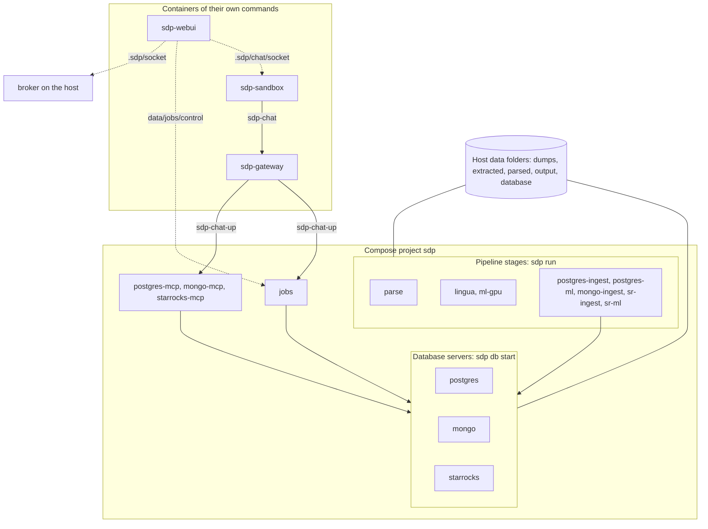

# Docker layout

Everything in the pipeline runs in Docker containers. One Compose file, `docker-compose.yml` (project name `sdp`), describes each pipeline stage, each database, each MCP server and the query scheduler as a service behind its own profile, so nothing starts unless asked for. The web UI and the chat's two containers are not in the Compose file: their own commands create them with `docker create`. You rarely call Docker yourself: `python sdp.py db start` and `db stop` manage the long-running services and `python sdp.py run <profile>` runs one stage for one source, choosing the profiles, folders and passwords for each call. This page lists the services, the images, the mounts and the networks, and what needs a rebuild after which change.

## How it connects

## Profiles and services

15 services, one per profile. Three images are pulled; the others are built locally from the Dockerfiles in the repository.

| Profile | Service | Image | What it is for | Started by |
|---|---|---|---|---|
| `parse` | `parse` | Built: `Dockerfile` | Decompress and parse | `python sdp.py run parse` |
| `lingua` | `lingua` | Built: `Dockerfile` | Language detection on CPU | `python sdp.py run lingua` |
| `ml` | `ml-gpu` | Built: `Dockerfile.gpu` | GPU transformer classifiers (all GPUs, `ipc: host`) | `python sdp.py run ml` |
| `postgres` | `postgres` | Built: `Dockerfile.postgres` | PostgreSQL 18 with pg_parquet | `python sdp.py db start` |
| `postgres_ingest` | `postgres-ingest` | Built: `Dockerfile` | Load parsed files into PostgreSQL | `python sdp.py run postgres_ingest` |
| `postgres_ml` | `postgres-ml` | Built: `Dockerfile` | Load classifier outputs into PostgreSQL | `python sdp.py run postgres_ml` |
| `mongo` | `mongo` | Pulled: `mongo:8` | MongoDB | `python sdp.py db start` |
| `mongo_ingest` | `mongo-ingest` | Built: `Dockerfile.mongo` | Load extracted files into MongoDB (JSON through `mongoimport`) | `python sdp.py run mongo_ingest` |
| `starrocks` | `starrocks` | Pulled: `starrocks/allin1-ubuntu` | StarRocks front end and back end in one container | `python sdp.py db start` |
| `sr_ingest` | `sr-ingest` | Built: `Dockerfile.starrocks` | Load parsed files into StarRocks | `python sdp.py run sr_ingest` |
| `sr_ml` | `sr-ml` | Built: `Dockerfile.starrocks` | Load classifier outputs into StarRocks | `python sdp.py run sr_ml` |
| `postgres_mcp` | `postgres-mcp` | Pulled: `crystaldba/postgres-mcp` | MCP server (SSE) | `python sdp.py db start`, when configured |
| `mongo_mcp` | `mongo-mcp` | Built: `Dockerfile.mcp-mongo` | MCP server (Streamable HTTP) | `python sdp.py db start`, when configured |
| `starrocks_mcp` | `starrocks-mcp` | Built: `Dockerfile.mcp-starrocks` | MCP server (Streamable HTTP) | `python sdp.py db start`, when configured |
| `jobs` | `jobs` | Built: `Dockerfile.jobs` | Query scheduler: page, MCP and runner | `python sdp.py db start jobs`, or `python sdp.py db start` when one of its targets' databases is being started |

Three more containers live outside the Compose file:

| Container | Image | Built by | Started by |
|---|---|---|---|
| `sdp-webui` | `sdp-webui` from `Dockerfile.webui` | `python sdp.py webui setup` | `python sdp.py webui start` |
| `sdp-gateway` | `sdp-gateway` from `Dockerfile.gateway` | `python sdp.py chat setup` | `python sdp.py chat start` |
| `sdp-sandbox` | `sdp-sandbox` from `Dockerfile.sandbox` | `python sdp.py chat setup` | `python sdp.py chat start` |

The databases restart only on request (`restart: "no"`) and get long stop grace periods (10 minutes for PostgreSQL, 5 for MongoDB and StarRocks) so they can shut down cleanly. Each database's healthcheck is a script, `config/<db>/healthcheck.sh`; under authentication it also logs in as the read-only user, and the MCP servers wait for that healthy state (`depends_on: service_healthy`). The scheduler has no `depends_on`: `python sdp.py db start` brings the databases up with `--wait` before it starts the scheduler.

## Images

| Dockerfile | Base | Python requirements | Extra |
|---|---|---|---|
| `Dockerfile` | `python:3.13-slim` | `requirements.txt`: PyYAML, Polars, PyArrow, Lingua, psycopg | `zstd` |
| `Dockerfile.gpu` | `nvcr.io/nvidia/pytorch:25.03-py3` | `requirements-gpu.txt` (ONNX Runtime GPU index): PyYAML, Polars, Optimum with ONNX Runtime GPU | torch and transformers come with the base |
| `Dockerfile.mongo` | `python:3.13-slim` | `requirements-mongo.txt`: PyYAML, PyMongo, PyArrow | `zstd`, `mongodb-database-tools` |
| `Dockerfile.starrocks` | `python:3.13-slim` | `requirements-starrocks.txt`: MySQL Connector/Python, PyArrow, PyYAML | none |
| `Dockerfile.jobs` | `python:3.13-slim` | `requirements-jobs.txt`: FastAPI, uvicorn, Jinja2, the `mcp` SDK, sqlparse, PyArrow and the three database clients | Downloads its page's CSS and JS at build time |
| `Dockerfile.postgres` | `postgres:18` | none | `pg_parquet`, the first-start scripts in `config/postgres/initdb.d/` |
| `Dockerfile.mcp-mongo` | `oven/bun:1` build, `node:22-slim` runtime | none | `mcp-mongo-server` at a pinned commit with three patches from `config/mcp/` |
| `Dockerfile.mcp-starrocks` | `python:3.13-slim` | `mcp-server-starrocks==0.3.0` | none |
| `Dockerfile.webui` | `python:3.13-slim` | `requirements-webui.txt`: FastAPI, uvicorn, Jinja2 | `openssl`; htmx 2.0.4, Vega 6.4.0, Vega-Lite 6.5.0 and vega-embed 7.3.0, each checked against a SHA-256 sum |
| `Dockerfile.gateway` | `python:3.13-slim` | none | The gateway package only |
| `Dockerfile.sandbox` | `python:3.13-slim` | `requirements-sandbox.txt`: pandas, NumPy, Matplotlib, PyArrow, Altair and vl-convert (pinned), the `mcp` SDK | Claude Code at a pinned version, checked against a SHA-256 sum |

`requirements-test.txt` is for the test suite only. The Python images copy the package code (and a copy of `config/`) in at build time. Configuration is not baked in for use: `./config` is mounted read-only into every pipeline container and the scheduler, so YAML edits apply at the next run. The web UI, gateway and sandbox images copy only the modules they import, each from a build context cut down by its ignore file where it has one.

## Data folders and mounts

| Host folder (variable, default) | Seen by | Inside the container |
|---|---|---|
| `DUMPS_PATH` (`./data/dumps`) | `parse`, `postgres-ingest`, `mongo-ingest` | `/data/dumps`, read-only |
| `EXTRACTED_PATH` (`./data/extracted`) | `parse`, `postgres-ingest`, `mongo-ingest` | `/data/extracted` |
| `PARSED_PATH` (`./data/parsed`) | `parse`, `lingua`, `ml-gpu`, `postgres-ingest`, `sr-ingest`, the `postgres` and `starrocks` servers | `/data/parsed` (read-only for the readers) |
| `OUTPUT_PATH` (`./data/output`) | `parse`, `lingua`, `ml-gpu`, `postgres-ingest`, `postgres-ml`, `sr-ingest`, `sr-ml`, the `postgres` and `starrocks` servers | `/data/output` (read-only for the ingest stages and servers) |
| `PGDATA_PATH`, `MONGO_DATA_PATH`, `STARROCKS_DATA_PATH` (`./data/database/<db>`) | The server, its ingest stages, its MCP server (read-only) | Database files, state tracking, `.ro_credentials` |
| `DB_EXPORT_PATH` (`./data/export`) | The `postgres` and `mongo` servers | `/export` |
| `JOBS_RESULT_ROOT` (`./data/jobs/results`) | `jobs`, `starrocks`, and `postgres` through the override file | `/data/jobs/results` in the scheduler, `/jobs_export` in the servers |
| `./data/jobs` | `jobs` | `/data/jobs`, the job store |
| `HF_HOME` (`~/.cache/huggingface`) | `ml-gpu` | `/root/.cache/huggingface`, the model cache |
| `./config/<db>` | Each server | Its config files, entrypoint and healthcheck script |

For a pipeline stage, `python sdp.py run` points `DUMPS_PATH`, `EXTRACTED_PATH`, `PARSED_PATH` and `OUTPUT_PATH` at the source's own folders (for example `./data/parsed/reddit`) and creates them first, so each run sees only its source. The database servers read files themselves (PostgreSQL's parquet `COPY`, StarRocks' `FILES()`), so they need to see every source. They do this in two layers:

1. **Parent mounts** in `docker-compose.yml`: the whole parsed and output trees are mounted read-only, which covers every source stored under the default folders, without a restart when a source is added.
2. **Per-source mounts** in `docker-compose.override.yml`: for a source stored elsewhere (another disk), `python sdp.py db start` adds a mount for that source's folders.

`social_data_pipeline/setup/mount_sync.py` decides which per-source mounts are needed. When a source is added or removed while a database runs, `python sdp.py source add` and `source remove` warn that the running server no longer matches and print the `db stop` / `db start` line that fixes it; `python sdp.py run` checks the running container's mounts before an ingest and stops with the same advice; `python sdp.py db verify` reports the mismatch.

`docker-compose.override.yml` is generated: `python sdp.py db setup` writes PostgreSQL tablespace and StarRocks extra-disk mounts there, `python sdp.py db setup-jobs` adds the results mount, and every `python sdp.py db start` of postgres or starrocks rewrites it, keeping only those kinds of entries plus the current per-source mounts. Hand edits to other services in it do not survive. `docker-compose.override.yml.example` shows the tablespace form.

The web UI and the chat mount only folders under `.sdp/` in the deployment folder (and, for the web UI's Queue window, the scheduler's control and results folders, read-only); they are listed in [Broker, web UI and chat](control-plane.md).

## Networks

| Network | Made by | What is on it | Its properties |
|---|---|---|---|
| The compose project's default network | Docker Compose | Every Compose service | The MCP servers and the scheduler reach the databases by service name (`postgres`, `mongo`, `starrocks`) |
| `sdp-webui` | `python sdp.py webui start`, when missing | `sdp-webui` | A bridge with masquerading switched off, so the container reaches the machine and nothing beyond; start refuses a network of that name of another driver or with masquerading on |
| `sdp-chat` | `python sdp.py chat start` | `sdp-sandbox`, `sdp-gateway` | Internal, IPv4 only, IPv4 gateway mode `isolated`: this machine has no address on it, and the sandbox's only peer is the gateway |
| `sdp-chat-up` | `python sdp.py chat start` | `sdp-gateway`, each attached MCP server and the scheduler, under aliases | An ordinary bridge; the compose project's own network is never touched |

`python sdp.py chat stop` removes both chat networks; `python sdp.py webui unsetup` removes `sdp-webui`.

## Published ports

| Service | Host port (variable, default) | Container port |
|---|---|---|
| `postgres` | `POSTGRES_PORT` (5432) | The same |
| `mongo` | `MONGO_PORT` (27017) | 27017 |
| `starrocks` | `STARROCKS_PORT` (9030), `STARROCKS_FE_HTTP_PORT` (8030), 8040 | 9030 (MySQL protocol), 8030 (front end HTTP), 8040 (back end HTTP) |
| `postgres-mcp` | `POSTGRES_MCP_PORT` (8000) | 8000 |
| `mongo-mcp` | `MONGO_MCP_PORT` (3000) | 3000 |
| `starrocks-mcp` | `STARROCKS_MCP_PORT` (9000) | 9000 |
| `jobs` | `JOBS_PORT` (8050) | The same |
| `sdp-webui` | The port asked by `webui setup` (8443) | 8444 for 127.0.0.1, 8443 for every other address; with `all`, 8443 once on every address |

The gateway and the sandbox publish no port.

## How `sdp` drives Compose

| Command | Compose call |
|---|---|
| `python sdp.py db start` | Creates the data folders, rewrites the override, `up -d --wait` with the database profiles, then again with the database and configured MCP profiles, then `--profile jobs up -d --build jobs` when the scheduler is configured and one of its target databases is among those being started |
| `python sdp.py db start <db>-mcp` | `up -d --wait` with that database's profile and its MCP profile |
| `python sdp.py db start jobs` | `--profile jobs up -d --build jobs` |
| `python sdp.py db stop [<db>]` | `down` with every configured database and MCP profile and, when it is configured, the jobs profile; with `<db>`, that database and its MCP profile only |
| `python sdp.py db stop <db>-mcp`, `db stop jobs` | `stop` and `rm -f` of that one service |
| `python sdp.py run <profile>` | `--profile <profile> run --rm [--build] <service>` with the source's folders in the environment |

Every call prints the command it runs; passwords are never part of it, they travel in the environment. Running Compose by hand works the same way, but every command needs the right `--profile` flags, and an MCP service also needs its database's profile, for example `docker compose --profile mongo --profile mongo_mcp logs mongo-mcp`.

## What needs a rebuild

`--build` is a flag of `python sdp.py run` only. A database server picks up a config change by a restart (`python sdp.py db stop`, then `python sdp.py db start`).

| What changed | What to run |
|---|---|
| Python code in `social_data_pipeline/`, `requirements.txt`, `requirements-gpu.txt`, `requirements-mongo.txt`, `requirements-starrocks.txt`, or the stage Dockerfiles | `python sdp.py run <profile> --build` for each stage that uses it (for example `python sdp.py run mongo_ingest --build`) |
| The scheduler's code, `requirements-jobs.txt` or `Dockerfile.jobs` | `python sdp.py db start jobs`: the scheduler's image is rebuilt every time it is started, also by `python sdp.py db start [<db>]` when one of its targets' databases is being started |
| `Dockerfile.postgres` or `config/postgres/initdb.d/` | `docker compose --profile postgres build postgres`, then a restart; the first-start scripts run only when the database is first initialized |
| `Dockerfile.mcp-mongo`, its patches or `config/mcp/entrypoint-mongo.sh` | `docker compose --profile mongo --profile mongo_mcp build mongo-mcp`, then a restart |
| `Dockerfile.mcp-starrocks` or `config/mcp/entrypoint-starrocks.sh` | `docker compose --profile starrocks --profile starrocks_mcp build starrocks-mcp`, then a restart |
| The web UI's code, `requirements-webui.txt` or `Dockerfile.webui` | `python sdp.py webui setup` (it builds the image), then `python sdp.py webui stop` and `webui start` |
| The chat's code, the gateway's code, `requirements-sandbox.txt`, `Dockerfile.gateway` or `Dockerfile.sandbox` | `python sdp.py chat setup` (it builds both images), then `python sdp.py chat stop` and `chat start` |
| The broker's code (`social_data_pipeline/control/`) | `python sdp.py broker stop`, then `python sdp.py broker start`: it runs from the clone, not from an image |
| YAML under `config/` | Nothing: it is mounted read-only and read at the next run |

The postgres server and the mongo and starrocks MCP images are rebuilt by no `sdp` command, which is why they need the `docker compose ... build` lines above; an MCP build needs its parent database's profile too. The pulled images (`mongo:8`, `starrocks/allin1-ubuntu`, `crystaldba/postgres-mcp`) are fetched when they are first missing, and no `sdp` command fetches a newer one.

## Design decisions

**A profile for every service.** Stages run one at a time per source, the databases are optional and each MCP server is optional, so nothing may start just because it is in the file, and `sdp` turns your configuration into the right set of profiles. The cost is that a hand-run Compose command needs the right `--profile` flags, two for an MCP server.

**The mongo service sets a glibc tunable.** `GLIBC_TUNABLES=glibc.pthread.rseq=1` keeps MongoDB 8 from crashing about 30 seconds after start on Linux 6.19 and later (Ubuntu 26.04), where its bundled memory allocator relies on a kernel behaviour that changed; the setting makes glibc take the kernel feature first, so the allocator falls back to a safe mode. The cost is a small speed loss until a MongoDB release with a fixed allocator is pinned (the value `0`, which many posts suggest, still crashes).

**Healthchecks are scripts, and they log in as the read-only user.** The check needs runtime values (the read-only user and its password file), and Compose's escaping of `$` inside healthcheck commands proved unreliable, so each database's check is `config/<db>/healthcheck.sh`; under authentication a database counts as healthy only when that login works, which is what the MCP servers wait for. The cost is one more script per database to keep in step with its auth setup.

**The database servers see sources through two layers of mounts.** Mounting the parent folders lets a new source under the default folders appear in a running database at once, and per-source mounts keep sources on other disks working; one module computes both, so the override file, the warnings and `db verify` agree on what a database should see. The cost is that a source added on another disk needs a database restart, and the override file is rewritten by `db start`.

**`sdp` creates host folders before Docker does.** Docker creates a missing bind-mount folder as root, which later blocks your own writes, so `db start` and `run` create every folder they are about to mount, as your user, first. The cost is that a folder Docker made earlier (for example `data/jobs` by a `db start jobs` before `setup-jobs`) stays root-owned until you fix it.

**The web UI and the chat are not Compose services.** Their containers need exact `docker create` arguments (the operator's user id, a read-only root, no capabilities, pinned mounts and networks) that their host modules check and pin in tests, and they must not change what `db start` and `db stop` do. The cost is three images that only their own `setup` commands build, outside the `--build` flag.
