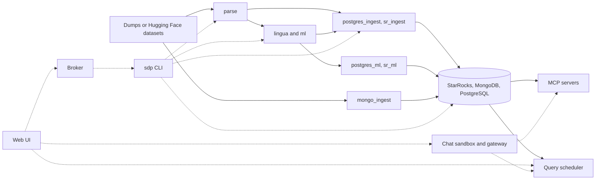

# Architecture

How Social Data Pipeline works and why, for those who change or extend it. Every page describes what exists in the code today and ends with the design decisions behind it.

A **source** is one named collection of data you add with `python sdp.py source add <name>`, such as a set of Reddit dumps or a Hugging Face dataset. Its **platform** decides how its records are read: the name `reddit` picks the Reddit platform with its own parser, and any other name a custom platform configured from your answers. All settings of a source live in `config/sources/<name>/`.

Each step of the pipeline is a **profile** (also called a stage): `parse`, `lingua`, `ml`, and the ingest profiles `postgres_ingest`, `postgres_ml`, `mongo_ingest`, `sr_ingest` and `sr_ml`. A profile is one Docker Compose service that `python sdp.py run <profile>` starts for one source. The profiles hand data to each other through the **data folders**: `dumps/` mirrors the origin, `extracted/` holds the decompressed input by data type, `parsed/` the field-selected and typed files, and `output/` the classifier results, each written only by its own stage.

The ingest profiles load the files into up to three **databases**: StarRocks for fast analytical queries, PostgreSQL as a general-purpose database, and MongoDB for the raw records. The **MCP servers**, one per database, give AI agents read-only access for quick questions. The **query scheduler** (the `jobs` profile) takes heavier queries from agents, waits for a person to approve each one, and writes the result to files.

The **broker** is a host process, next to the CLI, that runs a fixed list of typed CLI actions for a logged-in session. The **web UI** is a container that serves a page over HTTPS and works through the broker's socket, the scheduler's control socket and the chat's socket only. The **chat** is an AI assistant in a sandbox container whose only network peer is a gateway that holds the model's credential.

| Page | What it covers |
|---|---|
| [Pipeline and data folders](pipeline.md) | The stages from a dump to a database, the data folders between them, and how a stage resumes |
| [Setup and configuration](configuration.md) | The configuration layers and which one wins |
| [Platforms](platforms.md) | The platform interface, the Reddit algorithms, Hugging Face downloads, and adding a platform |
| [Classifiers](classifiers.md) | How language detection and the GPU classifiers run, and custom Python classifiers |
| [Databases and ingestion](databases.md) | How each ingest profile loads, deduplicates and resumes |
| [Credentials and auth](credentials.md) | How database authentication works and where credentials live |
| [MCP servers](mcp.md) | How the MCP servers are built and kept read-only |
| [Query scheduler](query-scheduler.md) | The lifecycle of a job, concurrency, the control socket and the assistant's endpoint |
| [Broker, web UI and chat](control-plane.md) | How the broker, the web UI and the chat connect, and what they defend against |
| [Docker layout](docker.md) | The Compose profiles and services, the images, mounts and networks, and what needs a rebuild |
| [Testing](testing.md) | The test layers, how to run each, and what each test file covers |

## Core design decisions

**Everything runs in Docker, driven by one host-side CLI.** The operator installs only Docker and Python with PyYAML, and `sdp.py` turns the configuration into the right Compose profiles, folders and passwords for each call ([Docker layout](docker.md)).

**Each stage writes only to its own data folder.** That keeps every stage restartable on its own and lets a profile resume from what is already on disk ([Pipeline and data folders](pipeline.md)).

**Decisions are made at setup and stored in config; the runtime executes the config exactly.** Setup asks the questions and writes the files, and a missing required value fails loudly with the command that fixes it instead of falling back to a guess ([Setup and configuration](configuration.md)).

**The database servers read the files themselves.** PostgreSQL and StarRocks load through server-side `COPY` and `FILES()`, so large files never stream through Python, which is why they mount the parsed and output folders ([Databases and ingestion](databases.md)).

**Agents get two doors: read-only MCP servers for quick looks, an approval queue for heavy work.** Read-only answers come in-band, while anything large or slow waits for a person and lands as files outside the agent's context ([MCP servers](mcp.md), [Query scheduler](query-scheduler.md)).

**The browser's side holds no power.** The web UI's container has a socket to the broker and nothing else of the deployment, and the broker runs only typed actions for a logged-in session ([Broker, web UI and chat](control-plane.md)).

**The chat's sandbox holds no credential.** The assistant's code runs on a network where its only peer is a gateway that adds the credential for the model's address only and forwards a fixed table of paths ([Broker, web UI and chat](control-plane.md)).
