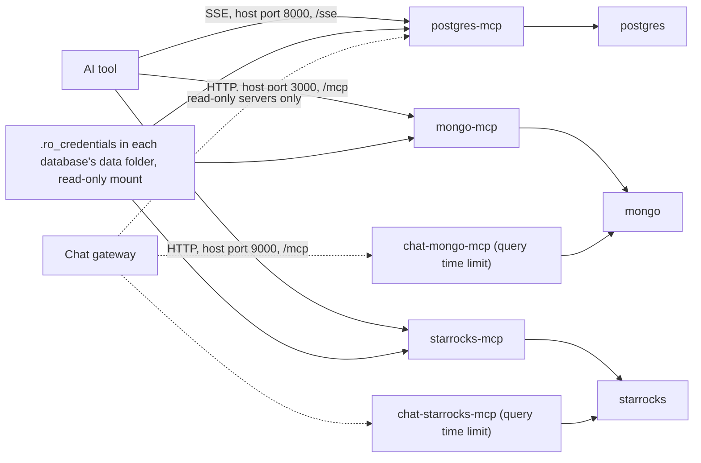

# MCP servers

Three optional MCP (Model Context Protocol) servers expose the databases to AI tools over HTTP, one per database, each in its own container next to its database. `python sdp.py db setup-mcp` writes `config/db/mcp.yaml` and the `*_MCP_*` keys in `.env`; `python sdp.py db start` starts each enabled server's `<db>_mcp` profile once its database is healthy. This page describes how each server is built, which credentials it uses, where read-only access is enforced, and what is exposed on which port. Connecting a client is on [AI access](../user-guide/ai-access.md); the query scheduler's own MCP endpoint is on [Query scheduler](query-scheduler.md).

## How it connects

An AI tool talks to each server on its published host port; each server talks only to its own database, as the read-only user when auth is on. The chat's gateway reaches `postgres-mcp` over its own network, and for MongoDB and StarRocks the chat's own copies of their servers (see [The chat's copies](#the-chats-copies-with-a-query-time-limit) and [Broker, web UI and chat](control-plane.md#the-chat)).

## How the servers are built

| Profile / service | Built from | Entrypoint | Port (container, host variable, default) | Transport, endpoint |
|-------------------|------------|------------|------------------------------------------|---------------------|
| `postgres_mcp` / `postgres-mcp` | Image `crystaldba/postgres-mcp` from Docker Hub, pulled (no tag pinned) | `config/mcp/entrypoint-postgres.sh`, bind-mounted at `/mcp-config` | 8000, `POSTGRES_MCP_PORT`, 8000 | SSE, `/sse` (messages posted to `/messages/`) |
| `mongo_mcp` / `mongo-mcp` | `Dockerfile.mcp-mongo`: `kiliczsh/mcp-mongo-server` at a pinned commit plus four patches, built with bun, run on `node:22-slim` | `config/mcp/entrypoint-mongo.sh`, copied into the image | 3000, `MONGO_MCP_PORT`, 3000 | Streamable HTTP, `/mcp` |
| `starrocks_mcp` / `starrocks-mcp` | `Dockerfile.mcp-starrocks`: `mcp-server-starrocks==0.3.0` from PyPI plus one patch, on `python:3.13-slim` | `config/mcp/entrypoint-starrocks.sh`, copied into the image | 9000, `STARROCKS_MCP_PORT`, 9000 | Streamable HTTP, `/mcp` |

The container port is fixed; the `*_MCP_PORT` variables change only the host side of the mapping. Compose builds the mongo and starrocks images the first time they are needed. Because their entrypoints are copied into the images, an edit to them takes effect only after the image is rebuilt (`docker compose --profile mongo --profile mongo_mcp build mongo-mcp`, and the same shape for starrocks); `python sdp.py db start` does not rebuild MCP images. The postgres entrypoint is bind-mounted, so an edit to it applies at the next container start.

The four MongoDB patches, applied in order on the pinned commit (there is no published image of the upstream server, and upstream connects to the single database named in its connection string):

| Patch | What it adds |
|-------|--------------|
| `config/mcp/mongo-mcp-multidb.patch` | A `database` argument on every tool and a `listDatabases` tool, since MongoDB holds one database per source and the connection URI names none |
| `config/mcp/mongo-mcp-maxtimems.patch` | `maxTimeMS` on `query`, `aggregate` and `listCollections`, so long queries can be bounded |
| `config/mcp/mongo-mcp-readonly.patch` | Hides the write tools (`insert`, `update`, `createIndex`) in read-only mode, and names `MCP_MONGODB_READONLY` in the refusal message |
| `config/mcp/mongo-mcp-query-limit.patch` | When `MCP_QUERY_TIMEOUT_SECONDS` is set, gives `query`, `aggregate`, `count` and `listCollections` a `maxTimeMS` of the smaller of the one asked and that limit, the limit when none is asked; unset, nothing changes |

Moving to a newer upstream means changing the commit in `Dockerfile.mcp-mongo` and checking that the four patches still apply in order; the build fails otherwise.

The StarRocks image applies `config/mcp/starrocks-mcp-query-limit.patch` to the installed package (`patch` without fuzz, so the build fails when it no longer fits): when `MCP_QUERY_TIMEOUT_SECONDS` is set, every connection the server takes from its pool gets `SET query_timeout = <seconds>` (the pool resets the session when a connection is given back), and a statement that names `query_timeout` is refused, so a hint such as `SET_VAR(query_timeout=...)` cannot lift the limit; unset, nothing changes. Both entrypoints accept the variable only as whole seconds from 1 to 3600 and exit with an error naming it otherwise.

What an AI tool can call through each server:

| Server | Tools |
|--------|-------|
| postgres | Tools such as `list_schemas`, `get_object_details`, `execute_sql`, `explain_query` and `analyze_db_health` |
| mongo | `query`, `aggregate`, `count`, `listCollections`, `serverInfo`, plus `listDatabases` from the patch, each with an optional `database` argument; `insert`, `update` and `createIndex` only when write access is allowed |
| starrocks | Tools such as `db_summary`, `table_overview`, `read_query` and `write_query`; `write_query` stays listed |

The manual agent checklist in `tests/agentic_mcp.md` exercises these tools against a live install, including the read-only refusals.

## Lifecycle

| Command | What it does |
|---------|--------------|
| `python sdp.py db setup-mcp` | Asks, for each configured database, whether to enable its server, which host port to use, and for PostgreSQL and MongoDB whether to allow write access (default read-only); writes `config/db/mcp.yaml` and the MCP keys in `.env`, then prints each URL (`http://<host>:<port>/sse` or `/mcp`) |
| `python sdp.py db setup-llm` | Runs `setup-mcp`, then the jobs setup |
| `python sdp.py db start` | Starts the databases with `up -d --wait`, then the enabled MCP profiles of the databases being started, and reports any MCP container that exited |
| `python sdp.py db start postgres-mcp` (or `mongo-mcp`, `starrocks-mcp`) | Starts one server; the same `up` brings its database up if it is not running |
| `python sdp.py db stop <db>-mcp` | Stops one server; the database keeps running |
| `python sdp.py db unsetup-mcp` | Stops the MCP containers and removes `config/db/mcp.yaml` and the MCP keys in `.env`; the images stay on disk. Its `docker compose down` names each database profile next to its MCP profile, so it stops the database too, although it prints that databases are not affected |

## The chat's copies with a query time limit

The shared servers above have no time limit of their own, and other MCP clients keep using them unchanged. The chat uses its own copies of the MongoDB and StarRocks servers: the compose services `chat-mongo-mcp` and `chat-starrocks-mcp`, with their own profiles (`chat_mongo_mcp`, `chat_starrocks_mcp`), so `python sdp.py db start` never starts them. They run the images Compose builds for `mongo-mcp` and `starrocks-mcp` (`sdp-mongo-mcp`, `sdp-starrocks-mcp`; never pulled, never built a second time) with the same environment and read-only data mount, publish no port, and set `MCP_QUERY_TIMEOUT_SECONDS` from `CHAT_QUERY_TIMEOUT_SECONDS` of `.env` (90 seconds when it is missing or empty). `python sdp.py chat start` starts them and attaches them to the chat's network, and `chat stop` removes them (see [What chat start does](../user-guide/chat.md#what-chat-start-does)).

PostgreSQL ignores the limit: the chat uses the shared `postgres-mcp`, which keeps its own limit (30 seconds in its restricted mode, the default).

A copy needs the images built from a version of `Dockerfile.mcp-mongo` and `Dockerfile.mcp-starrocks` that has the query-limit patches; those images carry the label `sdp.query-limit=1`, and `chat start` refuses, naming the build command, when an image is missing or lacks the label. After updating, rebuild them with `docker compose --profile mongo --profile mongo_mcp build mongo-mcp` and `docker compose --profile starrocks --profile starrocks_mcp build starrocks-mcp`.

## Which credentials a server uses

Each server uses the database's read-only user when its user variable is set: `POSTGRES_MCP_USER`, `MONGO_MCP_USER` (passed into the container as `MCP_MONGODB_USER`) or `STARROCKS_MCP_USER`. `python sdp.py db setup-mcp` writes these only when auth and a read-only user exist, and refuses to run when auth is on but a database has no read-only user or its `.ro_credentials` file is missing. The entrypoint then reads the password from the parent database's `.ro_credentials`, mounted read-only into the MCP container, and exits with an error when the file is empty or missing.

| Server | Data volume mounted read-only at | Password handed to the server as |
|--------|----------------------------------|----------------------------------|
| postgres | `/data/database` (`PGDATA_PATH`) | A `DATABASE_URI` built with the percent-encoded user and password |
| mongo | `/data/mongo` (`MONGO_DATA_PATH`) | A `mongodb://` URI with the percent-encoded user and password, `authSource=admin` |
| starrocks | `/data/starrocks` (`STARROCKS_DATA_PATH`) | `STARROCKS_USER` and `STARROCKS_PASSWORD` in the server's environment |

The entrypoints encode the password through the environment, never as a command-line argument, and log nothing of it.

When the user variable is not set (auth off), each server falls back:

| Server | Connects as |
|--------|-------------|
| postgres | `DATABASE_URI` from compose: the `postgres` user |
| mongo | The unauthenticated `mongodb://mongo:27017` |
| starrocks | `root` with an empty password |

The database entrypoint wrappers create or update the read-only user on every start, from `.ro_credentials` in the data volume. `python sdp.py db setup-mcp` only configures the MCP server settings (ports, access mode); it needs an existing read-only user when auth is on. Enabling auth after `setup-mcp` needs a `setup-mcp` re-run. `python sdp.py db unsetup-mcp` removes the MCP configuration and stops the MCP containers. How the credentials get there is on [Credentials and auth](credentials.md).

## Where read-only is enforced

Read-only is the default, and it is enforced in a different layer for each server:

| Server | Application layer | Database layer (auth on) |
|--------|-------------------|--------------------------|
| postgres | `--access-mode=restricted`, from `POSTGRES_MCP_ACCESS_MODE`; `unrestricted` when you allow write access in `setup-mcp` | Read-only role with `pg_read_all_data` |
| mongo | `--read-only` when `MCP_MONGODB_READONLY=true` (from `MONGO_MCP_READ_ONLY`, default `true`), plus the readonly patch | Read-only user with `readAnyDatabase` and `clusterMonitor` |
| starrocks | None: the server has no read-only flag and keeps its write tool | The read-only user's `sdp_readonly` role, SELECT only |

So with auth on, allowing write access in `setup-mcp` changes nothing in practice, because the read-only user cannot write. With auth off, the StarRocks MCP runs as `root` with full write access.

## Network exposure

The servers have no authentication of their own. Compose publishes each one as `"${X_MCP_PORT}:<port>"` on all host interfaces, so anyone who can reach the host's port can use it; the only access control is the database credential the server uses. On a shared or exposed machine, firewall the MCP ports or bind them to localhost in `docker-compose.override.yml`.

| Server | Published as | Reached by the chat gateway |
|--------|--------------|-----------------------------|
| postgres | `${POSTGRES_MCP_PORT:-8000}:8000` | `/sse` and `/messages/`, only when `POSTGRES_MCP_USER` is set |
| mongo | `${MONGO_MCP_PORT:-3000}:3000` | `/mcp`, only when the read-only user is set |
| starrocks | `${STARROCKS_MCP_PORT:-9000}:9000` | `/mcp`, only when `STARROCKS_MCP_USER` is set |

Each MCP service waits for its database with `depends_on: condition: service_healthy`, and under auth with a read-only user each database health check logs in as that user, so an MCP server does not start against a missing or drifted read-only user.

## Design decisions

**One server per database, each in its own container and profile.** Each database has a different best-available MCP server, and the profile split lets `sdp` start a server only when its database is configured and running, with `depends_on` ordering it after a healthy database. The cost is three images to keep current, built three different ways (pulled, patched fork, PyPI package).

**Read-only by default, enforced in the database when auth is on.** The application switches differ per server and StarRocks has none, so the dependable guard is the read-only account, which the MCP servers use whenever auth is on. The cost is that with auth off, only the switches limit writes, and the StarRocks server has full root access.

**Patch the MongoDB server rather than write one.** Upstream covers the tools needed, and three small patches at a pinned commit add multi-database access, time limits and a cleaner read-only tool list with a known diff. The cost is a source build with bun, and checking the patches whenever the pinned commit moves.

**Use the StarRocks server unpatched.** It has no read-only switch, but the `sdp_readonly` role already blocks writes when auth is on, and a pinned PyPI release is simpler to keep current than a fork. The cost is that `write_query` stays in the tool list and fails only at the database.

**No authentication on the MCP endpoints themselves.** None of the servers has an MCP-level login, so network exposure is your call (a firewall, or a localhost binding in the override file). The cost is that the default compose file publishes every server on all host interfaces.
