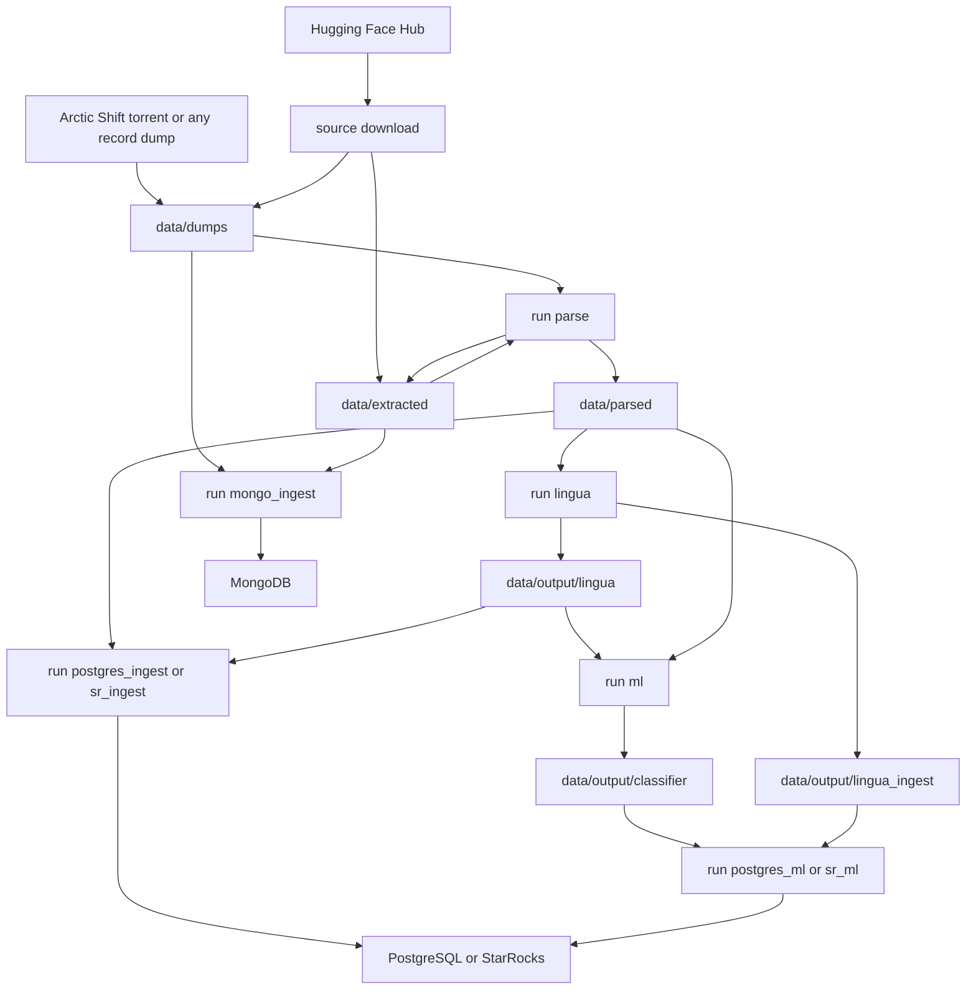

# Pipeline and data folders

The pipeline moves a source's data through four stage folders, from the raw dump to classifier output, and each profile (`python sdp.py run <profile> --source <name>`) reads one stage and writes the next. This page describes the folders and who writes them, the parse profile's three phases, and how every file stage resumes without a state file. Read it before you change what a stage reads or writes, or where it puts a file.

## How it connects

Each `run` box is a profile and its own container; each folder box is a per-source data folder on the host. The shortest useful path is `parse` and one ingest profile; the longest is `parse`, `lingua`, `ml`, a base ingest and a classifier ingest.



The two database boxes stand for the server-side loaders: PostgreSQL and StarRocks receive parsed and classified tables, MongoDB receives raw records. `postgres_ingest` can also decompress and parse by itself when `parse` was skipped (see [Databases and ingestion](databases.md)).

## Stage directories

```
data/
├── dumps/<source>/        # the origin, mirrored 1-to-1 (dumps as downloaded, HF repo layout)
├── extracted/<source>/    # decompressed or organized input, one folder per data type
├── parsed/<source>/       # field-selected and typed Parquet or CSV, one folder per data type
├── output/<source>/       # classifier results, one folder per classifier
└── database/<db>/         # database files and the ingest profiles' state files
```

**Each stage writes only to its own folder.** `dumps/` mirrors the origin, `extracted/` is organized by data type, `parsed/` is field-selected and typed, and `output/` holds classifier results. A stage finds its work by listing one folder, so a file written into the wrong stage is either invisible or processed twice.

| Folder | Holds | Written by | Read by |
|--------|-------|------------|---------|
| `dumps/` | Raw files exactly as they came from the origin; never modified | You, or `source download` (phase 1, the mirror) | Extraction (`parse`, `postgres_ingest`, `mongo_ingest`) |
| `extracted/` | Decompressed or organized input, all original fields | Extraction (in `parse`, `mongo_ingest`, and `postgres_ingest` when it extracts), or `source download` (phase 2, organize) | Parsing, `mongo_ingest` |
| `parsed/` | The configured fields only, with enforced types, as Parquet (default) or CSV | Parsing (in `parse`, and `postgres_ingest` when it parses) | `lingua`, `ml`, `postgres_ingest`, `sr_ingest` |
| `output/lingua/` | Parsed rows plus `lang`, `lang_prob`, `lang2`, `lang2_prob`, `lang_chars` | `lingua` | `ml` (lingua output), `postgres_ingest` / `sr_ingest` (with `prefer_lingua`), `parse --skip-lingua-files` |
| `output/lingua_ingest/` | Key columns plus the language columns only | `lingua`, when an ingest profile has `prefer_lingua: false` | `postgres_ml`, `sr_ml` |
| `output/<classifier>/` | Key columns, chosen extra fields and score columns | `ml` | `postgres_ml`, `sr_ml` |
| `database/` | Database files and state files | Database containers, ingest profiles | Databases |

The rule is backed by the compose mounts: a profile gets read-only access to the folders it only reads.

| Folder | Mounted read-only into |
|--------|------------------------|
| `dumps/` | `parse`, `postgres_ingest`, `mongo_ingest` (every profile that mounts it) |
| `parsed/` | `lingua`, `ml`, `sr_ingest`, and the PostgreSQL and StarRocks servers |
| `output/` | `postgres_ingest`, `postgres_ml`, `sr_ingest`, `sr_ml`, and the PostgreSQL and StarRocks servers |

Every folder is per source. `python sdp.py run` mounts the source's folders into the container as `/data/dumps`, `/data/extracted`, `/data/parsed` and `/data/output`. The host paths are set by `DUMPS_PATH`, `EXTRACTED_PATH`, `PARSED_PATH` and `OUTPUT_PATH`, or per source by `paths` in `platform.yaml` (see [Configuration reference](../user-guide/configuration.md)); a source with no `paths` gets `./data/<folder>/<source>`. Inside each folder, files sit in one subfolder per data type (`submissions/`, `comments/`, or whatever the source defines).

## The parse phases

Parse runs three phases on every start.

### Phase 1: input detection

| Scans | For |
|-------|-----|
| `DUMPS_PATH/<source>/<data_type>/` | Compressed files matching the platform's `dump` pattern |
| `EXTRACTED_PATH/<source>/<data_type>/` | Already-decompressed JSON files |
| `EXTRACTED_PATH/<source>/<data_type>/` | Parquet input files (when `input_format: parquet`, for example HF datasets) |
| `PARSED_PATH/<source>/<data_type>/` | Already-parsed files (Parquet or CSV, from `file_format` in the platform config) |

File detection is scoped to the per-data-type subfolders; files in the root of a stage folder are not detected. For Reddit, that means `RS_YYYY-MM.*` in `submissions/` and `RC_YYYY-MM.*` in `comments/` (the torrent layout). The data types come from `data_types` in the source's `parse.yaml` when it is non-empty, else from `platform.yaml`.

### Phase 2: extraction

Pending dumps are decompressed one at a time, with the tool for their format:

| Extension | Tool | Result in `extracted/<data_type>/` |
|-----------|------|------------------------------------|
| `.zst` | `zstd -d --long=31` (supports a 2 GB window) | The file without its extension |
| `.gz` / `.json.gz` | `gzip -d` | The file without `.json`; CSV files keep `.csv` |
| `.xz` | `xz -d` | The file without its extension |
| `.tar.gz` / `.tgz` | `tar -xzf` (extracts all files) | Every archive member, unpacked in place |

The compression format is detected from the file extension, or specified per data type in `platform.yaml` with the `compression` key. `.zst`, `.gz` and `.xz` output is written to a temp file (`.temp`) and renamed on success, for atomicity; a `.temp` left by an interrupted run is deleted before the file is redone. `tar` unpacks straight into the folder with no temp name. Decompressed NDJSON files have no extension; CSV files keep `.csv`.

### Phase 3: parsing

Parsing is platform-specific (see [Platforms](platforms.md)) and writes Parquet or CSV, as set by `file_format` in `platform.yaml`. With `parallel_mode` on, several files are parsed at once in `parse_workers` processes; decompression stays sequential.

| Input | Parsing |
|-------|---------|
| Reddit | Waterfall deletion detection, base-36 id conversion, format compatibility |
| Custom NDJSON | Field extraction with dot-notation and type enforcement |
| Custom CSV | Column selection, type casting, and robust handling of messy files through Polars |
| Custom Parquet (`input_format: parquet`) | Column selection, null-byte stripping and type enforcement through Polars; used for HF parquet files downloaded to `data/extracted/` |

| Output | How it is written |
|--------|-------------------|
| Parquet (default for new sources) | Typed columns through Polars / PyArrow, null-byte stripping only (no CSV escaping) |
| CSV (alternate, for external tool compatibility) | CSV with headers and full escape handling |

Parsing also writes to temp files and renames them, so a half-written output never looks finished. With `cleanup_temp` on, the extracted input is deleted once it is parsed. With `watch_interval` greater than 0 in a profile's `pipeline.yaml`, the stage keeps running and rechecks for new files every that many minutes.

## How parse resumes

Parse keeps no state file. It decides from the stage folders what is left to do:

- A compressed file that already has its decompressed file in `EXTRACTED_PATH/<source>/`, or already has a parsed output, is skipped.
- A JSON file that already has its output file (`.parquet` or `.csv`) in `PARSED_PATH/<source>/` is skipped.
- With `--skip-lingua-files`, an input whose id already has `OUTPUT_PATH/<source>/lingua/<data_type>/<id>_lingua.{csv,parquet}` is skipped too. That lets you delete extracted and parsed copies once `lingua` has consumed them, without `parse` recreating them.
- `--filter "<glob>"` narrows the run to file ids matching the glob (for example `"*2024*"`); the skip checks still apply.

Because extraction and parsing write to temp names and rename on success, an interrupted run leaves no file that a later run would mistake for finished work. The exception is a `.tar.gz` or `.tgz` dump: a stop while `tar` runs leaves partly unpacked members under their final names, and the next run takes them as complete. Deleting an output file (or its JSON) is therefore all it takes to reprocess it.

The other file stages resume the same way:

| Stage | A file is skipped when | To redo it |
|-------|------------------------|------------|
| `parse`, decompression | `extracted/<type>/<id>` or the parsed output already exists | Delete both |
| `parse`, parsing | `parsed/<type>/<id>.parquet` (or `.csv`) exists | Delete the parsed file |
| `lingua` | `output/lingua/<type>/<id>_lingua.<ext>` exists | Delete it, or the whole `output/<source>/lingua/` |
| `ml` | `output/<classifier>/<type>/<id><suffix>.<ext>` exists | Delete it, or the classifier's folder |
| Ingest profiles | The file is listed in the profile's state file | See [Databases and ingestion](databases.md#state-tracking-and-recovery) |

## Design decisions

**Each stage writes only to its own folder.** Every folder answers one question (raw as received, decompressed and organized, typed field subset, classifier result), so every stage finds its work by listing one folder, and the Hugging Face downloader mirrors the repository into `dumps/` before a separate organize step copies files into `extracted/<data_type>/`. The cost is disk space: the same records exist as a dump, an extracted copy and a parsed copy unless you turn on `cleanup_temp` or delete them by hand.

**A file stage counts a file as done when its final output exists, with no state file.** For `parse`, `lingua` and `ml`, the output file is the record of completion, and deleting it is how you ask for a redo. The cost is that a stage never notices a config change: after changing fields, types or a classifier's settings, you delete the affected outputs yourself.

**Writers use a temp name and rename at the end.** A stop at any moment leaves at most a `.temp` file, which the next run deletes before it redoes that one file. The cost is the `tar` exception: `.tar.gz` and `.tgz` members are unpacked under their final names, so an interrupted unpack must be cleaned up by hand.

**Each stage is its own profile and container.** CPU parsing, CPU Lingua, a GPU image with PyTorch and ONNX Runtime, and light loader images have different dependencies, and you can run stages days apart, on whatever hardware is free, and repeat one without touching the others. The cost is one `python sdp.py run` per stage: there is no single command that runs the whole chain.

**Database stages keep JSON state files instead.** A database load leaves no file to check, so the ingest profiles record each loaded file in a state file, and `postgres_ingest`, `sr_ingest` and `mongo_ingest` rebuild an empty one from what the database holds. The cost is that `postgres_ml` and `sr_ml` cannot rebuild a lost state file and reload everything.
