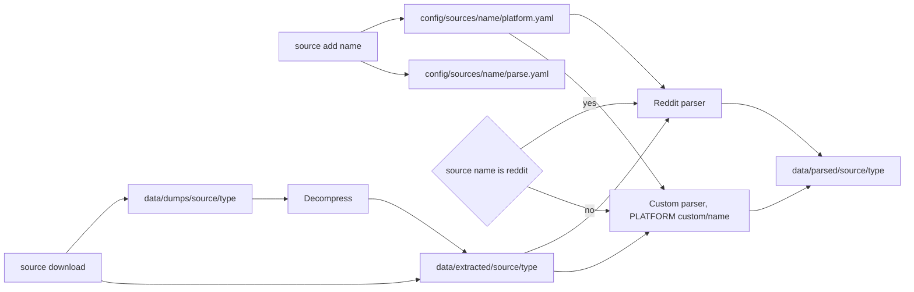
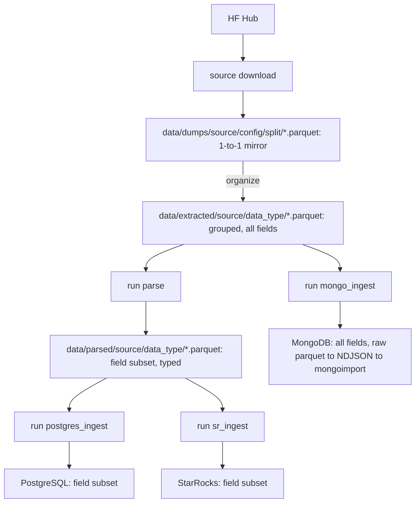

# Platforms

A platform is the code and config that turn one kind of raw record into typed rows: which files belong to which data type, which fields to extract, and any computed fields. There are two kinds: the built-in Reddit platform, with its own parser, and custom platforms, which are config only and share one generic parser. This page describes how a source gets its platform, the Reddit algorithms, the custom parser, the Hugging Face flow, and what adding a platform takes.

## How it connects



The source's name picks the parser; `platform.yaml` tells that parser which files, fields and types to use. Both parsers read `extracted/` and write `parsed/`.

## How a source gets its platform

| Term | What it is | Where it lives |
|------|------------|----------------|
| Source | One dataset with its own folders, config and database namespace (PostgreSQL schema, MongoDB and StarRocks database) | `config/sources/<name>/`, `data/*/<name>/` |
| Platform | The parser module used for a source's files | `social_data_pipeline/platforms/reddit/` or `platforms/custom/` |
| Data type | A category of records within a source, each with its own field list, folder and table | `data_types` and `fields` in `platform.yaml` |

The source name decides the platform. A source named `reddit` gets `PLATFORM=reddit`; every other name gets `PLATFORM=custom/<name>`. There is no platform question in `python sdp.py source add`: the name alone decides, in setup (`setup/source.py`), in `sdp.py` and in `setup/utils.py`. `python sdp.py run` passes `PLATFORM` to the container alongside `SOURCE`, which picks the config folder.

The parse profile delegates to a platform-specific parser based on the `PLATFORM` environment variable:

| Platform | Parser | What it does |
|----------|--------|--------------|
| `reddit` (default) | `social_data_pipeline/platforms/reddit/parser.py` | Deletion detection, base-36 id conversion, retrieval-time format compatibility, lowercased `author` and `subreddit` (below) |
| `custom/<name>` | `social_data_pipeline/platforms/custom/parser.py` | JSON, CSV and Parquet parsing with configurable field extraction and type enforcement; Parquet input is used for Hugging Face datasets |

| | Reddit | Custom | Hugging Face |
|---|---|---|---|
| Created by | `python sdp.py source add reddit` | `python sdp.py source add <any other name>` | `python sdp.py source add <name> --hf <dataset_id>` |
| Parser | `platforms/reddit/parser.py` | `platforms/custom/parser.py` | The custom parser with `input_format: parquet` |
| Input | NDJSON dumps `RS_YYYY-MM.*` and `RC_YYYY-MM.*` in `submissions/` and `comments/` | NDJSON, CSV or Parquet, names matching the patterns set at setup | Parquet files fetched by `python sdp.py source download` |
| `dataset` column | The month from the file name (`RC_2024-01` gives `2024-01`) | The file's name without extension | The file's name without extension |
| Computed fields | `is_deleted`, `removal_type`, `id10`; `retrieved_utc` from older or newer field names | None | None |
| File patterns | From the template | Built from a glob you type at setup | Generated from the dataset's configs |

Every output starts with the `dataset` column, followed by the fields configured for that data type. For NDJSON input, lines that are not valid JSON are counted and logged to `parsing_errors_<data_type>.log`.

## Reddit

The Reddit parser adds three computed behaviours on top of field extraction, and lowercases `author` and `subreddit`. The user-level meaning of each field is on [Reddit dumps](../user-guide/reddit.md).

### retrieved_utc format compatibility

The parser sets `retrieved_utc` from several sources, in this priority:

| Priority | Format | Source |
|----------|--------|--------|
| 1 | Modern format | `retrieved_utc` directly |
| 2 | Old format | `retrieved_on`, if `retrieved_utc` is missing |
| 3 | New format (2023-11+) | `_meta.retrieved_2nd_on` when available, replacing either of the above, since the second retrieval is more reliable |
| 4 | Pre-2010 Arctic Shift dumps | No retrieval metadata exists, so the column ingests as NULL |

The database column is nullable because pre-2010 dumps genuinely lack retrieval timestamps; forcing `NOT NULL` would make every row from those dumps fail COPY. Deduplication treats NULL as smallest, so a real timestamp always wins over NULL when the same id appears across mixed-era dumps. See [Databases and ingestion](databases.md#fast-initial-load-new-tables) for the full ORDER BY.

### id10 (base-36 conversion)

Reddit ids are base-36 (digits 0-9 and letters a-z). The `id10` field holds the base-10 equivalent as a `bigint`, for applications that need numeric ids or sorting. It is computed only when `id10` is listed in the platform config `fields`.

### is_deleted and removal_type (waterfall algorithm)

The parser detects deleted and removed content with a waterfall: it checks several data sources in priority order, and the first match wins.

| Priority | Source field | Era | Detection |
|----------|--------------|-----|-----------|
| 1 | `_meta.removal_type` | 2023-11+ | Arctic Shift ground truth, passed through as the canonical value |
| 2 | `_meta.was_deleted_later` | 2023-11+ | Marks as deleted, then keeps checking for a specific removal type |
| 3 | `removed_by_category` | 2018+ | Gold standard from the Reddit API |
| 4 | `spam` (boolean) | 2020+ | Reddit API spam flag |
| 5 | `removed` (boolean) | 2020+ | Reddit API removed flag |
| 6 | `banned_by` | 2008-2018 | Legacy field: `true` = Reddit spam filter, `"AutoModerator"` = automod, any other string = moderator |
| 7 | Text content | All | `[deleted]` or `[removed]` markers in `body` / `selftext` |
| 8 | `author` | All | `author == '[deleted]'` |

The `removed_by_category` field (priority 3) maps to the canonical `removal_type` values:

| `removed_by_category` | `removal_type` |
|-----------------------|----------------|
| `deleted`, `author` | `deleted` |
| `moderator` | `moderator` |
| `reddit`, `anti_evil_ops`, `admin` | `reddit` |
| `automod_filtered` | `automod_filtered` |
| `content_takedown` | `content_takedown` |
| `copyright_takedown` | `copyright_takedown` |
| `community_ops` | `community_ops` |
| Unknown categories | `moderator` (conservative default) |

## Custom platforms

Custom platforms (`PLATFORM=custom/<name>`) parse JSON, CSV and Parquet into Parquet or CSV for arbitrary data sources, with no platform-specific logic: pure data transformation, no assumptions about content. Each custom source has one self-contained `config/sources/<name>/platform.yaml`, with no merging. Field types defined there are enforced during parsing.

| Input | How the custom parser reads it |
|-------|--------------------------------|
| NDJSON (`input_format: ndjson`, the default) | Line by line: field extraction with dot-notation (`user.profile.name`) and array indexing (`items.0.id`), then type enforcement |
| CSV (`input_format: csv`) | Column selection and type casting through Polars, streamed in batches, which handles ragged rows, encoding issues, mixed quoting and configurable delimiters (comma, tab, pipe; `input_csv_delimiter`) |
| Parquet (`input_format: parquet`) | Column selection, null-byte stripping and type enforcement through Polars; used for Hugging Face parquet files downloaded to `data/extracted/`. A configured field missing from the file becomes a null column, with a warning |

| Output (`file_format` in `platform.yaml`) | What changes |
|-------------------------------------------|--------------|
| `parquet` (setup's default) | Typed columns, zstd compression, row groups of `parquet_row_group_size` rows; text keeps its newlines, only NUL bytes are removed |
| `csv` | Header row, text values quoted and escaped |

The setup questions for custom sources are on [Your own data and Hugging Face](../user-guide/custom-data.md).

## Hugging Face datasets

### How `--hf` works

`python sdp.py source add <name> --hf <dataset_id>` does the following:

1. **Fetches metadata** from the Hugging Face API: dataset configs, field names and feature types.
2. **Groups HF configs by schema**: configs with identical field sets are grouped together.
3. **Interactive data type assignment**: you name each group (for example `comments`, `submissions`) and select which fields to include.
4. **Type auto-mapping**: HF feature types are mapped to SDP SQL types (`string`→`text`, `int64`→`bigint`, `float`→`float`, `bool`→`boolean`). Unmappable types (sequences, structs) can be skipped, cast to text, or given a custom type.
5. **Generates platform.yaml** with `input_format: parquet`, `hf_dataset`, `hf_config_map` and auto-generated file patterns.

### How `source download` works

`python sdp.py source download <name>` uses the HF Hub parquet API in two phases:

1. **Download**: mirrors the HF repo 1-to-1 into `data/dumps/<source>/<config>/<split>/<index>.parquet`.
2. **Organize**: copies the files into `data/extracted/<source>/<data_type>/`, using the config-to-data-type mapping from setup. File names keep the source file name (prefixed with the config name when a data type groups several configs), so a re-run after upstream adds shards copies only the new files.

| Behaviour | How |
|-----------|-----|
| Resume | Skips files whose local size matches the remote `Content-Length`; organize skips files already in `extracted/` with the same size |
| Atomic writes | Downloads to a `.partial` suffix and renames on completion |
| Selective download | `--data-type` organizes only one data type |
| Private datasets | `--token`, or the `HF_TOKEN` environment variable |

### Pipeline flow



The dumps folder keeps the original HF repo structure for inspection and re-organization. PostgreSQL and StarRocks get the configured field subset through parse. MongoDB can ingest raw parquet directly from `data/extracted/`, keeping all original HF columns (minus any `mongo_exclude_fields`).

## Adding a new platform

There are two ways to support a new platform.

| Way | When | Code needed |
|-----|------|-------------|
| Custom platform (recommended) | Data is standard JSON/NDJSON, CSV or Parquet | None |
| Built-in platform with its own parser | The platform needs specialized logic (computed fields, format handling), like Reddit's deletion detection or base-36 id conversion | A parser, a template, and changes in setup and `sdp.py` |

### Custom platform

Run `python sdp.py source add <name>` with any name other than `reddit`. The source becomes `custom/<name>`, and the interactive setup generates `config/sources/<name>/platform.yaml` with file patterns, fields, types and indexes. See [Your own data and Hugging Face](../user-guide/custom-data.md).

### Built-in platform

A built-in platform needs code in several places, because only Reddit is wired in today.

**1. Create the platform template.** Write `config/templates/<platform>.yaml` with all sections (`db_schema`, `data_types`, `file_patterns`, `indexes`, `field_types`, `fields`). Setup reads only `config/templates/reddit.yaml` today (`setup/source.py`, `generate_reddit_platform_yaml`, and `setup/reddit.py`, `REDDIT_TEMPLATE`), so a new template is read only once setup is changed to copy it into `config/sources/<name>/platform.yaml`.

**2. Create the parser module.** Write `social_data_pipeline/platforms/<platform>/parser.py` with these functions:

```python
def transform_json(data, dataset, data_type_config, fields_to_extract, file_format='csv'):
    """Transform a single JSON record into a list of values."""
    ...

def process_single_file(input_file, output_file, data_type, data_type_config, fields_to_extract,
                        file_format='csv', parquet_row_group_size=0):
    """Process a single JSON file to Parquet/CSV. Returns (input_size, output_file)."""
    ...

def parse_to_csv(input_file, output_dir, data_type, platform_config, use_type_subdir=True):
    """Main entry point. Parse a JSON file to Parquet/CSV. Returns output path."""
    ...

def parse_files_parallel(files, output_dir, platform_config, workers):
    """Parse multiple files in parallel. Returns list of (output_path, data_type)."""
    ...
```

**3. Register the parser.** `get_platform_parser()` takes no argument and reads the `PLATFORM` environment variable. It exists in two copies, `social_data_pipeline/orchestrators/parse.py` and `social_data_pipeline/orchestrators/postgres_ingest.py`; add the new platform to both:

```python
def get_platform_parser():
    if PLATFORM == 'reddit':
        from ..platforms.reddit import parser
        return parser
    elif PLATFORM == 'my_platform':
        from ..platforms.my_platform import parser
        return parser
    elif PLATFORM.startswith('custom/'):
        from ..platforms.custom import parser
        return parser
    else:
        raise ConfigurationError(f"Unknown platform: {PLATFORM}. Supported: reddit, custom/<name>")
```

**4. Map the source name to the platform.** The name-to-platform rule (`reddit` or `custom/<name>`) is repeated in each of these places, and each must learn the new name:

| File | Where |
|------|-------|
| `social_data_pipeline/setup/source.py` | `run_questionnaire` (decides the platform), and the `platform == "reddit"` / `startswith("custom/")` branches that pick the questions and the generated files |
| `social_data_pipeline/setup/utils.py` | `require_source_state` |
| `social_data_pipeline/setup/classifiers.py` | The `platform == "reddit"` branches |
| `sdp.py` | `do_run_start` (sets `PLATFORM` for a run), `cmd_source_configure`, `_interactive_mongo_indexes` |

**5. Run.**

```bash
python sdp.py source add <name>
python sdp.py run parse --source <name>
```

## Design decisions

**Custom parsing is configuration, Reddit parsing is code.** Most record dumps need only field selection and typing, which a YAML field list expresses, while Reddit carries years of API changes (removal signals, renamed timestamp fields, base-36 ids) that need real logic. The cost is that a second platform with its own logic is a code change in several files, not a config entry.

**The platform follows from the source name, not from a setting.** There is no platform question to get wrong: `reddit` is Reddit and every other name is custom. The cost is that the name check is repeated in `sdp.py` and the setup modules, and a new built-in platform must change every copy.

**Raw is kept and organizing is a separate step.** Hugging Face downloads go to `dumps/` as a 1-to-1 mirror and only then get copied into `extracted/` by data type, so regrouping configs needs no new download and `dumps/` always shows what the origin published. The cost is that the Parquet files are stored twice, once in each folder.

**Parquet is the default output.** Parquet keeps types and the original text, compresses well, and is read directly by PostgreSQL (`pg_parquet`), StarRocks and the classifiers. The cost is that code finding no `file_format` assumes CSV, so an older `platform.yaml` without the key keeps producing CSV.

**Parsing streams with bounded memory.** NDJSON and CSV inputs are processed row by row or in batches, and Parquet output is written one row group at a time, so a multi-hundred-gigabyte monthly dump parses in fixed memory. The cost is the Parquet-input exception: the selected columns of each input file are loaded whole into memory before writing.
