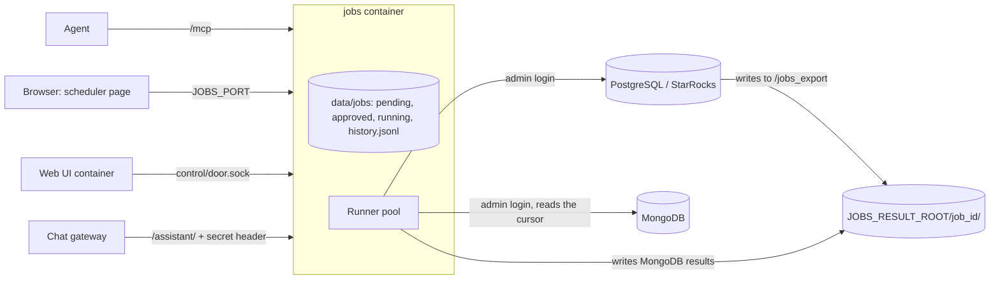

# Query scheduler

The query scheduler is the `jobs` container: a web page, an MCP endpoint and a runner in one process, in front of the configured databases. Agents submit queries over MCP, a person approves them on the page (or in the web UI's Queue window, through the scheduler's control socket), and the runner executes each approved query so that the result lands as files on disk. The job store on disk is the source of truth. This page describes how a job moves through the store, how the runner bounds and resumes work, the control socket, and the second endpoint that serves the chat's assistant. What a user sets and runs is in the [Query scheduler](../user-guide/query-scheduler.md) guide.

## How it connects



PostgreSQL and StarRocks write the result file themselves: the runner wraps the query in `COPY (...) TO '/jobs_export/<job_id>/<output_filename>'` (PostgreSQL) or `... INTO OUTFILE "file:///jobs_export/<job_id>/<stem>_"` (StarRocks, which splits the output into `<stem>_0.<ext>`, `<stem>_1.<ext>`, ...). `/jobs_export` is the results folder mounted into those database containers. MongoDB has no server-side export, so the runner reads the aggregation cursor and writes the NDJSON or CSV file itself. The container layout is in [Docker layout](docker.md).

## Lifecycle of a job

```
[agent submits via MCP]
        ↓
   pending/<job_id>.json     ── visible in the page's "Pending" tab
        ↓ human clicks Approve (or auto-accept)
   approved/<job_id>.json    ── runner picks it up
        ↓
   running/<job_id>.json     ── backend is executing it
        ↓
   history.jsonl             ── one line appended: done | failed | rejected | cancelled
```

Each live phase is a folder under `data/jobs/` with one JSON file per job, and every transition is an atomic rename between sibling folders. A job that ends is appended as one line to `data/jobs/history.jsonl`, which is append-only and never pruned. `history_retention` (default 500) is how many of its newest entries the History tab shows.

| Status | Where it is | Who can stop it |
|---|---|---|
| `pending` | `pending/` | A person (Reject) or the agent (`query_cancel`) |
| `approved` | `approved/` | Nobody: this phase has no cancel |
| `running` | `running/` | A person (Kill) |
| `done`, `failed`, `rejected`, `cancelled` | `history.jsonl` | |

## Concurrency and resume

| Rule | What it does |
|---|---|
| `max_concurrent` | Caps how many jobs run in parallel: each gets one thread from a `ThreadPoolExecutor`. Setup suggests 20; the committed `config/jobs/config.yaml` has 5. Approved jobs beyond the cap stay in `approved/` until a slot frees up. |
| Poll loop | Once a second the runner first auto-accepts what it may, then claims approved jobs, oldest first, up to the cap. |
| Auto-accept | Per target, with a limit between 0 and `max_concurrent`. A target's pending jobs are approved oldest first while its approved plus running jobs stay under the limit. Kept in `data/jobs/auto_accept.json`; a target never switched on stays off. A query of the chat's assistant is never auto-accepted. |
| Restart | The store on disk is the source of truth: jobs in `pending/` and `approved/` resurface. Jobs caught mid-execution in `running/` are marked failed ("runner restarted; job aborted") on the next start and their result folder is removed. Nothing re-runs by itself; the agent can resubmit. |
| Failure | A failed or killed job has its partial output deleted. |
| File permissions | The scheduler's entrypoint sets `umask 0000`, and after each job that finishes the runner makes its folder readable (folders 0755, files 0644), because the database servers write as their own users and you need to read the result. |

## The control socket

When its data folder (`data/jobs` on the host) belongs to a user other than root, the scheduler opens a unix socket at `data/jobs/control/door.sock` for that user, the operator. The folder is made with mode 0700 and the socket with mode 0600, both given to the owner of `data/jobs`; a connection from any other user (root included) is closed without a reply.

The web UI's Queue window uses it (see [The Queue window](../user-guide/webui.md#the-queue-window)): `python sdp.py webui start` mounts the control folder read-only into the web UI's container. Through it a program of the operator can:

| Operation | What it does |
|---|---|
| List | The jobs of each tab |
| Read | One job, with a digest of what it runs |
| Approve | Only when that digest still matches the job as it is at that moment |
| Reject, kill | Reject with a reason; kill a running job |
| EXPLAIN | Runs EXPLAIN on an admin connection, like the page's EXPLAIN button |
| Preview | A finished result |
| Auto-accept | Change the auto-accept settings |

Who approved or rejected a job, and who asked to kill it, through the socket is kept in its record (`acted_by`). The kill's label names who asked: it is set on a job that may still finish by itself, and it is lost when the scheduler restarts before the job is retired. Every approval, rejection, kill, EXPLAIN and auto-accept change through the socket is logged twice, the attempt and its outcome. The scheduler's own page, its port and its password gate work as they do without the socket.

### When the socket stays closed

`python sdp.py db setup-jobs` makes `data/jobs` as the operator. If Docker made it instead (a `db start jobs` before setup), it belongs to root and the socket stays closed. Each reason the socket stays closed is one line in the scheduler's log (`docker logs <jobs container>`), beginning with "the control socket stays closed:":

| Reason in the log | What to do |
|---|---|
| the data folder cannot be opened | Check that `data/jobs` exists and is a folder |
| the data folder belongs to root | `sudo chown <you>:<your group> data/jobs`, then restart the scheduler |
| others may write into the data folder | `chmod o-w data/jobs`, then restart the scheduler; anyone could otherwise move the control folder away. Write for the folder's group is accepted (a private group of your own is the common default) |
| the results folder is the data folder or contains it | Set `JOBS_RESULT_ROOT` (`python sdp.py db setup-jobs`) to a folder that is not `data/jobs` and does not contain it: the database servers can write into the results folder |
| the results folder lies inside the control folder | Set `JOBS_RESULT_ROOT` to a folder outside `data/jobs/control` |
| the results folder cannot be looked at | Check that the results folder exists; it also stays closed when the folders up to three levels below the results folder (job folders aside) hold more than 10,000 entries |
| the control folder is not a real folder | Remove the link or file at `data/jobs/control`; the scheduler makes the folder at its next start |
| the control folder belongs to another user than the data folder | `sudo chown <owner of data/jobs> data/jobs/control` |
| the control folder is open to the group or to others | `chmod 700 data/jobs/control` |
| the control folder could not be made or given to the data folder's owner, or cannot be used | Check the permissions of `data/jobs` |
| something other than a socket is in the place of door.sock | Remove `data/jobs/control/door.sock` |
| the socket could not be made, or its thread could not be started | Restart the scheduler; a socket left by a scheduler that was killed is replaced by itself |

The scheduler never deletes or re-creates `data/jobs/control` itself. The socket is removed when the scheduler stops. The scheduler's code is in its image, so `python sdp.py db start jobs` (which rebuilds the image) is what brings the socket to a running deployment.

## The assistant's endpoint

The scheduler also serves a second MCP server and a results route for the chat's assistant (see [The query queue](../user-guide/chat.md#the-query-queue)), under `/assistant/` of its port: `/assistant/mcp` (Streamable HTTP) and `/assistant/results/<job id>` and `/assistant/results/<job id>/<part>`. The `/mcp` endpoint, the page and their behaviour for every other request are the same as without it.

- **The secret.** A request under `/assistant/` must carry the header `x-sdp-assistant` with the secret held in `data/jobs/control/assistant.secret`: a regular file (a link is not followed) of 64 to 256 lowercase hex digits. `python sdp.py chat start` writes it (32 random bytes as hex, mode 0600) when the scheduler runs and the control folder is there, keeps a valid one, and gives the chat's gateway a copy; nothing else writes it, and it is never printed. Without the file, without the header or with a wrong secret, the scheduler answers with the same 404 as for a path it does not have; it only counts such requests in its log. The file is looked at on every request, so a new secret takes effect without a restart.
- **Marked queries.** A query submitted through `/assistant/mcp` carries `submitted_by: "assistant"` in its record (a record without it is written exactly as before). Such a query is never auto-accepted, whatever its target's auto-accept setting: it waits until a person approves it on the page or in the web UI's Queue window. The control socket's job lists show `submitted_by` for such a query, and the web UI's Queue window labels it "Submitted by the chat's assistant" in its rows, on its page and on the confirm pages of its actions (see [Queries the chat's assistant submitted](../user-guide/webui.md#queries-the-chats-assistant-submitted)); the scheduler's own page does not show the mark.
- **The tools.** The same submit tools as on `/mcp` (each query they make is marked) and `list_targets`; not `list_mongo_databases`, which uses the database's admin login without anyone's approval (the assistant finds MongoDB's databases through the read-only MongoDB MCP server instead). A submission's query text may be at most 1,000,000 characters (a Mongo pipeline: as compact JSON before it is checked and as the indented JSON that is stored, and at most 32 levels deep) and its description at most 2,000; a longer one is refused. A Mongo submission without a database is refused with a pointer to the read-only MongoDB MCP server. `query_status` and `query_cancel` take only the scheduler's job ids and only marked queries, and answer "no such job" for any other id. Nothing lists other queries.
- **The results.** `GET /assistant/results/<job id>` lists the parts of a finished marked query (`{"parts": [{"index", "name", "size"}]}`); `GET /assistant/results/<job id>/<part>` sends one part as `application/octet-stream`, at most two at a time (and at most four listings at a time; beyond that the answer is 429). The parts are found as the control socket's preview finds them: in the query's folder under the results folder, only the output file's own name or `<stem>_<n><ext>`, and only regular files, looked at without following a link; a download opens only the part asked for. Anything else is the same 404; when the file system fails while the parts are found (too many open files, a part that went away), the request is refused with 503 rather than answered with a shorter list.

## Design decisions

**A person approves each query; no read-only fence does.** The read-only MCP servers answer in-band and are only as read-only as their server switch and account make them, and direct database clients are unsafe to hand to an agent. The scheduler lets an agent ask for heavy work while a person reads the query and its description before it runs. The cost is that the runners connect with the admin accounts, so the approval, not the account, is the safety mechanism, and every query waits for a person unless its target is opted into auto-accept.

**The database writes the result file.** For PostgreSQL and StarRocks the query is wrapped in the server's own export, so large results never stream through Python. The cost is a shared results folder mounted into the database containers (which `setup-jobs` adds, so they must be restarted once), plus `umask 0000` and a permission fix after each job so that you can read what the servers wrote; MongoDB still streams through the runner.

**The file system is the store.** Jobs are JSON files moved between phase folders by atomic renames, plus an append-only history file, so a crash leaves every job in exactly one place and there is nothing to migrate or back up beyond `data/jobs/`. The cost is that `history.jsonl` grows without bound and the History tab reads it to show the newest `history_retention` entries.

**A submission is checked when the agent submits it.** The target, the file name and extension, and for MongoDB CSV the pipeline's last stage are checked at submit time, so a bad request fails in the agent's turn instead of after you approve it. The cost is that the same rules live in two places: the backend checks the file name again when it runs the job.

**Auto-accept is per target and capped.** An earlier master switch was removed (old state files that still carry it are read and the field ignored), so the only way to auto-approve is to opt a single target in, and the cap counts approved as well as running jobs so that a backlog cannot slip past it. The cost is one setting per target to manage, and the assistant's queries are excluded from it altogether.

**An approval through the socket names what was shown.** The Queue window approves with a digest of the job's target, backend, statement, output file, overwrite, collection and database, and the scheduler recomputes it right before approving. The cost is that an approval of a job changed in between is refused ("changed") and must be made again from a fresh page.

**The page's password gate reuses the database admin password and keeps no state.** The signing key of its session cookie lives only in the process's memory, so no new secret is written to disk and a restart revokes every session. The cost is that every restart of the container logs everyone out, and the `/mcp` endpoint is not behind the gate: whoever reaches the port can submit jobs, as with the other MCP servers.
