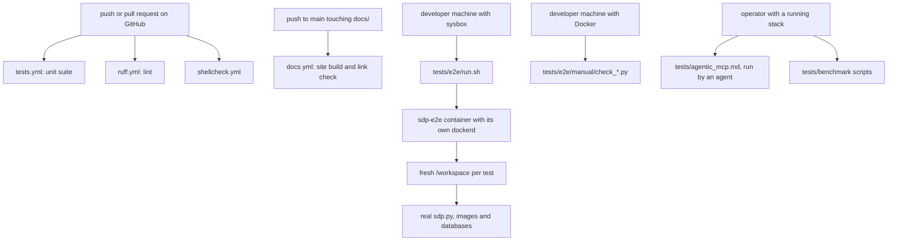

# Testing

The project is checked in layers, from seconds to hours: unit tests on every push in GitHub Actions, an end-to-end suite and hand-run checks against a real Docker on a developer machine, an agentic checklist against a running stack, and benchmarks on real data. Much of the orchestration glue is LLM-written, so tests are the load-bearing way to catch regressions. This page lists the layers and how to run each, the layout of `tests/`, what each test file covers, how to add a test and how to swap the test data.

## How it connects



## The layers

| Layer | Where | What it covers | How it is run | Where it runs |
|---|---|---|---|---|
| Unit | `tests/` except `e2e/` and `benchmark/` | Pure logic: config loading and merge, parsers, state files, dedup and index SQL shape, setup helpers and generators, the CLI's commands with Docker replaced by stand-ins, the broker's library, the scheduler's store, runner and validation, the web UI's routes through FastAPI's test client, the gateway and the chat's runner against stand-ins on loopback | `pytest` (below) | GitHub Actions on every matching push or pull request; locally in seconds |
| E2E | `tests/e2e/tests/` | Full operator flows with real containers: parse, ingest into each database, auth setup and migration, idempotent re-runs, recovery, unsetup, mount drift, the canonical smoke run | `./tests/e2e/run.sh` | A developer machine with sysbox 0.7.0 or newer; never in CI |
| Hand-run checks | `tests/e2e/manual/` | The run store, the broker, the web UI, the scheduler's control socket and the chat against a real Docker, some in headless Chromium | `python tests/e2e/manual/<script>.py` | A developer machine with Docker; no sysbox, no database |
| Agentic MCP | `tests/agentic_mcp.md` | The four MCP servers as an agent sees them: discovery, reads, refused writes, a scheduler round of submit, approve and done | Point an agent at the file with the four servers connected; a person approves its jobs | Your own running stack |
| Benchmark | `tests/benchmark/` | How much a setting buys (today: StarRocks LZ4 against ZSTD); no assertions | `tests/benchmark/sr_compression.sh` by hand | A populated database; minutes to hours |

## Running the unit tests

```bash
pip install -r requirements-test.txt
pytest --override-ini="pythonpath=." --ignore=tests/e2e --ignore=tests/benchmark --ignore=data -v
```

| Option | Why |
|---|---|
| `--override-ini="pythonpath=."` | Lets pytest import the project package without installing it |
| `--ignore=tests/e2e` | The E2E suite needs sysbox |
| `--ignore=tests/benchmark` | Benchmarks need a populated database and run for minutes to hours |
| `--ignore=data` | Skips the runtime database volumes, which are owned by container users while containers run and unreadable by pytest's collection. CI has no `data/`, so it leaves the flag out |
| `-m "not slow"` | Skips the slow decompression tests (marker `slow`) |

`requirements-test.txt` holds pytest and pyzstd, the project's light dependencies (pyyaml, polars, pyarrow) and FastAPI, Jinja2 and httpx for the web UI's route tests. It has no lingua, psycopg, database drivers or torch: tests of code that imports them replace those modules with stand-ins (the scheduler's tests install theirs in `tests/jobs/conftest.py`). The web UI's route tests are skipped (through `pytest.importorskip`) where FastAPI, Starlette or Jinja2 is missing; its tests of pure parts run everywhere.

## CI

Four GitHub Actions workflows:

| Workflow | File | Runs on | What it runs |
|---|---|---|---|
| Tests | `.github/workflows/tests.yml` | Push and pull request touching `**/*.py`, `requirements*.txt`, `tests/**` or `config/**/*.yaml`; manual dispatch | Python 3.13, `pip install -r requirements-test.txt`, the unit suite with `--ignore=tests/e2e --ignore=tests/benchmark` |
| Ruff | `.github/workflows/ruff.yml` | Push and pull request touching `**/*.py` or `ruff.toml`; manual dispatch | `ruff check .` with ruff 0.15.12 in its container, against the narrow rule set of `ruff.toml` (F, E9, W6) |
| ShellCheck | `.github/workflows/shellcheck.yml` | Push and pull request touching `**/*.sh`; manual dispatch | ShellCheck (`ludeeus/action-shellcheck` v2.0.0) over the repository's shell scripts, such as the entrypoints in `config/` |
| docs | `.github/workflows/docs.yml` | Push to `main` touching `docs/**` or the workflow itself; manual dispatch | Builds the site from `docs/` with GitHub's Pages build, checks every internal link and image of the built site, and deploys it to GitHub Pages |

The actions of the tests, ruff and ShellCheck workflows are pinned to full commit hashes; the docs workflow uses the actions' version tags. Pytest output goes to the step log; nothing is uploaded. The path filters mean some changes run nothing: a workflow file alone, `pyproject.toml`, Dockerfiles, `docker-compose.yml`, the scheduler's HTML templates or `*.conf` files. No workflow builds an image, and the E2E suite cannot run on standard GitHub runners because they lack sysbox.

The local equivalents: `docker run --rm -v "$PWD":/io -w /io ghcr.io/astral-sh/ruff:0.15.12 check .` and `git ls-files -z '*.sh' | xargs -0 shellcheck`.

## Test layout

```
tests/
├── conftest.py                  # Root fixtures (fixture paths, NDJSON helpers) and markers (slow, postgres, mongo)
├── fixtures/                    # NDJSON, CSV, config and state fixtures
├── test_cli_help.py             # Smoke: every subcommand's --help exits 0
├── test_cli_db_start.py         # db start: the probe for services that exited after up
├── test_runstore.py             # The run store: records, logs, locks, terminal runs found through Docker
├── agentic_mcp.md               # The checklist for an agent against the four MCP servers
├── chat/                        # The chat's runner and its two back ends, against stand-ins
├── classifiers/                 # Lingua's batched file readers
├── control/                     # The verb registry, its typed inputs and the broker's library
├── core/                        # Config, parser, state, decompression, classifier and index plans
├── db/                          # The SQL shape and contract checks of ingestion
├── gateway/                     # The chat's gateway against stand-in upstreams on loopback
├── jobs/                        # The query scheduler
├── orchestrators/               # Parse file detection
├── platforms/                   # The Reddit and custom parsers
├── setup/                       # The CLI's commands, generators and status output (golden files in setup/golden/)
├── webui/                       # The web UI
├── e2e/                         # Sysbox-backed end-to-end tests
│   ├── Dockerfile.e2e           # The sysbox image: Ubuntu 24.04, Docker CE, Python 3.13, the test dependencies
│   ├── run.sh                   # Host-side runner: build, start the sysbox container, run pytest in it
│   ├── questions.yaml           # Tagged-prompt dictionary
│   ├── conftest.py              # Per-test workspace lifecycle, the smoke marker
│   ├── helpers/                 # pexpect wrapper, fixtures, workspace, database assertions
│   ├── tests/                   # Test scenarios
│   └── manual/                  # Hand-run checks against a real Docker (plain scripts, not collected by pytest)
└── benchmark/                   # Measurement tools (no assertions, excluded everywhere)
    ├── README.md                # What lives here and why it is excluded
    └── sr_compression.sh        # StarRocks LZ4 against ZSTD: size, query time, CPU
```

## Unit tests

Unit tests target **silent-failure code**: config merge, dispatch, dedup SQL, auto-derivation. Code that fails loudly (column-mismatch errors, missing-file exceptions) is left to E2E and to the first manual run. Each test file's module docstring lists the contracts it pins and the bug class each test catches; the tables below say what each file covers.

### `core/`

| File | What it covers |
|---|---|
| `test_config.py` | YAML config loading, deep merge (overlay rules, list replacement), `get_required` strictness, `validate_processing_config` and `validate_classifier_config` |
| `test_parser.py` | Type enforcement, CSV escaping, null-byte stripping, nested dot-notation field access |
| `test_state.py` | Pipeline state JSON resume and recovery, atomic temp-rename, the state file's shape |
| `test_decompress.py` | `.zst`, `.gz`, `.xz` and `.tar.gz` round trips; marked `slow` |
| `test_classifier_scope.py` | `normalize_classifier_entries`: the per-classifier `data_types` scope |
| `test_resolve_classifier_runs.py` | `resolve_classifier_runs`, shared by `postgres_ml` and `sr_ml`: ordered classifier-ingestion runs from `ml.yaml`, `lingua.yaml` and per-source overrides |
| `test_ml_index_plan.py` | `build_ml_index_plan`: `postgres_ml`'s flat `ml_indexes` lookup, profile over platform, no fallback to `indexes`, the guard against the StarRocks per-type shape |
| `test_sr_index_spec.py` | `normalize_index_spec` and `build_sr_index_plan`: a plain list always means bitmap, the per-type `{bitmap, bloomfilter}` shape, `sr_ingest`'s `sr_indexes` to `indexes` fallback against `sr_ml`'s none |

### `db/`

| File | Bug class pinned |
|---|---|
| `test_ingest_dedup_sql.py` | A non-NULL-safe upsert `WHERE` or dedup `ORDER BY`: the fast-load and ON CONFLICT paths must both treat a NULL `retrieved_utc` as smaller than any real timestamp, and same-NULL re-ingests must be no-ops |
| `test_mongo_validate.py` | The file checks before `mongoimport` |
| `test_reddit_column_contract.py` | Parser CSV columns against the `COPY` column list (a column listed twice made a duplicate-column COPY) |
| `test_starrocks_ingest.py` | StarRocks ingestion helpers: table DDL, schema inference, the `INSERT ... SELECT FROM FILES()` SQL shape, BITMAP index DDL |
| `test_bloom_filter_columns.py` | Reading `bloom_filter_columns` out of `SHOW CREATE TABLE`, and the merge-not-replace and abort-on-unreadable rules that keep an `ALTER … SET` from dropping existing bloom columns |

### `jobs/`

The scheduler's database drivers and FastAPI are replaced by stand-ins (`tests/jobs/conftest.py`), so these tests check its logic; a backend's `execute()`, `cancel()` and `explain()` against a live database are tested nowhere automatically.

| File | What it asserts |
|---|---|
| `test_store.py` | The record's round trip (unknown keys kept in `extras`); job ids per backend and unique; submit, approve, claim (oldest first) and complete moving the file between phases; fail, reject, cancel of a pending job and the cancelled mark of a running one; errors for a missing job; find in every phase; phase lists sorted by time and skipping corrupt files; history most recent first, its limit, invalid lines skipped |
| `test_runner.py` | One backend per target and dispatch by target; a finished job's metadata; a backend error, an unexpected exception and a cancel racing either way; the result folder removed on failure; running jobs failed on recovery; draining approved jobs up to the cap; `request_cancel`, EXPLAIN and `list_mongo_databases` dispatch; auto-approval up to each target's limit, oldest first, with running jobs counted and a lost race to a manual approval swallowed; who asked to kill a job reaching the record, and labels of another shape never stopping a kill |
| `test_auto_accept.py` | Eligible targets and slots from running and approved counts; limits clamped to 0 and `max_concurrent`; the first switch-on defaulting to the maximum; state surviving a reload, a missing or corrupt file giving the defaults, an atomic replace, the old master switch ignored |
| `test_config.py` | Target filters per backend, timeouts per backend (the old single timeout applied, 0 meaning no limit, StarRocks capped at 72 hours), safe defaults; the local overlay merged on top; a PostgreSQL target needing a database, StarRocks and MongoDB ones not; unknown backends, no targets and missing files refused; the auth flag and the admin password lookup |
| `test_auth.py` | The page's optional password gate: the password from the first set variable, startup refused when auth is on without a password, password checks, the HMAC session token (round trip, garbage, tampered payload or MAC, expired, negative age), the gate a no-op when auth is off |
| `test_mcp_tools.py` | Submit-time validation per backend (file extension, a `/` in the name, empty SQL, MongoDB's database and pipeline, Parquet refused for MongoDB, an unknown backend) and the rule that a MongoDB CSV pipeline must end in a flattening stage |
| `test_web.py` | The auto-accept form (an empty `enabled` switches off, an absent one changes nothing, the limit parsed or ignored) and the result zip (files flat, folders skipped, a missing or empty folder refused) |
| `test_backends_postgres.py` | `validate()`: Parquet and CSV accepted, other extensions, path traversal and empty SQL refused; the port from the environment, its fallback and an explicit one |
| `test_backends_starrocks.py` | `validate()` as above; the port and `max_file_size` defaults and overrides; reading the row count out of the `INTO OUTFILE` summary |
| `test_backends_mongo.py` | Pipeline and collection taken from a job; `validate()` (NDJSON and CSV accepted, Parquet and a missing database refused); the NDJSON and CSV writers (one document per line, dates, header then rows, nested values and mixed schemas refused for CSV) |
| `test_backends_base.py` | `validate_filename` (traversal, characters, extension, length), `strip_trailing_semicolon`, `dir_size_bytes` |
| `test_door.py` | The control socket on a real unix socket with a real store: the folder and socket modes and every reason it stays closed, other users refused, every operation's shape, the digest, approve against a changed record, reject and kill with who asked, EXPLAIN off the event loop, preview bounds (50 rows, 200 columns, 500 characters, 1 MiB read, 10,000 entries listed), the results folder's figures (`stats`) with null figures instead of an error, size and time bounds, the attempt and outcome log lines |
| `test_assistant.py` | The assistant endpoint's gate (every refusal the same 404, the secret compared in constant time and read again when replaced), the `submitted_by` mark, auto-accept never approving a marked job, `query_status` and `query_cancel` only for the assistant's own jobs, the results' parts and their 404, 429 and partial-read rules |

### `control/`

| File | What it covers |
|---|---|
| `test_control_verbs.py` | The verb registry and `validate_request`: every leaf subcommand is a verb or terminal-only, inputs a typed subset of what the CLI takes, deny by default |
| `test_control_types.py` | The closed set of input types: refuse instead of coercing, full matches, no value in a reason |
| `test_control_names.py` | The source-name helpers: line breaks, one path component, the lookup of an existing source folder |
| `test_control_actions.py` | Each verb's action is a `do_` or `get_` function of the CLI whose keyword parameters are the verb's inputs |
| `test_control_child.py` | The process that runs one verb's action: the arguments each kind of action gets, the exit codes, every refusal, no secret printed |
| `test_control_supervise.py` | The process that keeps a recorded run alive: the log, the record's states, the lock, cancel with and without a container, when an end may be recorded. Linux only |
| `test_control_runs.py` | `start_run`: refusals that create nothing, one live run per profile and source, the lock handed to the supervisor, no secret in the record. Linux only |
| `test_control_tasks.py` | Tasks (`start_task`, the allow-list) with the real supervisor and child: a verb not on the allow-list creates nothing, one live task per key, the record holding no token, the log and exit code the action's own, a cancel ending the child and what it started (by KILL after the grace time), a task without its supervisor reading `lost` without Docker. Linux only |
| `test_control_framing.py` | One frame of the broker's socket: size limits, deadlines, repeated keys, `NaN`, nesting beyond 32 levels, refusals that hold nothing of the payload |
| `test_control_passwords.py` | The management password file: refused forms, its content and modes, the replacement in one step, links and pipes refused, the constant-time comparison, the real scrypt once |
| `test_control_client.py` | Why a request got no reply, told apart, with constant texts; the channel `login` sends |
| `test_control_sessions.py` | The two login budgets, the eight-hour session, sessions ended by a password change, at most 64 sessions, the second check of the password, passwords kept for redaction |
| `test_control_audit.py` | The audit log: line format and chain, secrets replaced, cut and edited ends repaired or marked, counts lines, `verify` and `read_tail` |
| `test_control_redact.py` | Overwriting secrets in text, data and logs read in pieces, with bounded work |
| `test_control_environ.py` | The environment the broker keeps, and the import rules of the broker's modules |
| `test_control_broker.py` | The broker itself on real sockets: who may connect, start refusals, sessions and tokens, the second check, destructive verbs refused while a run is alive, the write lock, redacted logs and replies, transport bounds, the audit lines, stop and signals. Linux only |

### `setup/` and top level

| File | What it covers |
|---|---|
| `test_utils.py` | The input helpers (`ask`, `ask_bool`, `ask_choice`, `ask_multi_select`, `ask_int`) with mocked stdin, glob-to-regex, file-pattern derivation |
| `test_source.py` | Per-source config generation: platform routing, field and index derivation, deep merge with templates |
| `test_source_add.py` | `do_source_add`, the `source add` without prompts: the terminal questionnaire with scripted answers and the action given the same answers writing the same files byte for byte (a custom source, every answer left to Enter, Reddit); a name that is already a source, a folder of another source and an answer the terminal would not ask refused before anything is written |
| `test_hf.py` | `organize_hf_downloads`: Hugging Face parquet files copied from `dumps/` into `extracted/<data_type>/` by `hf_config_map` |
| `test_env_and_compose.py` | `.env` updates that keep sibling keys, and `docker-compose.override.yml` generation (tablespaces, StarRocks extra disks, the scheduler's `/jobs_export` mount) |
| `test_profile_gating.py` | Every pipeline profile mapped to its required database, source and classifier; `cmd_run` blocking on missing config |
| `test_setup_llm_actions.py` | `do_db_setup_mcp` and `do_db_setup_jobs` against the terminal's questionnaires answered by tag: the same files byte for byte for the same answers; the terminal's refusals and the browser's own writing nothing; `db restart-needed` against file times and a stand-in Docker; `db llm-settings` against the questionnaires' defaults |
| `test_index_persistence.py` | `db create-indexes` saving base tables to `indexes` / `sr_indexes` and classifier tables to `ml_indexes` / `sr_ml_indexes`; StarRocks entries merged per index type |
| `test_db_auth_state.py` | The `.ro_credentials` format: atomic writes, the read helper, migration from the old `username:password` form, a loud failure for an unreadable file under auth |
| `test_db_reset.py` | `db reset --db`: every config file byte-identical afterwards, `.ro_credentials` never deleted, compose down limited to that database and its MCP profile |
| `test_mcp_credential_precheck.py` | `db setup-mcp` refusing to write `mcp.yaml` when an enabled database under auth has no `.ro_credentials`, naming every missing file |
| `test_mount_sync.py` | The mount-coherence helpers behind the `source add` warning and the `run` check of a live container's mounts |
| `test_recover_password.py` | `db recover-password --regenerate-ro` and keeping the read-only password on a re-setup |
| `test_status_display.py` | `db status` and `source status` display fixes: no source-blind fallback, lines per configured database |
| `test_status_golden.py` | Golden files (`golden/`) for the whole text and exit code of `db status`, `db verify`, `source list`, `source status` and `source error-logs`; regenerate with `SDP_REGENERATE_GOLDEN=1` after an intended change of the text |
| `test_status_data.py` | The getters behind those commands: they print nothing, return JSON-serialisable data that prints the golden text, carry no secret |
| `test_source_progress.py` | `source progress`: finished and being-written files per stage and data type, damaged trees reported, not raised |
| `test_unsetup_cleanup.py` | `db unsetup` symmetry: StarRocks storage paths removed, the MCP image prune line, a warning for scheduler targets of a removed database |
| `test_verify.py` | `db verify`'s drift matrix (yaml, env, credentials), its exit code, `--json` shape and `--db` filter |
| `test_actions.py` | The state-changing commands as action functions: no prompt without a terminal, confirmation failing closed, a missing password failing before any side effect |
| `test_runs_commands.py` | `runs list`, `runs logs` and `runs cancel`: malformed ids refused before any path or Docker call, safe printing |
| `test_broker_commands.py` | `broker passwd`, `start`, `status`, `stop` and `audit` against a real broker in a temp deployment |
| `test_webui_commands.py` | The `webui` commands with Docker replaced by a recording stand-in: the addresses and names, the port's range, the `docker create` argument list pinned |
| `test_chat_commands.py` | `chat setup` and `unsetup`: refused endpoint addresses, model names, caps and secrets, the files and their modes |
| `test_chat_start.py` | `chat start`, `stop` and `status` against a model of containers and networks: the `docker create` argument lists pinned, the networks' checks, the databases attached |
| `test_cli_help.py` (top level) | Every `sdp.py` subcommand's `--help` exits 0: argparse regressions and import errors |
| `test_cli_db_start.py` (top level) | `db start`'s probe of `docker compose ps` output for services that exited after `up --wait` returned 0 |
| `test_runstore.py` (top level) | The run store with Docker replaced by a fake: run ids, private state folders, atomic records, runs started in a terminal found through Docker, cancel |

### The rest of the unit suite

| Folder | Files | What they cover |
|---|---|---|
| `orchestrators/` | `test_parse_orchestrator.py` | File detection: pattern matching across compressed, extracted and parsed file lists, data-type routing |
| `platforms/` | `test_reddit_parser.py`, `test_custom_parser.py` | Base-36 ids, the deletion waterfall, field extraction, format drift (`retrieved_on`, `retrieved_utc`, `_meta.retrieved_2nd_on`); NDJSON, CSV and Parquet input, dot-notation and array-index access, type enforcement |
| `classifiers/` | `test_lingua_io.py` | Lingua's batched file readers, without the lingua backend |
| `webui/` | 18 files, `test_webui_*.py` | The request checks and headers, login and sessions, the pages, the table of actions against the registry, how an action travels and is confirmed, the output view, the Management, Queue and Chat windows, the setup forms of the MCP servers and the scheduler and the restart, the Add source wizard, the database setup in steps, the entry point's settings, error sentences, the statement escapes and hints, log cleaning, the prose renderer, the pure parts. Route tests run the whole application with a stand-in broker that records every call, and check after every test that each call is in the web UI's table |
| `gateway/` | `test_gateway_server.py`, `test_gateway_table.py`, `test_gateway_secret.py` | The gateway against stand-in upstreams with raw bytes for the hostile cases: the credential never leaking, nothing outside the table forwarded, request smuggling refused, header allow-lists, model bodies checked, limits; its config and command line; the queue listener's secret file and header |
| `chat/` | `test_chat_runner.py`, `test_chat_agent.py`, `test_chat_openai.py`, `test_chat_queue.py` | The runner and its Claude Code back end with a stand-in `claude` program and a real socket; the OpenAI-compatible agent against a stand-in endpoint (`standins.py`), every request checked by the gateway's own rules; its command line and environment; the query queue in both back ends |

## E2E tests

E2E tests exercise the real pipeline inside a sysbox Docker-in-Docker container. Nothing is mocked: each test runs real `sdp.py` commands, builds real images, starts real databases, and checks the results by querying the databases and reading the output files.

### How it works

1. `run.sh` builds the image `sdp-e2e` from `tests/e2e/Dockerfile.e2e`: Ubuntu 24.04 with systemd, Docker CE and the compose plugin, and Python 3.13 with the project's and the tests' requirements plus pexpect and requests.
2. It starts the container `sdp-e2e-runner` under the sysbox runtime, with the repository mounted **read-only** at `/repo`, and waits up to 30 seconds for the inner dockerd.
3. Each test gets a fresh `/workspace`: a copy of what `git ls-files -co --exclude-standard` lists (tracked files plus untracked files that are not ignored), so gitignored state such as `.env`, `config/db/`, `*.local.yaml` and `data/` never leaks in.
4. Interactive commands (`sdp db setup`, `sdp source add`) are driven by pexpect, matching prompts by their `[tag_id]` prefix (enabled by `sdp.py --tag`). Answers are a `{tag: answer}` dict per test.
5. Non-interactive commands use subprocess directly.
6. Checks use psycopg (PostgreSQL), pymongo (MongoDB), `mysql.connector` (StarRocks) and polars (CSV and Parquet files).
7. Teardown: `docker compose down --volumes --remove-orphans`, then the workspace is removed.

Every interactive prompt of the setup flows has a stable `tag=` identifier (for example `db_data_path`, `src_profiles`). With `--tag`, prompts are prefixed with `[tag_id]`, so tests survive reordering and rewording of the questions. The tags are listed in `tests/e2e/questions.yaml`.

### Running E2E tests

They need [sysbox](https://github.com/nestybox/sysbox) **0.7.0 or newer** on the host: `run.sh` checks the version (`sysbox-runc --version`) and exits before building if it is older. The E2E image installs current `docker-ce`, which ships runc 1.3.3 or newer; runc's procfs safety check (CVE-2025-52881) works inside sysbox only from 0.7.0, which traps `openat2` for sysbox-fs mounts under `/proc` and `/sys`.

```bash
./tests/e2e/run.sh                  # all enabled E2E tests
./tests/e2e/run.sh -k parse         # only tests matching "parse"
./tests/e2e/run.sh -x               # stop on the first failure
./tests/e2e/run.sh -m smoke         # only the canonical smoke run
```

`run.sh` runs only the files listed in its `ENABLED_TESTS` array and passes its own arguments on to pytest after that list. The first run builds the images inside the sysbox container (about 3 to 5 minutes); later runs use the layer cache (about 5 to 10 minutes in all).

### Test scenarios

22 files; 18 run by default.

| Test | Runs | What it exercises |
|---|---|---|
| `test_parse_reddit` | Yes | `db setup`, `source add reddit`, fixtures compressed to `.zst`, `run parse`; CSV and Parquet output (row counts, mandatory columns, fields) |
| `test_filter` | Yes | `--filter` on the parse profile: an fnmatch glob narrows the file set without breaking the state skip |
| `test_postgres_flow` | Yes | PostgreSQL from setup to `run postgres_ingest`: schema, row counts, no duplicate ids, indexes, column types |
| `test_postgres_dedup_null_safe` | Yes | Null-safe and deterministic dedup across the whole case table (NULL against real `retrieved_utc`, same-NULL re-ingests, ties) |
| `test_recovery_postgres` | Yes | `postgres_ingest` recovering from an interrupted fast load (the orphaned table without a primary key is found and re-routed) |
| `test_mongo_flow` | Yes | MongoDB from setup to `run mongo_ingest`: databases, collections, document counts, `_sdp_metadata` state |
| `test_sr_flow` | Yes | StarRocks: parse, `sr_ingest`, Primary Key tables, BITMAP indexes from a plain list, row counts |
| `test_sr_ml_flow` | Yes | StarRocks: parse, lingua, `sr_ingest`, `sr_ml`; classifier tables, the `merge_condition` upsert, the BITMAP index from `sr_ml_indexes` |
| `test_no_primary_key` | Yes | A custom platform without a primary key: PostgreSQL append-only and a StarRocks Duplicate Key table |
| `test_idempotency` | Yes | Re-running PostgreSQL, MongoDB and StarRocks ingestion is a no-op |
| `test_auth_postgres` | Yes | PostgreSQL auth: a fresh install and the migration from trust auth to scram-sha-256, the read-only user and `.ro_credentials` |
| `test_auth_mongo` | Yes | MongoDB auth on a fresh install: admin, the read-only user from `.ro_credentials`, an unauthenticated client refused |
| `test_auth_starrocks` | Yes | StarRocks auth on a fresh install: root, the read-only user with SELECT only, an unauthenticated client refused |
| `test_auth_full_cycle` | Yes | The whole PostgreSQL credential lifecycle across the yaml, `.env`, `.ro_credentials` and the container's environment |
| `test_unsetup_gating` | Yes | `db unsetup` removing per-source database overrides; `run <profile>` blocked when its database is no longer configured |
| `test_unsetup_symmetry` | Yes | `db unsetup --db <name>` removing what `db setup` made |
| `test_mount_drift` | Yes | Adding a source under the parent folders needs no restart; one outside them is warned about and fixed by a restart |
| `test_full_smoke` | Yes | The canonical smoke run of the operator's hot path, once from the real path and once through a symlinked one (marker `smoke`) |
| `test_mcp_lifecycle` | No: disabled, it hangs inside sysbox while the MCP image builds | The PostgreSQL and MongoDB MCP entrypoints reading `.ro_credentials`, an authenticated connection, a passing healthcheck |
| `test_parse_custom` | No: deferred until the custom parser's fields config is settled | A custom platform: NDJSON in `extracted/`, `run parse`, Parquet output with dot-notation fields |
| `test_db_verify` | No: present, but not in `run.sh`'s list | `db verify`'s exit code and JSON shape on a real workspace, and the drift after `.ro_credentials` is deleted |
| `test_reset_full_loop` | No: present, but not in `run.sh`'s list | `db reset --db <name>`: ingest, reset, configuration preserved, start, re-ingest to identical row counts |

The scheduler, the broker, the web UI and the chat have no E2E scenario; their real-Docker checks are the hand-run scripts below.

### Hand-run checks

`tests/e2e/manual/` holds plain scripts that need a real Docker but no sysbox and no database. They are not collected by pytest and not started by `run.sh`; each one builds a throwaway deployment with throwaway names and removes it at the end. Run one with `python tests/e2e/manual/<script>.py`; its module docstring says what it needs. The `*_browser.py` scripts run in headless Chromium (Playwright) against a running page, with the management password on standard input; `check_webui.py`, `check_queue.py` and `check_chat_page.py` start them with `--browser PYTHON`.

| Script | What it checks |
|---|---|
| `check_runs.py` | The `runs` commands: a container started with `docker compose run` is listed, read and cancelled, and a planted password appears nowhere |
| `check_run_start.py` | A recorded run through the real chain (`start_run`, supervisor, child, `docker compose run`): listed, its log read, a second run refused, cancelled |
| `check_broker.py` | The broker through the CLI and its socket: login, reads, a kept database password, `run.start`, its log in pieces, the audit log |
| `check_webui.py` | `webui setup` and `start`, then the page over HTTPS with the generated certificate |
| `check_webui_browser.py` | The page by clicking: login, Overview, a run started and cancelled, a step-up action |
| `check_door.py` | The scheduler's control socket from the host: folder and socket modes, operations, other users refused |
| `check_queue.py` | The Queue window against a real scheduler: a query holding U+202E and a hint word approved over HTTPS, another rejected, auto-accept and its password, a preview and a download, a planted link never offered |
| `check_queue_browser.py` | The Queue window by clicking, failing on any content-policy violation or console error |
| `check_chat_setup.py` | `chat setup` with both back ends and `chat unsetup` |
| `check_chat_isolation.py` | `chat start`, `status` and `stop`, and the sandbox's isolation: only the gateway's ports are reached |
| `check_chat_runner.py` | The runner in the real sandbox image with the real Claude Code, through the real gateway, against a stand-in API |
| `check_chat_openai.py` | The OpenAI-compatible back end in the real sandbox image, through the real gateway |
| `check_chat_page.py` | The Chat window over HTTPS on the chat of `check_chat_runner.py` |
| `check_chat_page_browser.py` | The Chat window by clicking: a question, its events, the image, deleting the chat |
| `check_chat_queue.py` | The scheduler's assistant endpoint and the gateway's queue listener |
| `check_chat_queue_use.py` | The assistant submitting through the queue end to end |

## Adding a test

The bar for a unit test is high. Before writing one, ask what bug class it catches: pure-logic tests of silent-failure code (auto-derivation, dispatch, dedup conditions, a config merge that must keep sibling keys) are worth the most, because nothing else catches those bugs. Skip:

- Tests of trivial one-liners (`fnmatch`, list comprehensions): they end up testing the standard library.
- Mock-heavy tests of polling loops or driver dispatch: they end up testing the mock. Use E2E.
- Tests of code that fails loudly: the first manual run catches it.
- Tests of one-shot tools (recover-password, migration scripts).

Name the bug class in the test's docstring, as the existing files do. For E2E, prefer scenarios that exercise a real bug class (auth migration, dedup correctness, the MCP credential flow). New scenarios reuse `helpers/sdp.py` (the pexpect wrapper) and `helpers/db.py` (database assertions); `test_postgres_flow.py` is a template. A new scenario runs only once its file is added to `ENABLED_TESTS` in `run.sh`.

## Swapping test data

| Folder | What it holds |
|---|---|
| `tests/fixtures/reddit/` | Eight NDJSON dumps: `RC_2024-01`, `RS_2006-01`, `RS_2006-02`, `RS_2024-01` and `RS_2024-03` to `RS_2024-06` |
| `tests/fixtures/custom/` | `events.ndjson` and `events.csv` for the custom platform |
| `tests/fixtures/config/` | `valid_pipeline.yaml`, `valid_platform_reddit.yaml`, `valid_platform_custom.yaml`, `invalid_yaml.yaml` |
| `tests/fixtures/state/` | `existing_state.json`, `corrupt_state.json` |

To test against a different upstream schema (for example a new Reddit dump format):

1. Put the new NDJSON into `tests/fixtures/reddit/`, under the name of the file it replaces.
2. Run the unit tests and the E2E suite: the structural checks catch column and type drift.
3. The tests count rows per file (for example 10 rows of `RS_2024-01`) and name fixture files: a file with another number of records, or under a new name, needs those numbers and names changed in the tests that read it.

## Design decisions

**Unit tests only for silent failures.** The policy is to test logic whose bugs would not show (derivation, dispatch, config merge that must keep sibling keys, dedup conditions) and to skip one-liners, mock-heavy tests of polling or driver calls, and code that fails loudly on first use, so that tests catch real bugs rather than chase a coverage number. The cost is that a loud failure is found by the first manual or E2E run, not by CI.

**Bugs that go through the Docker daemon need a real daemon.** A mount redesign once shipped with a thorough unit suite and still produced three operator-facing bugs (a bind-mount folder created as root by Docker, a symlinked path compared against `docker inspect` output, a stale mount in a running container), none visible from Python; that is why the E2E suite exists and why its smoke test also runs through a symlinked path. The cost is a suite that takes minutes and runs only by hand.

**sysbox instead of a privileged container.** sysbox gives the test container a real systemd and Docker daemon without `--privileged`, so the suite runs the project's own compose file and entrypoints unchanged. The cost is that it needs sysbox 0.7.0 or newer on the host and cannot run in hosted CI.

**Git decides what the test workspace contains.** The copy holds tracked files plus untracked files that are not ignored, so your own configuration never changes a test's outcome; an earlier copy that pulled in a local `auth: true` scheduler config made every `db start` fail at the admin password prompt, which got end-of-file from pytest's stdin. The cost is that a new file a test needs must not be gitignored.

**Prompts are matched by tag, not by wording.** Tagged prompts let tests survive rewording and reordering of the setup questions and give each question a stable name to document. The cost is that every new prompt needs a tag, and `tests/e2e/questions.yaml` must be kept in step.

**CI stays small.** Three workflows check code (tests, ruff, ShellCheck) with a deliberately narrow ruff rule set, and CI installs only light dependencies, so it stays fast and needs no database driver. The cost is that no image is built and no database is touched in CI, and some changes (Dockerfiles, `docker-compose.yml`, templates, `*.conf`) trigger no workflow at all.
