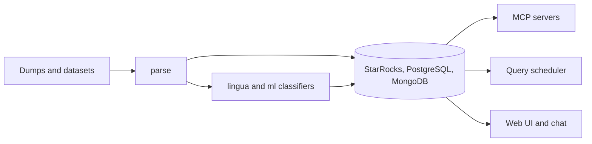

# Social Data Pipeline

Turn large social media data dumps into databases you can query, and let AI agents query them with you.

[Install](user-guide/install.md) · [Quick start](user-guide/quick-start.md) · [User guide](user-guide/) · [Architecture](architecture/) · [CLI reference](user-guide/cli.md)

## What it does

- **Sources.** The [Reddit dumps](https://github.com/ArthurHeitmann/arctic_shift) from Arctic Shift, record-based [Hugging Face](https://huggingface.co/datasets) datasets, or any JSON, CSV or Parquet collection of your own.
- **Parsing.** Decompresses `.zst`, `.gz`, `.xz` and `.tar.gz` dumps and parses them into typed Parquet or CSV files with the fields you choose.
- **Classifiers.** Language detection on CPU (Lingua) and transformer classifiers on GPU, from configuration alone or your own Python.
- **Databases.** Loads the results into StarRocks, PostgreSQL or MongoDB, with deduplication, indexes and optional authentication with admin and read-only users.
- **AI access.** Read-only MCP servers for each database, for agents such as Claude Code, Codex or Cursor.
- **Query scheduler.** Agents queue heavy queries, you approve each one, and the results land as Parquet, CSV or NDJSON files.
- **Web UI and chat.** A page in the browser to run and follow the pipeline, approve queries, and ask an AI assistant in a sandbox about your data.



## Get started

```bash
python sdp.py db setup             # configure the databases
python sdp.py source add reddit    # add a data source
python sdp.py db start             # start the databases
python sdp.py run parse            # decompress and parse the dumps
python sdp.py run sr_ingest        # load the parsed files into StarRocks
```

The [Quick start](user-guide/quick-start.md) walks through each step, from downloading the dumps to the first query.

| Part | What it covers |
|---|---|
| [User guide](user-guide/) | How to install and use it: sources, the pipeline, the databases, AI access, the web UI and the chat |
| [Architecture](architecture/) | How it works and why: the mechanisms, data flow, security model and design decisions |
