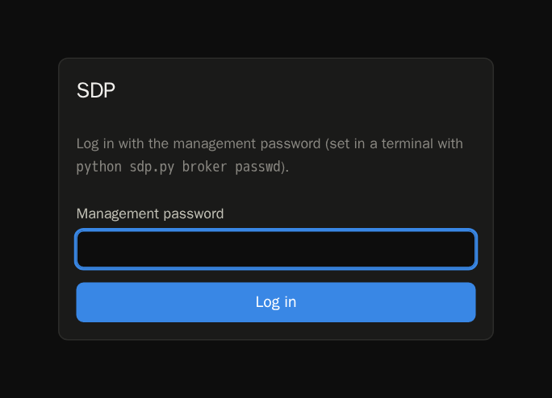
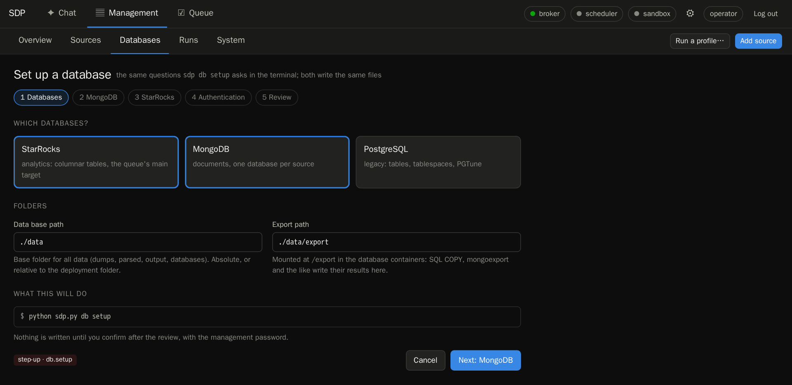
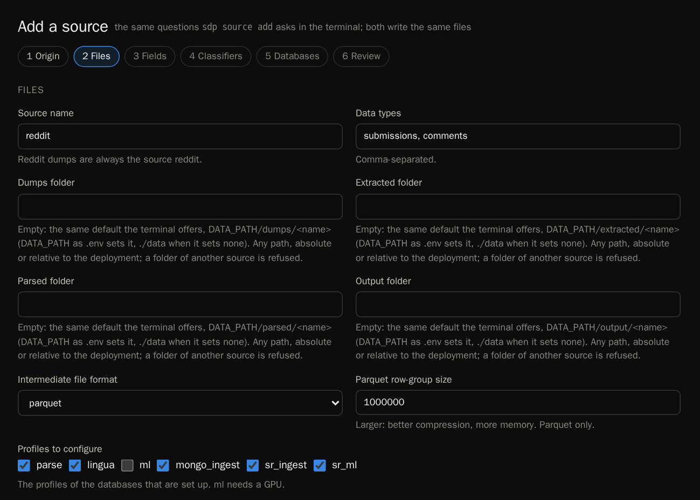
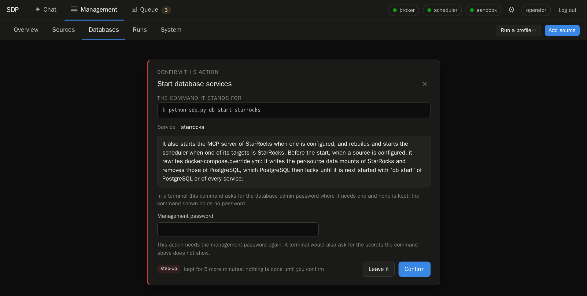
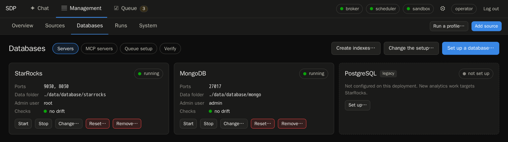
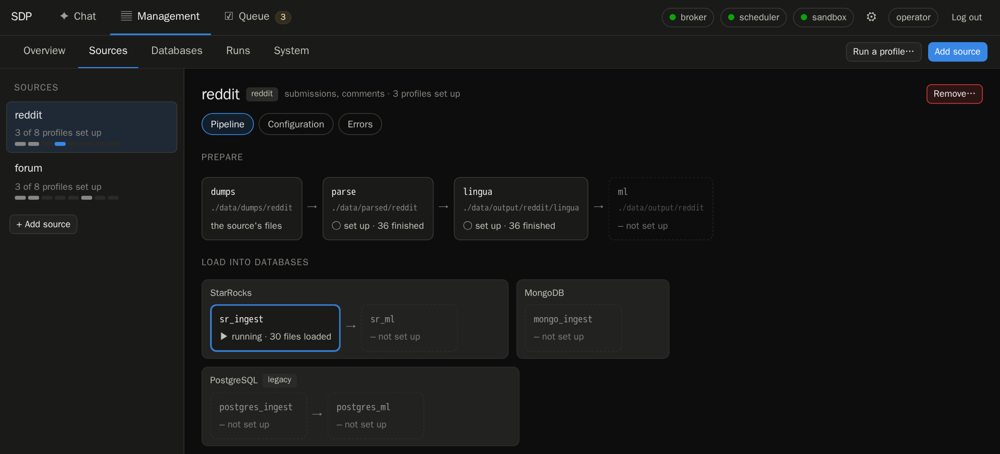
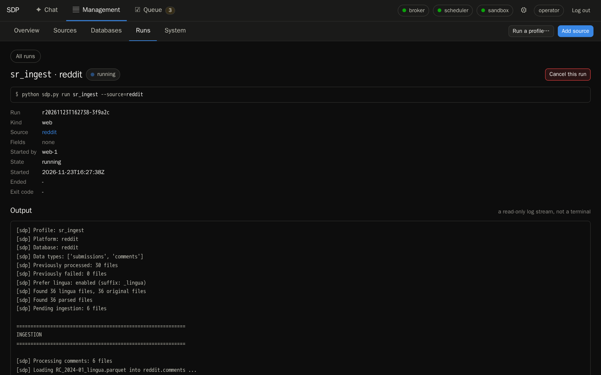
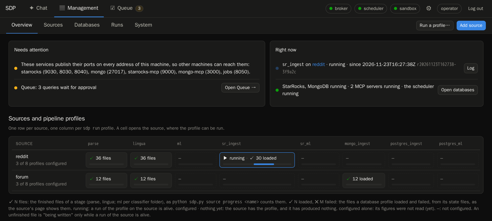
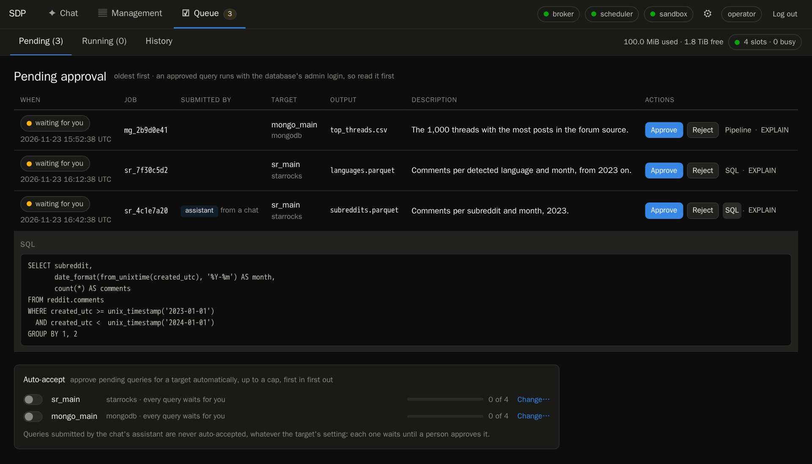
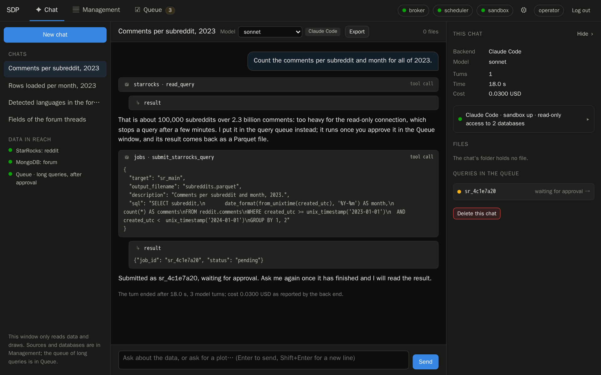

# Getting started in the browser

This page takes you from an [installed](install.md) CLI to a deployment set up, data loaded and a chat answer, all from the web UI in your browser. A few steps still need a terminal; each says so.

## Start the web UI

The web UI needs Linux and a Docker without user-id mapping (see [Requirements](webui.md#requirements)). In a terminal, set the management password, start the broker, then set up and start the web UI:

```bash
python sdp.py broker passwd                 # the management password, asked twice
python sdp.py broker start                  # the host process the page works through
python sdp.py webui setup                   # port (default 8443), addresses, certificate
python sdp.py webui start                   # start the page
```

Open `https://localhost:<port>/`, by default `https://localhost:8443/`. The first visit shows the browser's certificate warning: compare the certificate's SHA-256 fingerprint with the one `webui setup` printed (see [The certificate](webui.md#the-certificate)). Log in with the management password. The web UI opens on the Chat window; **Management** in the top bar opens the pipeline's pages (Overview, Sources, Databases, Runs, System).



## Set up a database

Open **Databases → Set up a database…**. It asks the questions of `python sdp.py db setup` in steps: the databases, the data base path and the export path, then each database's paths, ports and memory, then authentication and users. A field left empty takes the terminal's default.

To use the chat later, turn authentication on and create a read-only user: the chat reads a database only through its MCP server on the database's read-only user.



## Add a source

Click **Add source** at the top right. It asks the questions of `python sdp.py source add` in six steps: **Origin**, **Files**, **Fields**, **Classifiers**, **Databases** and **Review**. On **Files** you choose the name, the data types, the four folders, the file format and the profiles to configure.

Then put the dumps in the dumps folder you chose, for Reddit by default `data/dumps/reddit/submissions/` and `data/dumps/reddit/comments/`. This is a file copy outside the browser. A Hugging Face dataset needs no copy: **Download now** on **Review** downloads it.



## Confirm an action

Every action shows a confirm dialog with the `sdp` command it stands for, its inputs and, where it matters, what else it acts on or destroys. It runs only once you click **Confirm**; **Leave it** does nothing. Some actions, such as a database start, a setup or adding a source, ask the management password again. Starting or cancelling a run needs none. The details are in [How an action is confirmed](webui.md#how-an-action-is-confirmed).



## Start the databases

Open **Databases → Servers** and click **Start it now** on the card of a stopped database (the outcome of a setup offers it too). With authentication on, give the database admin password in its field. The confirm dialog says what else the start takes along, such as the database's MCP server and the scheduler. The card also has **Start**, **Stop**, **Change…**, **Reset…** and **Remove…**.



## Run the pipeline

Open the source in **Sources** (or click **Run a profile…**) and stay on its **Pipeline** tab. Each profile has a small form: run `parse`, then optionally `lingua` and `ml`, then the ingest profile of your database (`sr_ingest`, `mongo_ingest` or `postgres_ingest`). When the source has `lingua`, run it before the ingest: by default the ingest loads only lingua's output, so the language columns land in the main table.



Once a run is started, the outcome links to its run page, which follows the run's output as it goes. **Cancel this run** stops it. **Runs** lists every run.



## Keep an eye on it

The **Overview** is the first page of the Management window. **Needs attention** lists what wants you, such as ports open beyond this machine, services to restart and queries waiting for your approval. **Right now** shows the runs alive and the state of the databases. The table has one row per source and one column per profile, with what each profile has done; a cell opens the source at that profile's run form.



## Let agents query, through the queue

Set up the read-only MCP servers with **Databases → MCP servers → Change…** and the query scheduler with **Databases → Queue setup → Change…**: the questions of `python sdp.py db setup-mcp` and `python sdp.py db setup-jobs`. Nothing is restarted: start the scheduler with **Start** under **Queue setup**, and restart the services that **Needs attention** names with its **Restart…**.

The Queue window needs the web UI started after the scheduler was set up. Stop and start it in a terminal, then log in again:

```bash
python sdp.py webui stop
python sdp.py webui start
```

Agents submit heavy queries over the scheduler's MCP endpoint. Approve or reject each one in **Queue → Pending**. An approved query runs with the database's admin login: read each statement before you approve it.



## Ask the chat

The chat is set up and started in a terminal: it asks the back end and its secret, which a browser never sees. Then stop and start the web UI, so that it finds the chat:

```bash
python sdp.py chat setup                    # back end, credential (not echoed), work folder's cap
python sdp.py chat start                    # gateway and sandbox; attaches the databases
python sdp.py webui stop
python sdp.py webui start
```

Open **Chat** and ask a question about your data. The assistant reads each database through its read-only MCP server, and draws its plots in the page. A heavy query goes to the queue instead: it waits in **Queue** until you approve it, and the assistant fetches the result in a later turn.



The full detail is in the [Web UI reference](webui.md), [Chat](chat.md), [Query scheduler](query-scheduler.md) and the [CLI reference](cli.md).
