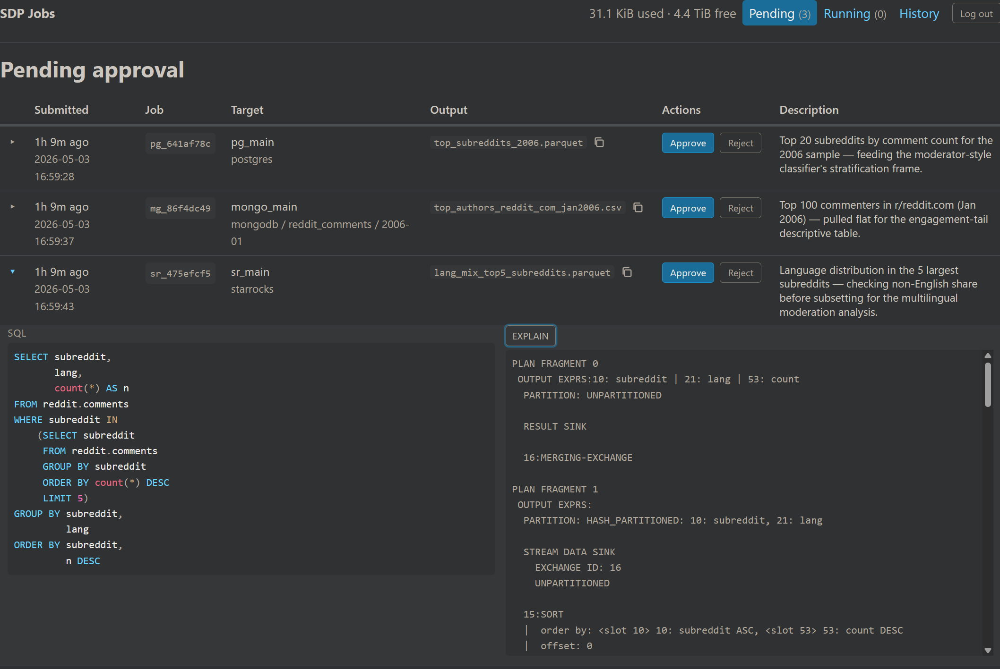

# Query scheduler

The query scheduler (the `jobs` profile) is a queue-and-approve layer in front of the configured databases. Agents (or humans) submit a query over MCP, a human approves or rejects it in a web page, and the scheduler runs the approved query and writes its result to files on disk.



It bridges two needs in the agentic flow:

- **Read-only MCP servers** ([postgres-mcp / mongo-mcp / starrocks-mcp](databases.md)) are great for short ad-hoc questions but answer in-band: large result sets can blow up an agent's context, and read-only enforcement blocks any query that needs more than `SELECT`.
- **Direct database clients** (psql, MySQL, mongosh) work for humans but aren't safe to hand to an autonomous agent.

The scheduler sits between them: agents submit through MCP tools, humans gate execution through a web page, and results land as files on disk (Parquet, CSV or NDJSON). Long-running aggregations don't block the agent's session and don't pollute its context.

## Setup

**1. Configure at least one database and its MCP servers.** The scheduler reuses the read-only database credentials provisioned by the MCP setup (`.ro_credentials` in each data volume), so run `setup-mcp` before `setup-jobs`.

```bash
python sdp.py db setup                    # configure at least one database
python sdp.py db setup-mcp                # configure the per-database MCP servers
```

**2. Configure the scheduler.** Setup asks the port, the results folder, the number of jobs that run at once, the history kept, the targets, a timeout per backend, and whether the page needs a password.

```bash
python sdp.py db setup-jobs               # interactive
```

**3. Start it.** `db start` includes the jobs container automatically once `setup-jobs` has been run.

```bash
python sdp.py db start                    # starts databases, MCP servers and the scheduler together
python sdp.py db start jobs               # only the scheduler
```

`python sdp.py db setup-llm` runs `setup-mcp` followed by `setup-jobs`.

The same questions can be answered in the web UI (Databases → Queue setup → Change…, with the management password); see [Setting up the MCP servers and the scheduler](webui.md#setting-up-the-mcp-servers-and-the-scheduler). From there the page's login can be switched on but not off. Neither restarts the scheduler or the databases: `python sdp.py db restart-needed` names the services whose settings changed after they started.

`setup-jobs` writes:

| File | Purpose |
|---|---|
| `config/jobs/config.local.yaml` | Targets, port, timeouts, history retention, auth toggle |
| `.env` (`JOBS_PORT`, `JOBS_RESULT_ROOT`) | Compose interpolation |
| `docker-compose.override.yml` | Bind-mounts the result root into the PostgreSQL and StarRocks containers as `/jobs_export`, so the database server can write results directly |
| `config/starrocks/fe.local.conf` | Sets `enable_outfile_to_local = true` (only when a StarRocks target exists) |
| `data/jobs/`, `<JOBS_RESULT_ROOT>/` | Created on disk, as you |

The committed `config/jobs/config.yaml` is the default template; `config.local.yaml` is gitignored and merged on top at runtime, the same pattern as `postgresql.local.conf` and `fe.local.conf`.

## Targets

A **target** is a named connection profile that agents reference on every submission. One target is one backend and an optional database. You can define several:

```yaml
# config/jobs/config.local.yaml (excerpt)
targets:
  reddit_pg:
    backend: postgres
    database: datasets
  sr_main:
    backend: starrocks
    database: ""              # SR targets have no default DB — agents fully-qualify table names
  mongo_main:
    backend: mongodb
    database: ""              # Mongo targets pick the database per query
```

| Backend | `database` | How agents use it |
|---|---|---|
| PostgreSQL | Required: the PostgreSQL database to connect to | Plain table names |
| StarRocks | Empty by design | Queries must fully qualify (`reddit.comments`, not just `comments`), which keeps a single StarRocks target reusable across sources |
| MongoDB | Empty | Agents call `list_mongo_databases(target)` to discover what is available, then pass `database=` on each `submit_mongo_query` |

Tools for backends with no configured target are **not registered** at all: they don't appear in MCP discovery. So an agent that sees `submit_starrocks_query` knows there is at least one StarRocks target it can reach.

## Using it from an agent

The MCP endpoint is served at `http://<host>:<JOBS_PORT>/mcp` (Streamable HTTP transport), by default `http://localhost:8050/mcp`. Add it to your agent's MCP config the same way as the per-database MCP servers ([AI access](ai-access.md)).

| Tool | Backend gate | Purpose |
|---|---|---|
| `submit_postgres_query` | at least one `postgres` target | Queue a SELECT; the runner wraps it in `COPY (...) TO '/jobs_export/<job_id>/<file>' WITH (FORMAT parquet\|csv)` |
| `submit_starrocks_query` | at least one `starrocks` target | Queue a SELECT; the runner appends `INTO OUTFILE '...' FORMAT AS PARQUET\|CSV` (chunked output) |
| `submit_mongo_query` | at least one `mongodb` target | Queue an aggregation pipeline; the runner streams the cursor into NDJSON (default) or CSV |
| `list_mongo_databases` | at least one `mongodb` target | Discover databases available on a MongoDB target |
| `query_status` | always | Poll job phase and result location |
| `query_cancel` | always | Cancel a *pending* job (running jobs must be killed from the page) |

Submission tools all require a short `description`: the human approver reads it before clicking Approve. The agent submits the SELECT or aggregation only; the runner builds the export wrapper, so agents can't smuggle in writes by appending `INSERT` or `INTO OUTFILE` clauses themselves.

A job goes from pending to approved to running to history (done, failed, rejected or cancelled); the [lifecycle](../architecture/query-scheduler.md#lifecycle-of-a-job) is in the architecture part.

### Output formats

| Backend | File extension | How it's produced |
|---|---|---|
| PostgreSQL | `.parquet`, `.csv` | Server-side `COPY ... TO '/jobs_export/<job_id>/<file>'` |
| StarRocks | `.parquet`, `.csv` | Server-side `INTO OUTFILE 'file:///jobs_export/<job_id>/<stem>_'`: StarRocks chunks output, so the folder contains `<stem>_0.<ext>`, `<stem>_1.<ext>`, … (readable as a single dataset by pyarrow, polars or DuckDB) |
| MongoDB | `.ndjson` (default), `.csv` | The runner streams the cursor; CSV requires a terminal `$project` of flat scalars (the runner fails fast on nested values) |

Result files land in `<JOBS_RESULT_ROOT>/<job_id>/<filename>` on the host. The folder is created per job; agents get the path back via `query_status`.

The chat's assistant uses a separate endpoint of the scheduler, whose queries always wait for a person (see [The query queue](chat.md#the-query-queue) and [The assistant's endpoint](../architecture/query-scheduler.md#the-assistants-endpoint)).

## The scheduler's page

The page is at `http://localhost:<JOBS_PORT>/` (by default `http://localhost:8050/`).

| Tab | Contents |
|---|---|
| **Pending** | Queued submissions awaiting Approve or Reject. SQL is rendered with syntax highlighting; the agent's `description` is shown alongside |
| **Running** | Currently executing jobs with elapsed time and a Kill button |
| **History** | The last `history_retention` jobs with status, duration, output size, and a link to result files |

Other features of the page:

- **EXPLAIN** button on pending PostgreSQL and StarRocks jobs: runs `EXPLAIN` on the submitted SQL without executing the full query, so the approver can sanity-check cost before approving.
- **Results preview**: for done jobs, a small sample of the output file is rendered inline.
- **Disk usage panel**: shows bytes consumed by `<JOBS_RESULT_ROOT>` and free bytes on its filesystem.
- **SQL formatting**: submitted SQL is pretty-printed in the pending view.
- **Auto-accept**: an opt-in panel for skipping the manual approve step on trusted targets (below).

You can also approve, reject, kill, EXPLAIN and preview from the [web UI](webui.md)'s **Queue** window, behind its login and confirmation (see [The Queue window](webui.md#the-queue-window)). The scheduler's own page on its port keeps working beside it.

## Auto-accept

A pill next to the **SDP Jobs** title in the navbar opens a floating popover with a row per configured target. Each row has a slider (0..`max_concurrent`) and an enable switch. When a target's switch is on, the runner approves its pending jobs automatically up to the slider's value.

- **Per target only.** There is no master toggle. A target with the switch off never auto-approves; a target with it on auto-approves up to the slider's value. Targets you have never touched default to disabled.
- **Default limit is `max_concurrent`.** The first time you flip a target's switch, the slider is at its top (the runner's global cap). Lower it if you want to leave headroom for other targets.
- **FIFO.** Within a target, the oldest pending job is approved first (by submission time).
- **The global cap still applies.** The runner's `max_concurrent` gates the total number of jobs *executing* at once. Auto-accept just removes the human approval step; it doesn't bypass the worker pool. Slider values are clamped to `max_concurrent`.
- **Slot accounting.** The cap counts `approved + running` for the target, so a backed-up approved queue doesn't sneak past the limit while the runner is busy on other targets.
- **Persistence.** Settings are stored in `data/jobs/auto_accept.json` (atomic writes). They survive container restarts; deleting the file resets every target to disabled.
- **No Save button.** Flipping a switch or releasing a slider posts the change immediately.
- **The chat's assistant's queries are auto-accepted like any other.** On a target with auto-accept on they are approved oldest first together with every other pending query, within the same limit; on a target with it off they wait for a person. With auto-accept on, a query the assistant wrote (and text in the data it read can steer the assistant) runs with the database's admin login without anyone reading it first.

In the web UI's Queue window, switching auto-accept on or raising its limit needs the management password again (see [Auto-accept and the management password](webui.md#auto-accept-and-the-management-password)).

## Per-backend timeouts

Set during `setup-jobs`, applied at execution time:

| Backend | Default | Notes |
|---|---|---|
| PostgreSQL | 0 (no limit) | `statement_timeout` set per session; 0 disables |
| MongoDB | 0 (no limit) | `maxTimeMS` skipped when 0 |
| StarRocks | 259200 (72h) | StarRocks caps `query_timeout` at 72h and rejects 0; setup enforces 1–72h |

All three are tunable in `config/jobs/config.local.yaml` under `default_timeouts`.

## Auth (optional)

The page is open by default: anyone reaching `JOBS_PORT` on the host can approve, reject or kill jobs. This suits solo, single-user deployments.

With `auth: true` (toggled in `setup-jobs`), the page asks for the database admin password, the same password used by `python sdp.py db setup` for any auth-enabled database. The jobs container reads the password from its process environment (passed through by `python sdp.py db start` when any database has auth enabled) and HMAC-authenticates page sessions. Startup fails if no password is in the environment; setup warns when no database has authentication enabled.

> The page's password does not gate MCP. The MCP endpoint at `/mcp` is not gated by the page's password: anything that can reach `JOBS_PORT` on the network can submit jobs. Treat the network boundary as the trust boundary, the same way you would for the per-database MCP servers.

## Removing the scheduler

```bash
python sdp.py db unsetup-jobs
```

It stops the jobs container, removes `config/jobs/config.local.yaml`, removes `JOBS_PORT` and `JOBS_RESULT_ROOT` from `.env`, and strips the `/jobs_export` mount from `docker-compose.override.yml`. The `data/jobs/` directory and result files are left alone: delete them by hand if you no longer need them.

## Configuration reference

### `config/jobs/config.local.yaml`

10 settings.

| Key | Type | Default | Purpose |
|---|---|---|---|
| `port` | int | 8050 | Page and MCP port (host side via `JOBS_PORT` in `.env`) |
| `result_root` | path | `./data/jobs/results` | Host directory where job output files land. Bind-mounted into PostgreSQL and StarRocks as `/jobs_export` and into the jobs container as `/data/jobs/results` |
| `max_concurrent` | int | 20 (setup's suggestion; `config/jobs/config.yaml` falls back to 5 when the local file omits it) | Worker pool size: how many jobs run in parallel. Jobs beyond it stay approved until a slot frees up |
| `history_retention` | int | 500 | Number of finished jobs the History tab shows, newest first; the history file itself keeps every entry and is never pruned |
| `default_timeouts.postgres` | seconds | 0 | 0 = no limit |
| `default_timeouts.mongodb` | seconds | 0 | 0 = no limit |
| `default_timeouts.starrocks` | seconds | 259200 | StarRocks caps at 72h, rejects 0 |
| `auth` | bool | false | Require the database admin password for the page |
| `targets.<name>.backend` | enum | required | `postgres` \| `starrocks` \| `mongodb` |
| `targets.<name>.database` | string | varies | Required for PostgreSQL; empty for StarRocks and MongoDB |

### Env vars (in `.env`)

| Var | Default | Purpose |
|---|---|---|
| `JOBS_PORT` | 8050 | Host port for the page and MCP |
| `JOBS_RESULT_ROOT` | `./data/jobs/results` | Host path mounted into containers as `/jobs_export` (PostgreSQL, StarRocks) and `/data/jobs/results` (jobs) |

A job caught mid-execution when the container restarts is marked failed on the next start and is not re-run; the agent can resubmit (see [Concurrency and resume](../architecture/query-scheduler.md#concurrency-and-resume)).
